# 🎬 TINT Web (`apps/web`)

SPA de **TINT — Watch Party**: salas privadas donde un grupo ve el mismo vídeo en el mismo segundo, con chat, reacciones, puntero láser, encuestas, trivia, Ambilight y un recap al terminar.

Este README explica **cómo funciona la aplicación por dentro** para quien llega nuevo al código. Las reglas del dominio (límites, TDD, contratos, convenciones) viven en [`AGENTS.md`](AGENTS.md): si este documento y el `AGENTS.md` se contradicen, manda el `AGENTS.md` y hay que corregir este archivo.

## Índice
1. [Propósito](#1-propósito)
2. [Arquitectura de la SPA](#2-arquitectura-de-la-spa)
3. [Cómo funciona, paso a paso](#3-cómo-funciona-paso-a-paso)
4. [Estado](#4-estado)
5. [Sistema visual](#5-sistema-visual)
6. [Configuración](#6-configuración)
7. [Ejecutar, probar y construir](#7-ejecutar-probar-y-construir)
8. [Decisiones de arquitectura](#8-decisiones-de-arquitectura)
9. [Enlaces](#9-enlaces)

---

## 1. Propósito

| Quién | Qué ve y qué puede hacer |
| :--- | :--- |
| **Host** (cuenta de Google vía Firebase) | `Dashboard` con sus salas, crear/editar salas e invitaciones (`CreateRoom`), y en la sala (`WatchRoom`): controles de reproducción (play/pausa, saltos, velocidad, volumen y calidad de toda la sala), panel **Cambiar vídeo** (biblioteca "Mis vídeos" y "Subir nuevo"), **Participantes** (retirar y bloquear), puntero láser, crear encuestas, programar trivias, moderar el chat (modo lento, silenciar, bloquear) y decidir qué sigue tras el recap. Fuera de la sala, la analítica de cada sala (`/rooms/:id/analytics`). |
| **Invitado** (sin cuenta, con link de invitación y un nick) | La misma sala, pero solo refleja: el vídeo lo gobierna el host (salvo control delegado por sync-core), puede chatear (con spoilers), reaccionar, votar, responder trivias, silenciarse localmente y ver el recap. |

**Límite principal: el cliente no es autoritativo.** El reloj maestro y el cálculo de drift viven en sync-core; los permisos, puntajes, límites de tasa, cierres de encuesta y disparo de trivias, en social-core; las sesiones, salas, bloqueos y URLs firmadas, en identity-api. La web solo **refleja y pre-valida** (p. ej. `validatePollDraft`, `validateTriviaDraft`, `useThrottle` a 5 reacciones/s): si el servidor dice otra cosa, gana el servidor.

---

## 2. Arquitectura de la SPA

### 2.1 Componentes y conectores

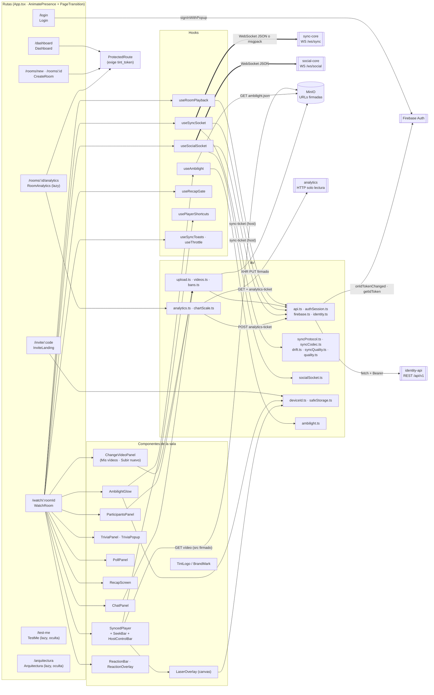

Reglas que el diagrama hace visibles:

- **Dos sockets, dos hooks, nunca mezclados** (ADR 0005): `useSyncSocket` lleva solo reproducción; `useSocialSocket` lleva chat, moderación, reacciones, láser, encuestas, trivia y recap.
- **Ambilight no usa sockets**: `useAmbilight` descarga `ambilight.json` por HTTP con la URL firmada que da `GET /rooms/:id/playback`.
- **El vídeo nunca pasa por identity-api**: la subida es un `PUT` directo a MinIO y la reproducción, un `GET` firmado en el `src` del `<video>`.
- **Sin canvas sobre el vídeo**: los colores de Ambilight vienen precalculados; la web no lee píxeles del `<video>` (sin `crossOrigin` ni canvas "tainted"). El único canvas es el del láser, que solo dibuja.

### 2.2 Carpetas

| Carpeta | Responsabilidad |
| :--- | :--- |
| `src/main.tsx` · `src/App.tsx` | Arranque (`startHostSession(auth)` una vez), `MotionProvider`, `BrowserRouter` y rutas animadas (`AnimatePresence mode="wait"`). `TestMe`, `Arquitectura` y `RoomAnalytics` se cargan con `React.lazy`. |
| `src/routes/` | `ProtectedRoute`: sin `tint_token` redirige a `/login?next=<ruta>`. |
| `src/pages/` | Una página por ruta: `Login`, `Dashboard`, `CreateRoom`, `InviteLanding`, `WatchRoom` (orquesta toda la sala), `RoomAnalytics`, `TestMe`, `Arquitectura` (mapa interactivo de la arquitectura, oculto). |
| `src/hooks/` | Estado con efectos: sockets (`useSyncSocket`, `useSocialSocket`), vídeo de la sala (`useRoomPlayback`), `useAmbilight`, `useRecapGate`, `usePlayerShortcuts`, `useSyncToasts`, `useThrottle`, `useCountdown`, `useTransientFlag`, `useElementWidth`, `useQuiz`. |
| `src/lib/` | Lógica pura y clientes: REST (`api.ts`, `upload.ts`, `videos.ts`, `bans.ts`, `analytics.ts`), protocolos (`syncProtocol.ts`, `syncCodec.ts`, `socialSocket.ts`), drift y calidad (`drift.ts`, `syncQuality.ts`, `quality.ts`, `stallTracker.ts`), identidad y almacenamiento (`authSession.ts`, `firebase.ts`, `identity.ts`, `deviceId.ts`, `safeStorage.ts`, `invite.ts`), `ambilight.ts`, `motion.ts`, `chartScale.ts`, `time.ts`, `quiz.ts`, `archSim.ts` (aristas, geometría y reducer del mapa `/arquitectura`). |
| `src/components/` | UI: `SyncedPlayer`, `LaserOverlay`, `PollPanel`, `RecapScreen`, `ReactionBar`/`ReactionOverlay`, `InvitePopover`; subcarpetas `player/` (`SeekBar`, `AmbilightGlow`), `host/` (`ChangeVideoPanel`, `ParticipantsPanel`, `HostControlBar`), `chat/` (`ChatPanel`), `quiz/` (`TriviaPanel` y el cuestionario), `sync/` (semáforo, reconexión, toasts), `analytics/` (gráficos SVG), `arch/` (diagrama, panel de paso y ficha de componente de `/arquitectura`), `brand/` (`TintLogo`), `layout/` (`AppShell`, `AmbientBackground`), `motion/`, `ui/` (`Button`, `Primitives`, `ConfirmDialog`, `BackLink`). |
| `src/data/` | Banco de preguntas del cuestionario oculto `/test-me` y el modelo del mapa `/arquitectura` (componentes, conectores C1–C15 e historias de usuario paso a paso). |
| `src/test/` | Dobles de prueba compartidos: `MockWebSocket`, `MockXhr`, `testGuestToken`. |
| `public/` | `logo.svg`, `favicon.svg`, `apple-touch-icon.png`, `icon-192.png`, `icon-512.png`, `manifest.webmanifest`. |

---

## 3. Cómo funciona, paso a paso

### 3.1 Login del host con Firebase

`Login` abre el popup de Google, guarda el ID token en `tint_token`, borra restos de invitado y llama a `POST /auth/verify`. Después, `authSession.ts` mantiene el token fresco: el ID token de Firebase caduca a la hora.

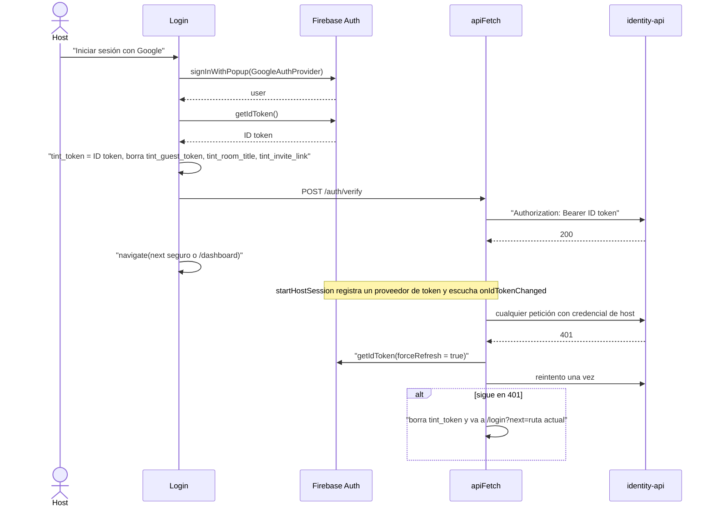

`next` solo acepta rutas internas (empieza con `/` y no con `//`) para evitar un open redirect.

### 3.2 El invitado se une con una invitación

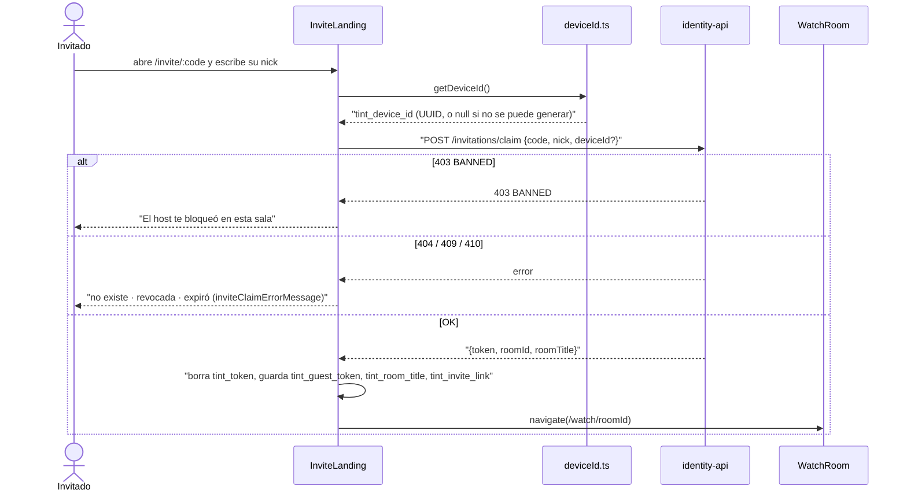

- Si el navegador ya tiene sesión de host, `InviteLanding` **no la borra en silencio**: busca la sala en `GET /rooms` por el código y ofrece "Entrar como host"; solo canjea tras pulsar "Entrar como invitado".
- `WatchRoom` solo acepta el `tint_guest_token` si su payload tiene el `room_id` de la sala y un `exp` futuro (`guestTokenGrantsRoom`). **No verifica la firma**: solo evita abrir un socket que sync-core rechazaría. Quien autoriza es el backend.
- El bloqueo es por dispositivo: borrar los datos del navegador cambia el `tint_device_id` (limitación documentada, ADR 0013).

### 3.3 Entrar a la sala

`WatchRoom` monta tres fuentes en paralelo: el vídeo (`useRoomPlayback`, REST), el Canal Sync (`useSyncSocket`) y el Canal Social (`useSocialSocket`). El host abre ambos sockets con un **sync-ticket** fresco (`POST /rooms/:id/sync-ticket`) en cada (re)conexión; el invitado, con `tint_guest_token`.

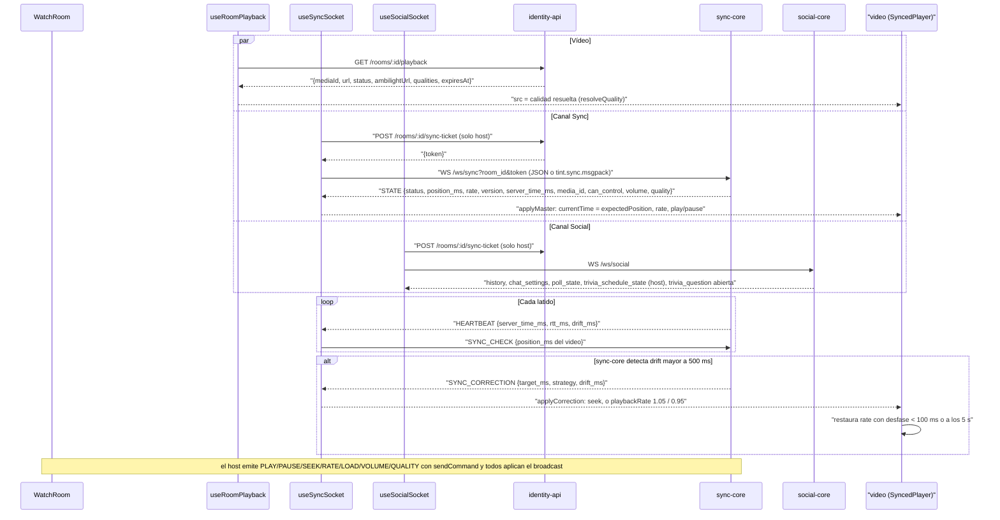

Detalles que conviene saber:

- **Filtro por `version`**: los broadcasts con `version` menor o igual a la del último estado se descartan; el `STATE` siempre reemplaza (p. ej. tras reconectar). Las `SYNC_CORRECTION` más viejas que el estado también se ignoran.
- **Posición esperada**: `expectedPosition` suma al `position_ms` el tiempo transcurrido × `rate` cuando está `playing`. El "ahora del servidor" se estima con `server_time_ms` + el tiempo local transcurrido desde que llegó el snapshot (`performance.now()`), sin comparar relojes de pared.
- **El cliente no calcula el drift para corregir**: solo aplica lo que ordena sync-core (`drift.ts`). La única telemetría que envía es `BUFFERING` (stalls medidos por `stallTracker.ts`), por el mismo Canal Sync.
- **`canControl`** lo decide el servidor (`STATE.can_control`/`CONTROL`); el host lo asume `true` hasta el primer `STATE`.
- **Autoplay**: si `video.play()` se rechaza, `SyncedPlayer` muestra un botón para unirse con un gesto.
- `useRoomPlayback` vuelve a pedir el playback al cambiar el `media_id` del estado sync, ~1 min antes de `expiresAt`, y cada 5 s (máx. 120) mientras el vídeo está `pending`/`processing`, sin cambiar el `src` del original.

### 3.4 El host cambia de vídeo

`ChangeVideoPanel` tiene dos pestañas. Ambas terminan igual: identity-api devuelve un `mediaId` y el host emite `LOAD{media_id}` por el Canal Sync, que hace que todos (incluido el host) vuelvan a pedir el playback.

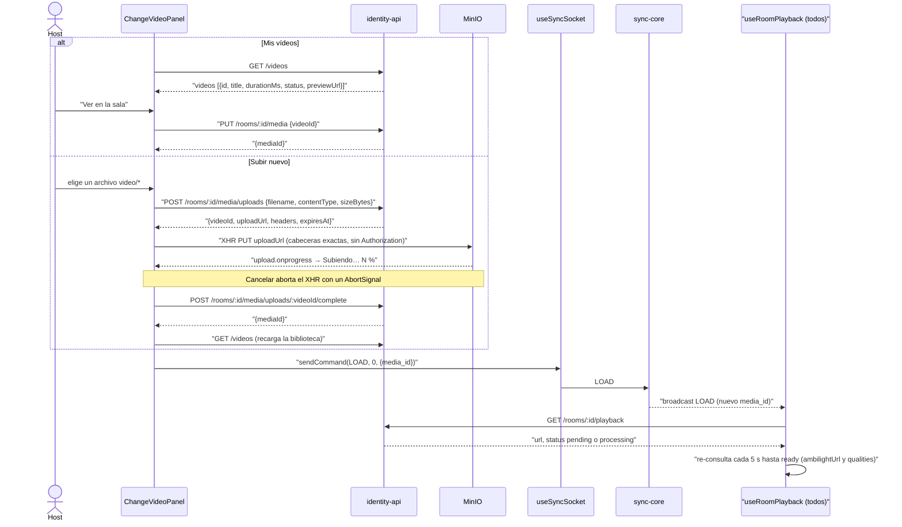

Si el socket no está abierto al confirmar, el panel guarda el `mediaId` y ofrece reintentar el aviso a la sala. Los errores se traducen a mensajes simples (`uploadErrorMessage`, `assignVideoErrorMessage`), sin jerga como HTTP, MinIO o bucket.

### 3.5 El puntero láser

Solo el host con control y el modo láser activo (botón o tecla `L`) dibuja; todos ven el trazo. social-core limita a 30 puntos/s.

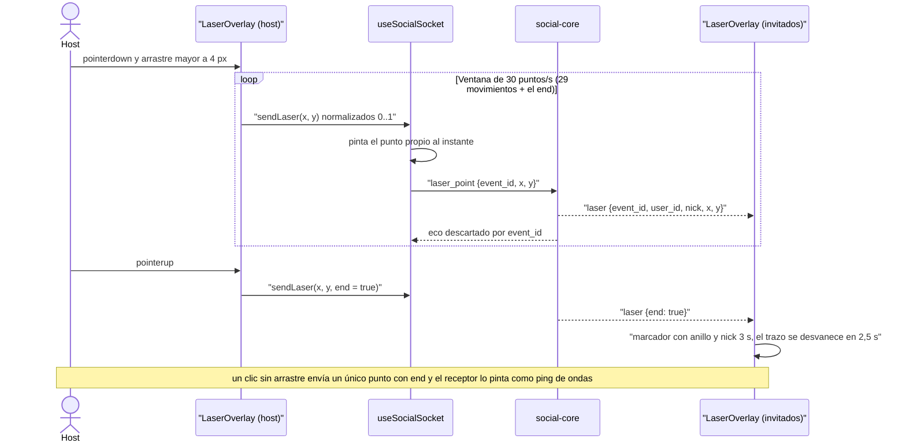

El trazo se suaviza con curvas cuadráticas en un `<canvas>` con `requestAnimationFrame`. La edad de cada punto usa el **reloj local de llegada**, nunca el del emisor.

### 3.6 El chat

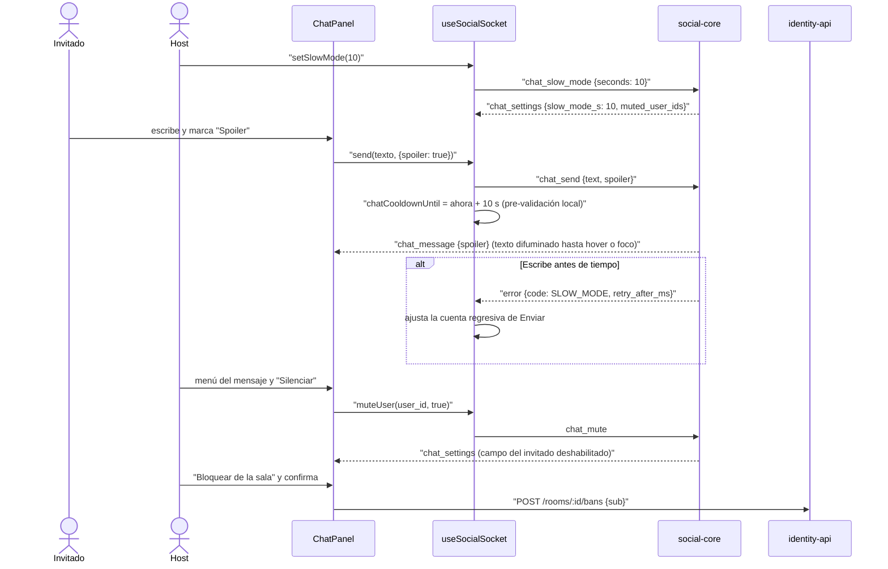

Host y cohost están exentos del modo lento y del silencio. Los errores de social-core se muestran con `socialErrorMessage` (SLOW_MODE, MUTED, UNAVAILABLE…). El texto del chat **nunca** se envía a telemetría.

### 3.7 La trivia

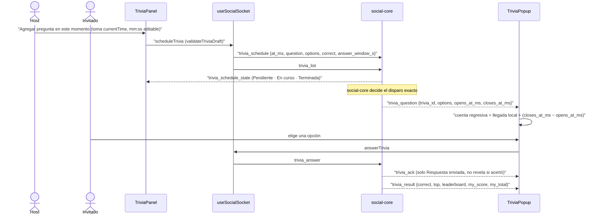

El puntaje lo calcula social-core. La cuenta regresiva se ancla al reloj local de llegada para **no comparar relojes** de cliente y servidor.

### 3.8 Ambilight

media-worker precalcula `ambilight.json` (`[{t_ms, top, right, bottom, left}]` en hex) al procesar el vídeo (ADR 0011). La web solo interpola:

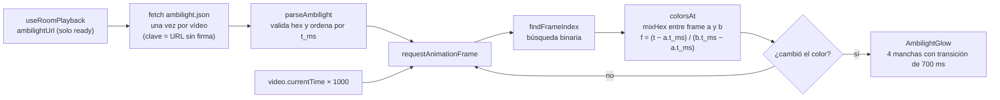

- Con `prefers-reduced-motion` no se interpola (salta de frame en frame) ni hay transición.
- El interruptor `role="switch"` "Ambilight" guarda la preferencia en `tint_ambilight` vía `safeStorage`.
- Sin `ambilightUrl` (vídeo sin paleta) no hay brillo de Ambilight y `WatchRoom` muestra el halo cálido de respaldo (`PlayerHalo`).

### 3.9 Fin de la función: recap y qué sigue

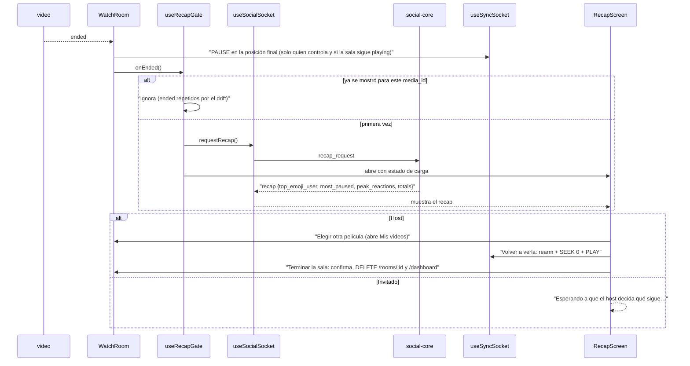

El `PAUSE` al final es necesario: sync-core seguiría en `playing` y la corrección de drift reanudaría el vídeo. Si al invitado lo cierran con 4001 después de terminar el vídeo, ve "El host terminó la sala".

### 3.10 Reconexión y cierres 4001 / 4003

Los dos sockets reconectan con **backoff exponencial**: Sync 500 ms × 2ⁿ hasta 10 s (`backoffDelay`), Social 500 ms × 2ⁿ hasta 8 s. El intento se reinicia al abrir. Los servidores comunican estados terminales haciendo el upgrade y cerrando con un código `4xxx` (ADR 0014), porque un rechazo antes del upgrade solo le llega al navegador como `1006`.

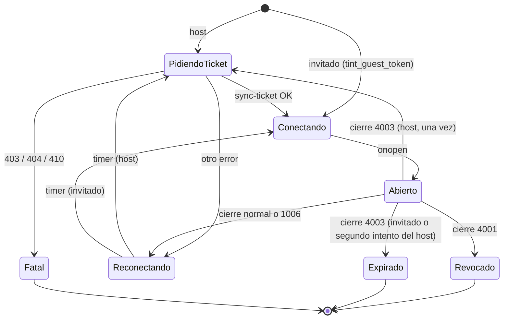

| Cierre o error | Canal Sync (`useSyncSocket`) | Qué ve el usuario (`WatchRoom`) |
| :--- | :--- | :--- |
| `4001` (revocado) | No reconecta; el invitado borra `tint_guest_token`; `revoked = true`. | "Fuiste retirado de la sala por el host" (o "El host terminó la sala" si el vídeo ya había terminado). |
| `4003` (token caducado) | Invitado: no reconecta y borra el token. Host: pide un sync-ticket nuevo **una vez** (se rearma al recibir `STATE`); si se repite, se rinde. `expired = true`. | "Tu invitación expiró" o "Tu sesión de sincronía caducó". |
| sync-ticket 403 / 404 / 410 | `fatalError = NOT_HOST / ROOM_GONE`, sin reintentos. | "No eres el host de esta sala" o "La sala ya no existe". |
| `GET /playback` 401/403 (invitado) | `useRoomPlayback` borra el token y expone `revoked`. | "Tu invitación ya no es válida". |
| Cualquier otro cierre | Reintento con backoff; `reconnect = {attempt, nextRetryAt}`. | "Reconectando… intento N · S s" sin desmontar el reproductor. |

El **Canal Social** no distingue códigos: reconecta siempre, salvo que el sync-ticket responda 403/404/410 (`status: 'closed'`). Al revocar, el invitado pierde `tint_guest_token`, `WatchRoom` deja de tener acceso y `useSocialSocket` recibe `roomId` indefinido, que cierra el socket social. Solo el socket vigente puede programar reconexiones: el cierre tardío de un socket viejo (StrictMode, limpieza) se ignora.

---

## 4. Estado

No hay store global: el estado vive en los hooks y `WatchRoom` lo reparte por props.

| Hook | Estado que mantiene |
| :--- | :--- |
| `useSyncSocket` | `connected`, `state` (último `SyncSnapshot` con `received_at_perf`), `canControl`, `hostOnline`, `rttMs`/`driftMs`, `correction` (con `seq` local), `lastBroadcast` (con `own` si el `event_id` es uno de los últimos 50 propios), `volume`/`quality` maestros, `reconnect`, `revoked`, `expired`, `fatalError`, `lastError`. |
| `useSocialSocket` | `status` (`connecting`/`open`/`reconnecting`/`closed`), `messages` (máx. 50), `reactions` (máx. 30), `laser` (máx. 64 puntos), `poll` (con el `my_vote` recordado por `poll_id`), `recap`, `chatSettings`, `chatCooldownUntil`, `trivia` (`question`, `receivedAt`, `ack`, `result`, `myOption`), `triviaSchedule` (ordenada por `at_ms`), `lastError`. |
| `useRoomPlayback` | `mediaId`, `url`, `status`, `ambilightUrl`, `qualities`, `loading`, `error`, `revoked` y los timers de refresco. |
| `useAmbilight` | Paleta cargada por vídeo y los colores actuales. |
| `useRecapGate` | `open`, el recap visible y, en refs, el `media_id` cuyo recap ya se cerró. |
| `useSyncToasts` | Avisos de comandos ajenos (3 s, máx. 3). |

**Deduplicación por `event_id`.** `useSocialSocket` guarda los `event_id` vistos en un `Set` acotado a 200 (descarta el más viejo). El `history` inicial los registra, y `chat_message`, `notice`, `reaction` y `laser` que se repitan (ecos del propio envío, redeliveries tras reconectar) se descartan. El láser propio se pinta optimista y su eco cae en este filtro. En el Canal Sync la deduplicación es por `version`.

**`localStorage`.** Las preferencias pasan por `safeStorage.ts` (`readStored`/`writeStored` con try/catch: en modo privado o con datos bloqueados se lee `null` y la escritura se ignora, nunca rompe la UI).

| Clave | Contenido | Acceso |
| :--- | :--- | :--- |
| `tint_token` | ID token de Firebase del host (lo refresca `authSession.ts`). | `localStorage` directo |
| `tint_guest_token` | Guest token HS256 del invitado. | `localStorage` directo |
| `tint_room_title` · `tint_invite_link` | Título y link guardados al canjear (el invitado no puede pedirlos al backend). | `localStorage` directo |
| `tint_device_id` | UUID del dispositivo para el bloqueo (respaldo en memoria si no hay almacenamiento). | `safeStorage` |
| `tint_ambilight` | Preferencia del interruptor Ambilight (`off` lo apaga). | `safeStorage` |
| `tint_laser_hint_seen` | La ayuda del láser ya se mostró. | `safeStorage` |
| `tint_quiz_muted` | Silencio del cuestionario `/test-me`. | `localStorage` |

Los payloads de los tokens se decodifican (`identity.ts`) **solo para mostrar** el nick y decidir si vale la pena abrir la sala; nunca para autorizar.

---

## 5. Sistema visual

Estética "quiet luxury": Discord-dark con acento naranja.

- **Tokens de Tailwind** (`tailwind.config.js`): `tint.bg` `#1E1F22`, `tint.surface` `#2B2D31`, `tint.card` `#313338`, `tint.muted` `#B5BAC1`, `tint.text` `#DBDEE1`, `tint.accent` `#FF6B1A`, `tint.accentHover` `#FF8A3D`, `tint.accentDark` `#C4520A`, `tint.success` `#23A55A`; sombras `shadow-glow` y `shadow-lift`; fondos `bg-accent-sheen` y `bg-noise`. Tipografía Outfit (Google Fonts en `index.html`).
- **Vidrio** (`src/index.css`): `.tint-glass` solo en botones, inputs, chips y paneles flotantes; `.tint-glass-panel` (≥ 80 % opaco, para AA) en diálogos, popovers y toasts. `Card` es sólida por decisión de producto. Además `.tint-eyebrow` y `.tint-shimmer`.
- **framer-motion**: `MotionProvider` carga `LazyMotion` con `domAnimation` en un chunk diferido y `MotionConfig reducedMotion="user"`; los componentes usan `m.*`. Curva, `spring` y variantes compartidas (`fadeUp`, `fadeBlur`, `pop`, `scaleIn`, `stagger()`) en `src/lib/motion.ts`: no declares duraciones sueltas. Cada ruta entra con `PageTransition`.
- **Accesibilidad**: contraste AA sobre fondo oscuro, foco visible global (`:focus-visible` con contorno en el acento), controles con `aria-label`, `role="slider"` en la barra de búsqueda y los gráficos, `role="switch"` en Ambilight, `alertdialog` (`useConfirm`) en lugar de `window.confirm`, `aria-live` en estados de sincronía, chat y toasts. Con `prefers-reduced-motion` se anulan animaciones y transiciones CSS, el halo y el fondo ambiental quedan estáticos, no hay fundido al corregir con seek y Ambilight no interpola.
- **Marca**: `public/logo.svg` (anillo abierto, "T" en línea doble y llama, gradiente `#FFC93C` → `#FF8A1A`) y `public/favicon.svg` (variante simplificada de trazo grueso para 16/32 px). `TintLogo` es el SVG en línea con prop `size`: por debajo de 24 px (`TINT_LOGO_COMPACT_BELOW`) usa la variante simplificada; `role="img"` con `aria-label` o `decorative`; gradiente con id único por instancia (`useId`). `apple-touch-icon.png`, `icon-192.png` e `icon-512.png` salen del SVG; `manifest.webmanifest` y `theme-color` (`#1E1F22`) se enlazan en `index.html`.

---

## 6. Configuración

Copia `.env.example` a `.env` (nunca lo subas). Todas las variables son opcionales en desarrollo.

| Variable | Por defecto | Para qué |
| :--- | :--- | :--- |
| `VITE_IDENTITY_API_URL` | `http://localhost:8081/api/v1` | identity-api (REST). |
| `VITE_SYNC_WS_URL` | `ws://localhost:8083/ws/sync` | Canal Sync de sync-core. |
| `VITE_SOCIAL_WS_URL` | `ws://localhost:8082/ws/social` | Canal Social de social-core. |
| `VITE_SYNC_ENCODING` | `json` | `json` o `msgpack` (pide el subprotocolo `tint.sync.msgpack`; si sync-core no lo acepta, sigue en JSON). |
| `VITE_ANALYTICS_API_URL` | `http://localhost:8084/api/v1` | API de lectura de analytics. |
| `VITE_DEMO_VIDEO_URL` | vacío | Vídeo de respaldo, solo si la sala no tiene vídeo (`mediaId: null`). |
| `VITE_FIREBASE_API_KEY` · `VITE_FIREBASE_AUTH_DOMAIN` · `VITE_FIREBASE_PROJECT_ID` | `test` | Configuración del cliente de Firebase Auth (login del host). |

Puertos locales: web (Vite) `5173`, identity-api `8081`, social-core `8082`, sync-core `8083`, analytics `8084`, MinIO `9000`. El backend se levanta desde la raíz con `docker compose up -d`.

---

## 7. Ejecutar, probar y construir

```bash
npm ci
npm run dev              # Vite en http://localhost:5173
npm run lint             # ESLint
npm run typecheck        # tsc -b
npx vitest run --coverage  # o npm run test:coverage
npm run build            # tsc -b && vite build
```

Ese es el **gate del dominio** y corre en CI. La cobertura mínima es **85 %** en líneas, funciones, ramas y sentencias (`vitest.config.ts`); no se relaja para que una prueba pase. El desarrollo es TDD (Red → Green → Refactor).

Cómo se prueba lo difícil:

- **Sockets**: `src/test/mockWebSocket.ts` (`MockWebSocket`, instalado con `vi.stubGlobal`) registra instancias y frames enviados, y simula la apertura (con subprotocolo negociado), mensajes del servidor (texto o binarios msgpack) y cierres con código (`4001`, `4003`…). `useSocialSocket` además acepta `createSocket`, `reconnectBaseMs` y `reconnectMaxMs` inyectables, y `useSyncSocket` un reloj `now`. Con timers falsos de Vitest se avanza el backoff.
- **Subidas**: `src/test/mockXhr.ts` (`MockXhr`) registra método, URL, cabeceras y cuerpo, y simula progreso, respuesta, error de red y abort.
- **Invitados**: `src/test/guestToken.ts` (`testGuestToken`) arma un guest token con forma de JWT (firma falsa) de la sala `r1`, vigente una hora.
- **Canvas del láser**: jsdom no tiene contexto 2D. Las funciones de dibujo (`drawTrails`, `drawMarker`, `drawPing`) son puras y se exportan; las pruebas les pasan un contexto falso que registra las llamadas, y `LaserOverlay` tiene guardas para `requestAnimationFrame` y `getContext` ausentes.
- **Animaciones**: `setupTests.ts` activa `MotionGlobalConfig.skipAnimations` y mapea `m` → `motion`. Los stubs de `matchMedia` deben incluir `addListener`/`removeListener`. También añade un polyfill de `PointerEvent` y restaura `localStorage` de jsdom en Node 22+.

---

## 8. Decisiones de arquitectura

| ADR | Por qué importa en la web |
| :--- | :--- |
| [0002 — Reloj maestro autoritativo en sync-core](../../docs/adr/0002-reloj-maestro-autoritativo-en-sync-core.md) | El cliente solo aplica `STATE`, broadcasts y `SYNC_CORRECTION`; no decide el drift. |
| [0005 — Canales WebSocket separados Sync y Social](../../docs/adr/0005-canales-websocket-separados-sync-y-social.md) | Dos hooks y dos sockets que no se mezclan; un fallo del chat no tumba el reproductor. |
| [0008 — Subida directa a MinIO con URL firmada](../../docs/adr/0008-subida-directa-a-minio-con-url-firmada.md) | `upload.ts`: `PUT` por XHR con progreso, sin pasar el vídeo por identity-api. |
| [0011 — Ambilight precalculado por media-worker](../../docs/adr/0011-ambilight-precalculado-por-media-worker.md) | `useAmbilight` interpola un JSON; no hay canvas sobre el vídeo ni CORS. |
| [0013 — Bloqueo de invitados por dispositivo](../../docs/adr/0013-bloqueo-de-invitados-por-dispositivo.md) | `deviceId.ts` y el `403 BANNED` en `InviteLanding`. |
| [0014 — Upgrade y cierre 4xxx para estados terminales](../../docs/adr/0014-upgrade-y-cierre-4xxx-para-estados-terminales.md) | Los cierres `4001`/`4003` cortan la reconexión y muestran una pantalla terminal. |

---

## 9. Enlaces

- [`AGENTS.md`](AGENTS.md): reglas del dominio, modelo de datos, contratos y detalle por pieza.
- [`AGENTS.md` raíz](../../AGENTS.md): reglas globales, contratos compartidos y gates.
- [`docs/`](../../docs/README.md): documentación de features.
- [Arquitectura](../../docs/arquitectura.md): [vista de componentes y conectores (C&C)](../../docs/arquitectura.md#vista-de-componentes-y-conectores), contratos en [§5](../../docs/arquitectura.md#5-contratos-compartidos-entre-dominios) y puertos en [§8](../../docs/arquitectura.md#8-puertos-locales).
- [Dominio de Reproducción](../../docs/dominio-reproduccion.md): Canal Sync v2, reloj maestro y flujos (incluido el [cliente web](../../docs/dominio-reproduccion.md#10-cliente-web)).
- [Usuarios, identidad y permisos](../../docs/usuarios-e-identidad.md): tokens, invitaciones y bloqueo.
- [Contrato de eventos de analítica](../../docs/contrato-eventos-analitica.md): `BUFFERING` y la API de KPIs.
- Protocolos: [sync-core](../../services/sync-core/AGENTS.md#protocolo-del-canal-sync) y [social-core](../../services/social-core/AGENTS.md#protocolo-del-canal-social).
