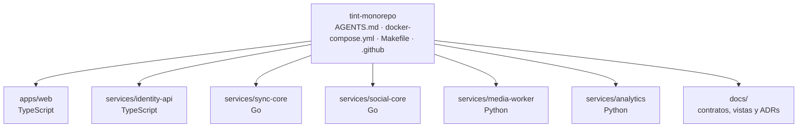

# ADR 0001 — Monorepo multilenguaje organizado por dominio

| Campo | Valor |
| :--- | :--- |
| **Estado** | Aceptada |
| **Fecha** | 2026-10-08 |
| **Dominios afectados** | Todos (`apps/web`, `services/*`, infra y CI) |

## Contexto
TINT combina necesidades muy distintas: sincronización de vídeo con latencia baja (< 100 ms), chat y gamificación en tiempo real, procesamiento de vídeo con FFmpeg, analítica con PostgreSQL y una SPA. Cada una encaja mejor en un lenguaje distinto (Go, Python, TypeScript). Al mismo tiempo, los servicios comparten contratos que deben cambiar juntos (claims JWT, protocolo del Canal Sync, `analytics:events`, `media:uploads`) y el equipo trabaja con agentes que necesitan límites claros para no tocar lo que no les toca.

## Decisión
Un único repositorio con una carpeta por **dominio**, cada una con su stack, sus pruebas y su `AGENTS.md`:

| Dominio | Ruta | Stack |
| :--- | :--- | :--- |
| Frontend | `apps/web` | React 18, TypeScript, Vite, Tailwind |
| Identidad | `services/identity-api` | Node 22, Express 5, Drizzle/PostgreSQL |
| Sincronización | `services/sync-core` | Go 1.22, WebSockets, Redis |
| Social y gamificación | `services/social-core` | Go 1.22, Redis |
| Media | `services/media-worker` | Python 3.11, FFmpeg, MinIO |
| Analítica | `services/analytics` | Python 3.11, Redis Streams, PostgreSQL |

Reglas que acompañan la decisión ([AGENTS raíz](../../AGENTS.md)):
- **Un cambio, un dominio:** un PR no toca varios dominios salvo los contratos compartidos listados en el AGENTS raíz y en [arquitectura §5](../arquitectura.md#5-contratos-compartidos-entre-dominios).
- **CI por dominio en paralelo** (`.github/workflows/ci-pipeline.yml`): matrices `go` (sync-core, social-core) y `python` (media-worker, analytics), jobs `web` e `identity-api`, y un `ci-gate` que exige que todos pasen con cobertura ≥ 85 %.
- **Infra común** en la raíz: `docker-compose.yml`, `.env.example`, `Makefile` (`make test-all`, `make up`) y `scripts/check-go-coverage.sh`.

## Alternativas consideradas
| Alternativa | Por qué no |
| :--- | :--- |
| Un repositorio por servicio | Los contratos compartidos (JWT, protocolos, streams) exigirían versionado y PRs coordinados entre repos; el bug hunting mostró que muchos fallos están justo en esas fronteras. |
| Monolito en un solo lenguaje | Go no tiene un ecosistema de FFmpeg y analítica tan directo como Python; Node no da el control de concurrencia y latencia que se buscó en sync-core. |
| Monorepo organizado por capa técnica (`backend/`, `frontend/`) | No delimita la responsabilidad de cada agente ni el dueño de cada contrato. |

## Consecuencias
**Positivas**
- Un PR de contrato compartido puede actualizar ambos lados y la documentación a la vez.
- Cada dominio elige su herramienta (Go para el tiempo real, Python para FFmpeg y SQL analítico).
- Los `AGENTS.md` por dominio dan a humanos y agentes límites explícitos ("❌ No …").

**Negativas**
- Cuatro toolchains en CI y en local (`go`, `python`, `node` ×2); `make test-all` falla si falta alguna (por ejemplo, `pytest`).
- Se duplican piezas pequeñas entre lenguajes (verificación de JWT en Go, Python y TypeScript).

**Riesgos**
- La regla "un cambio, un dominio" depende de disciplina: no hay verificación automática de rutas tocadas por PR.
- El CD solo publica imágenes de cuatro servicios; identity-api y la web no tienen imagen ([arquitectura §7.2](../arquitectura.md#72-producción)).

## Referencias
- Código: `AGENTS.md`, `Makefile`, `docker-compose.yml`, `.github/workflows/ci-pipeline.yml`, `scripts/check-go-coverage.sh`
- Documentos: [arquitectura](../arquitectura.md)
- Commits: `81a0eb5` chore: initialize TINT monorepo root configuration · `f7f7879` ci: add CI pipeline with parallel test suites and 85% coverage gate · `407b111` ci: add CD workflow to publish service images to GHCR
