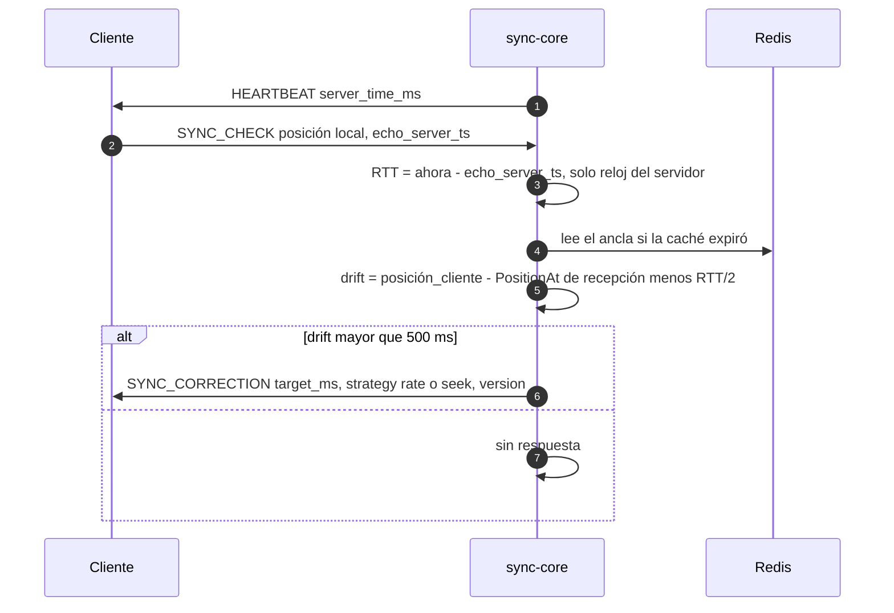

# ADR 0002 — Reloj Maestro autoritativo en sync-core

| Campo | Valor |
| :--- | :--- |
| **Estado** | Aceptada |
| **Fecha** | 2026-10-10 |
| **Dominios afectados** | `services/sync-core`, `apps/web` |

## Contexto
Todos los participantes de una sala deben ver el mismo fotograma al mismo tiempo (REQ-27, REQ-28): comandos del host a todos en < 100 ms y corrección del desfase (*drift*) por encima de 500 ms. Los relojes de los navegadores no son confiables (pueden ir adelantados o atrasados) y las réplicas de sync-core pueden caerse en cualquier momento, así que no puede haber un temporizador "dueño" de la posición en ningún proceso.

## Decisión
sync-core es la **única autoridad** del estado de reproducción, y lo guarda como un **ancla** en Redis, no como una posición que avanza:

- `room:{id}:sync_state` (Hash): `status`, `position_ms`, `updated_at_ms` (reloj del servidor), `rate`, `version`, `host_id`, `media_id`, `volume`, `quality`.
- La posición se calcula cuando hace falta: `PositionAt(t) = position_ms + (t − updated_at_ms) × rate` si `status = playing`; si no, `position_ms`.
- `master.Apply` (`internal/master`, puro y sin I/O) es la única función que calcula el estado siguiente; Redis solo lo persiste. Cada comando incrementa `version` (orden total) y fija el ancla en `received_at − RTT/2` del emisor.
- El drift lo mide **el servidor**: el cliente responde cada `HEARTBEAT` con `SYNC_CHECK` (su posición y el `server_time_ms` que recibió); el RTT se calcula solo con el reloj del servidor (EWMA α = 0.2) y, si `|drift| > 500 ms`, el servidor envía `SYNC_CORRECTION` (`rate` o `seek`).
- La web no tiene lógica autoritativa: aplica el estado, filtra por `version` y ejecuta las correcciones que recibe (`src/lib/drift.ts`).

## Alternativas consideradas
| Alternativa | Por qué no |
| :--- | :--- |
| El navegador del host como reloj (los invitados siguen al host) | Si el host se cae o se va, la sala pierde la referencia; además habría que comparar relojes de clientes distintos. |
| Temporizador por sala en el servidor que "avanza" la posición | Se pierde si la réplica cae, no escala a N réplicas y obliga a una réplica dueña por sala. La regla 2 de sync-core lo prohíbe. |
| Cada cliente calcula su drift y lo reporta | Mezcla relojes de cliente y servidor (lección "No compares relojes distintos") y deja la decisión en el cliente, que no es confiable. |

## Consecuencias
**Positivas**
- Cualquier réplica puede responder `STATE` o calcular la posición en cualquier instante; no hay temporizadores por sala (un solo temporizador de latido por réplica).
- El skew del reloj del cliente no afecta el RTT ni el drift.
- `master.Apply` es puro, lo que permite pruebas deterministas y concentra la lógica en Go (no se duplica en Lua, ver [ADR 0004](0004-scripts-lua-en-lugar-de-watch-multi.md)).

**Negativas**
- Cada `SYNC_CHECK` necesita el ancla vigente (se mitiga con una caché por sala en el hub).
- La sala depende de Redis: sin Redis no hay estado (`1011` al conectar).

**Riesgos**
- El orden entre `ACK` y broadcast no está garantizado: el cliente debe filtrar por `version` o aplicará estados viejos.
- La lección "el `STATE` inicial debe encolarse antes que cualquier publicación del bus" (`cee25be`) muestra que el orden de entrega es frágil.

## Referencias
- Código: `services/sync-core/internal/master`, `internal/drift`, `internal/hub`, `apps/web/src/lib/drift.ts`
- Documentos: [dominio-reproduccion §5](../dominio-reproduccion.md#5-el-reloj-maestro) y [§6.3](../dominio-reproduccion.md#63-latido-rtt-y-drift), [sync-core/AGENTS.md](../../services/sync-core/AGENTS.md#heartbeat-rtt-y-drift)
- Commits: `97e1fe2` feat(sync-core): reloj maestro y algoritmo de drift · `c626cc5` perf(sync-core): caché del estado maestro por sala en el hub · `cee25be` fix(sync-core): el STATE inicial siempre llega antes que los mensajes de la sala
