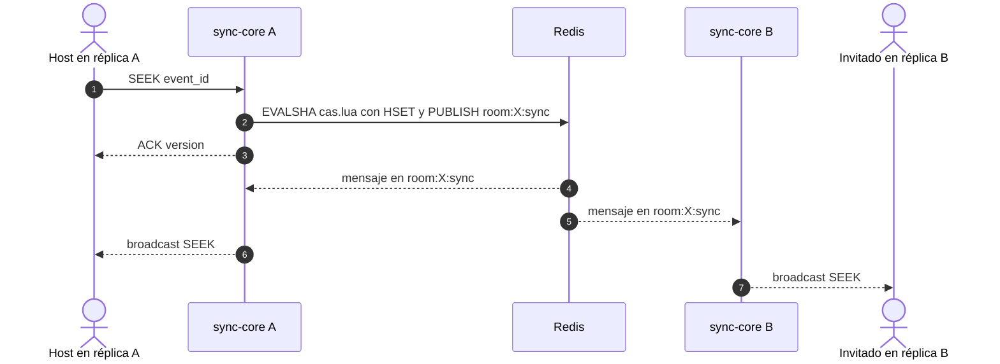

# ADR 0003 — Redis Pub/Sub para el fan-out entre réplicas

| Campo | Valor |
| :--- | :--- |
| **Estado** | Aceptada |
| **Fecha** | 2026-10-10 |
| **Dominios afectados** | `services/sync-core`, `services/social-core` (y `services/identity-api` como publicador de `REVOKED`) |

## Contexto
sync-core y social-core deben escalar a varias réplicas (REQ-08, SYNC-BE-05): el host puede estar conectado a una réplica y sus invitados a otras. Un comando o un mensaje de chat tiene que llegar a todos los clientes de la sala, estén donde estén, en < 100 ms. Redis ya estaba en la infraestructura para el estado de la sala.

## Decisión
Cada sala tiene un canal Redis Pub/Sub por dominio y cada réplica se suscribe **solo** a las salas en las que tiene clientes locales:

- **sync-core:** `room:{id}:sync`. `internal/bus` mantiene una conexión Pub/Sub por réplica. El script CAS que aplica un comando hace `PUBLISH` en la misma operación atómica que escribe el estado ([ADR 0004](0004-scripts-lua-en-lugar-de-watch-multi.md)). **La réplica emisora no difunde localmente**: su propio broadcast le llega por Redis, lo que da un único camino y el mismo orden en todas las réplicas.
- **social-core:** `room:{id}:social` para `chat_message`, `reaction`, `laser`, `poll_state`, `chat_settings`, `trivia_question` y `trivia_result`, con deduplicación por `event_id` contra el eco propio. Además se suscribe en **solo lectura** a `room:{id}:sync` para el recap, las trivias y `REVOKED`.
- **identity-api** publica `REVOKED{jti}` en `room:{id}:sync` ([ADR 0007](0007-revocacion-por-clave-redis-y-cierre-4001.md)); sync-core nunca lo reenvía a los clientes.
- Lo que no puede perderse no vive en Pub/Sub: el estado está en `room:{id}:sync_state` y los clientes se reconcilian con `STATE`, `version` y `SYNC_CORRECTION`.

## Alternativas consideradas
| Alternativa | Por qué no |
| :--- | :--- |
| Afinidad de sala (*sticky sessions*): todas las conexiones de una sala en la misma réplica | Requiere un balanceador que entienda `room_id` y deja la sala caída si esa réplica muere. |
| Redis Streams para el fan-out | Da persistencia y relectura que aquí no hacen falta (el estado ya está en Redis) a costa de más latencia y de gestionar grupos por réplica. Streams se reservan para colas de trabajo ([ADR 0009](0009-procesamiento-asincrono-con-redis-streams.md)). |
| Un broker dedicado (NATS, Kafka) | Otro componente que operar, sin necesidad: Redis ya es dependencia obligatoria. |
| Difundir localmente y además publicar | Dos caminos con órdenes distintos entre réplicas; se descartó en favor de un único camino por Redis. |

## Consecuencias
**Positivas**
- Medido: 1–4 ms entre réplicas para un comando ([dominio-reproduccion §2](../dominio-reproduccion.md#2-requisitos-y-mejoras-cubiertas)).
- Una conexión Pub/Sub por réplica, sin importar cuántas salas tenga.
- El mismo canal sirve para la integración de solo lectura sync-core → social-core.

**Negativas**
- Pub/Sub es *fire-and-forget*: una réplica desconectada pierde mensajes. Se compensa con `version` y `SYNC_CORRECTION` completo (`status`, `rate`, `media_id`, `volume`, `quality`, desde `9214cdb`).
- social-core solo cuenta para el recap los eventos que ve alguna réplica con clientes en la sala.
- La presencia de social-core (`connected_users`) no se comparte entre réplicas: cada una publica su propio conteo.

**Riesgos**
- sync-core mantiene `Hub.mu` durante `Subscribe`/`Unsubscribe` de Redis (pendiente en el [bug hunting §3](../bug-hunting-2026-10.md#3-pendiente-de-acordar-no-se-toca-en-esta-rama)).
- Las claves no usan *hash tags*: un Redis Cluster requeriría ajustarlas.
- `docker-compose.yml` levanta una sola réplica de cada servicio: el multirréplica se valida con pruebas y benchmarks, no con un despliegue.

## Referencias
- Código: `services/sync-core/internal/bus`, `internal/store/store.go` (`casScript`), `services/social-core/internal/server`
- Documentos: [dominio-reproduccion §6.2](../dominio-reproduccion.md#62-comando-entre-réplicas-compare-and-set), [social-core/AGENTS.md](../../services/social-core/AGENTS.md#modelo-de-datos-involucrado)
- Commits: `a10fa4b` feat(sync-core): bus Pub/Sub entre réplicas y telemetría de drift · `b49496b` feat(social-core): canal /ws/social solo-chat con historial corto en Redis · `2d6802e` fix(social-core): reenvía las reacciones a las demás réplicas por Redis
