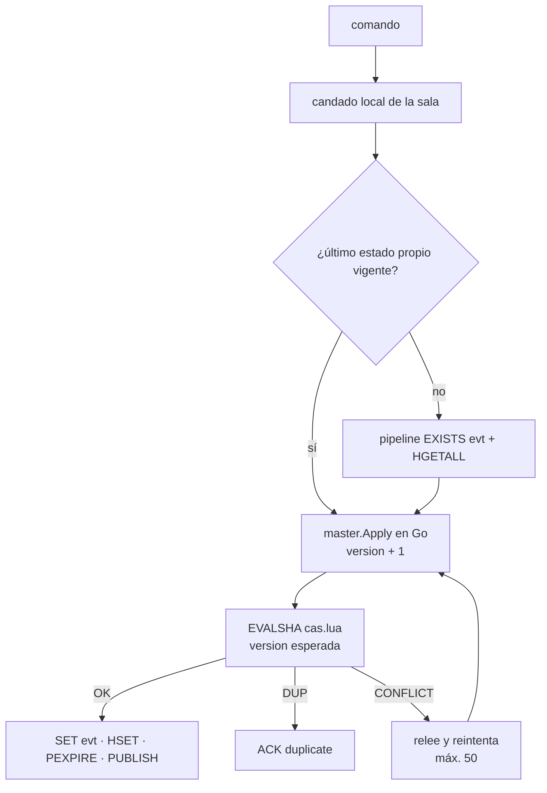

# ADR 0004 — Scripts Lua en lugar de `WATCH/MULTI`

| Campo | Valor |
| :--- | :--- |
| **Estado** | Aceptada (reemplaza la escritura con `WATCH/MULTI` de la v1 de sync-core) |
| **Fecha** | 2026-10-10 |
| **Dominios afectados** | `services/sync-core`, `services/social-core` |

## Contexto
La v1 de sync-core aplicaba cada comando con `WATCH/MULTI/EXEC` sobre `room:{id}:sync_state`. Con miniredis las pruebas pasaban, pero **contra Redis real y 16 escritores concurrentes en una sala, `WATCH/MULTI` agotaba los 50 reintentos y perdía comandos** (~7 ms/op). Es el origen de la lección del AGENTS raíz: *"Mide con la infraestructura real antes de afirmar algo sobre rendimiento"*. social-core tiene el mismo problema en operaciones que deben ser únicas entre réplicas (abrir y cerrar una trivia, cerrar una encuesta, admitir un mensaje con modo lento).

## Decisión
Las escrituras condicionales a Redis se hacen con **scripts Lua** (`redis.NewScript`, `EVALSHA`), que Redis ejecuta de forma atómica:

- **sync-core, compare-and-set** (`internal/store/store.go`, `casScript`): se lee el estado en un pipeline (o se usa el último estado que escribió la misma réplica, < 1 min), `master.Apply` calcula el siguiente **en Go** y el script escribe y publica solo si `version` no cambió. Respuestas `OK`, `CONFLICT` (relee; espera aleatoria de 0–4 ms si escribió otra réplica) o `DUP` (`event_id` ya aplicado).
- **Candado local por sala** (256 franjas por hash): dentro de una réplica no hay conflictos; solo pueden venir de otras réplicas.
- **Presencia** (`internal/store/presence.go`): `sweepScript` (latido en lote, presencia y transición de `HOST_STATUS` en una ida y vuelta) y `hostStatusScript`.
- **social-core**: `admitScript` (moderación: `SISMEMBER` + `SET NX PX`), `createScript`/`voteScript`/`closeScript` (encuestas), `syncScript` (ancla del recap) y `scheduleScript`/`deleteScript`/`launchScript`/`answerScript`/`closeScript` (trivias, con `HSETNX` para que una sola réplica emita).

## Alternativas consideradas
| Alternativa | Por qué no |
| :--- | :--- |
| Mantener `WATCH/MULTI/EXEC` | Medido con Redis real: perdía comandos bajo contención y fija una conexión por transacción. |
| Toda la lógica del Reloj Maestro en Lua | Duplicaría `master.Apply` en otro lenguaje; Go sigue siendo la única fuente de verdad y Lua solo hace el "escribe si nadie escribió". |
| Candado distribuido (por ejemplo, Redlock) | Más idas y vueltas y otra pieza que puede fallar; el CAS por `version` ya resuelve los conflictos entre réplicas. |

## Consecuencias
**Positivas**
- Benchmarks contra Redis 7: en serie 0,66–1,42 → 0,24–0,49 ms/op; con 16 escritores 7,07 ms/op con fallos → 0,27–0,32 ms/op sin fallos; dos réplicas 0,34–0,79 ms/op sin fallos (`c14b3c7`).
- Un comando tras otro de la misma réplica cuesta **una** ida y vuelta (`0971097`); el barrido por sala, una (`0746ea6`).
- Las operaciones "solo una réplica emite" de social-core son idempotentes con `HSETNX`.

**Negativas**
- Los scripts se prueban con miniredis, que no reproduce todas las condiciones de concurrencia; los benchmarks fiables necesitan `BENCH_REDIS_URL`.
- Lógica repartida entre Go y Lua (pequeña, pero en dos lenguajes).
- Quedan menciones a la versión reemplazada: el Stack Técnico de `services/sync-core/AGENTS.md` justifica `go-redis` por `WATCH/MULTI/EXEC` y el comentario de cabecera de `internal/hub/hub.go` dice `store.Apply (WATCH/MULTI + PUBLISH)`. El código real usa `casScript`; `TxPipelined` (`MULTI` sin `WATCH`) solo se usa en `Init` y en `HostSeen`.

**Riesgos**
- Un script lento bloquea Redis entero; los scripts deben seguir siendo O(1) o acotados.
- Redis Cluster exigiría que las claves de un script compartan *hash slot* (hoy no usan *hash tags*).

## Referencias
- Código: `services/sync-core/internal/store/store.go`, `internal/store/presence.go`, `services/social-core/internal/{moderation,polls,recap,trivia}/store.go`
- Documentos: [dominio-reproduccion §6.2](../dominio-reproduccion.md#62-comando-entre-réplicas-compare-and-set) y [§15](../dominio-reproduccion.md#15-decisiones-de-diseño), [AGENTS raíz § Lecciones aprendidas](../../AGENTS.md#lecciones-aprendidas-no-repetir)
- Commits: `c14b3c7` perf(sync-core): compare-and-set con Lua y candado por sala en el store · `0971097` perf(sync-core): Apply con una sola ida y vuelta tras un comando propio · `0746ea6` perf(sync-core): barrido de presencia en una sola ida y vuelta por sala · `ffb7f38` feat(social-core): modo lento y silencio en el chat · `b2cfbf9` feat(social-core): almacén Redis de trivias programadas
