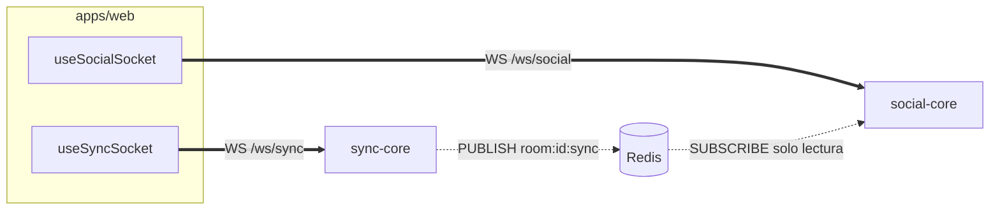

# ADR 0005 — Canales WebSocket separados para sync y social

| Campo | Valor |
| :--- | :--- |
| **Estado** | Aceptada |
| **Fecha** | 2026-10-10 |
| **Dominios afectados** | `services/sync-core`, `services/social-core`, `apps/web` |

## Contexto
La sala combina dos tipos de tráfico con requisitos opuestos:
- **Reproducción:** pocos mensajes pequeños, latencia < 100 ms, latido cada segundo, cola de salida acotada (64) y cierre de clientes lentos.
- **Interacción social:** ráfagas de chat, reacciones (5/s por usuario), láser (30/s), encuestas, trivias y recap, con historial y moderación.

Si compartieran socket, una ráfaga de reacciones podría retrasar un `SEEK` o un `HEARTBEAT` y provocar correcciones de drift falsas.

## Decisión
Dos servicios y dos WebSockets independientes:

| | Canal Sync | Canal Social |
| :--- | :--- | :--- |
| Servicio | sync-core (Go), puerto 8083 → 8080 | social-core (Go), puerto 8082 |
| Ruta | `GET /ws/sync?room_id&token` | `GET /ws/social?room_id&token` |
| Contenido | `PLAY`, `PAUSE`, `SEEK`, `RATE`, `LOAD`, `VOLUME`, `QUALITY`, latidos y `BUFFERING` | chat (moderación, spoilers), reacciones, láser, encuestas, trivias, recap |
| Codificación | JSON o MessagePack (`tint.sync.msgpack`) | JSON |
| Canal Redis | `room:{id}:sync` | `room:{id}:social` (+ lectura de `room:{id}:sync`) |

- En la web, dos hooks que **nunca se mezclan** (regla 1 de `apps/web/AGENTS.md`): `useSyncSocket` y `useSocialSocket`. El Ambilight no usa ninguno (se descarga por HTTP, [ADR 0011](0011-ambilight-precalculado-por-media-worker.md)).
- Límites de dominio explícitos: sync-core no procesa chat ni reacciones; social-core no emite comandos de reproducción.
- La única integración entre ambos es de **solo lectura** por Redis: social-core escucha los comandos de `room:{id}:sync` para el recap y las trivias ([ADR 0012](0012-trivia-con-reloj-del-servidor-y-ancla-del-recap.md)).

## Alternativas consideradas
| Alternativa | Por qué no |
| :--- | :--- |
| Un solo WebSocket multiplexado | El tráfico social compartiría cola y límites con el de reproducción; un cliente lento por reacciones sería cerrado por la cola de sync. |
| Un solo servicio con dos rutas | Acopla despliegue y escalado: el chat no puede escalar sin escalar el reloj, y un fallo del social tumbaría la sincronía. |
| Chat por HTTP (polling o SSE) | Más latencia y más conexiones; el láser y las trivias necesitan tiempo real bidireccional. |

## Consecuencias
**Positivas**
- La latencia del Canal Sync no depende de la actividad social; cada servicio tiene sus propios límites de tasa y tamaño.
- Escalado y fallos independientes: si social-core cae, el vídeo sigue sincronizado.

**Negativas**
- Dos conexiones por cliente, dos handshakes y dos verificaciones de token y de revocación.
- El host necesita el **sync-ticket** también para el canal social si quiere moderar ([ADR 0006](0006-tickets-jwt-hs256-emitidos-por-identity-api.md)).
- Las políticas de cierre divergen: el Canal Sync cierra estados terminales con `4xxx` tras el upgrade, el social todavía responde 401 antes del upgrade ([ADR 0014](0014-upgrade-y-cierre-4xxx-para-estados-terminales.md)).

**Riesgos**
- social-core depende del formato de los comandos de sync-core en `room:{id}:sync`: es un contrato compartido ([arquitectura §5](../arquitectura.md#5-contratos-compartidos-entre-dominios)).

## Referencias
- Código: `services/sync-core/internal/ws`, `services/social-core/internal/server/social.go`, `apps/web/src/hooks/useSyncSocket.ts`, `apps/web/src/hooks/useSocialSocket.ts`
- Documentos: [sync-core/AGENTS.md](../../services/sync-core/AGENTS.md#protocolo-del-canal-sync), [social-core/AGENTS.md](../../services/social-core/AGENTS.md#protocolo-del-canal-social), [apps/web/AGENTS.md](../../apps/web/AGENTS.md#reglas-de-dominio)
- Commits: `b49496b` feat(social-core): canal /ws/social solo-chat con historial corto en Redis · `a0a0855` feat(sync-core): handler WebSocket /ws/sync con handshake JWT · `4a421f2` feat(web): chat en vivo en WatchRoom con useSocialSocket y panel fijo
