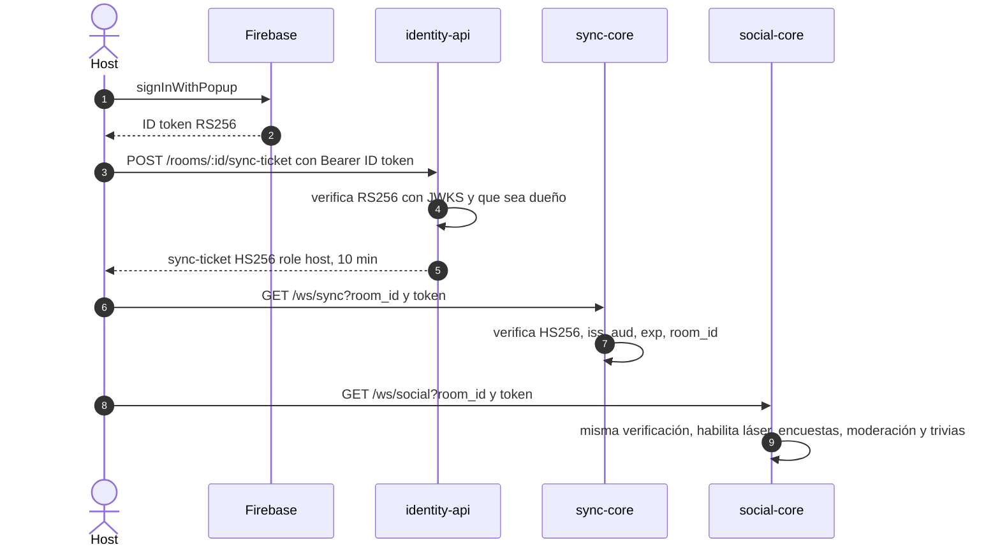

# ADR 0006 — Tickets JWT HS256 emitidos por identity-api

| Campo | Valor |
| :--- | :--- |
| **Estado** | Aceptada |
| **Fecha** | 2026-10-10 (sync-ticket); el guest token es del 2026-10-08 y el analytics-ticket del 2026-10-11 |
| **Dominios afectados** | `services/identity-api`, `services/sync-core`, `services/social-core`, `services/analytics`, `apps/web` |

## Contexto
Hay dos tipos de usuario: el **host**, con cuenta Google (ID token de Firebase RS256, ~1 h), y el **invitado**, anónimo, que entra con un link y un apodo. Los servicios de tiempo real necesitan saber, sin llamar a nadie en cada conexión, **quién es, de qué sala y con qué rol**. Un ID token de Firebase no dice de qué sala es dueño el usuario, y los WebSockets del navegador no permiten cabeceras (el token va en la query).

## Decisión
identity-api es el **único emisor** de tokens propios, todos JWT **HS256** firmados con `JWT_SECRET` y los mismos claims (`sub`, `room_id`, `role`, `nick`, `jti`, `iss = tint-identity`, `aud = tint:room`, `iat`, `exp`):

| Token | Cómo se obtiene | `role` | Vida | Lo aceptan |
| :--- | :--- | :--- | :--- | :--- |
| Guest token | `POST /invitations/claim` | `participant` | 4 h (`GUEST_TOKEN_TTL_HOURS`) | identity-api, sync-core, social-core |
| Sync-ticket | `POST /rooms/:id/sync-ticket` (Firebase + dueño) | `host` | 10 min (`SYNC_TICKET_TTL_SECONDS`) | sync-core, social-core (permisos de moderación) |
| Analytics-ticket | `POST /rooms/:id/analytics-ticket` (Firebase + dueño, también con la sala borrada) | `host` | 10 min | analytics |

- Los consumidores **solo verifican**: restringen el algoritmo a HS256, exigen `iss`, `aud`, `exp` (social-core y analytics también `jti`), `sub` no vacío y `room_id` igual a la sala pedida (otra sala → 403).
- `JWT_SECRET`, `JWT_ISSUER` y `JWT_AUDIENCE` deben ser idénticos en los cuatro servicios; sin `JWT_SECRET` sync-core, social-core y analytics no arrancan.
- social-core acepta además el ID token de Firebase del host, verificado contra los certificados públicos de Google, **solo para chatear**: no da permisos de moderación, porque no prueba de qué sala es dueño (falla cerrado).

## Alternativas consideradas
| Alternativa | Por qué no |
| :--- | :--- |
| Usar el ID token de Firebase en todos los servicios | No sirve para invitados anónimos y no contiene `room_id` ni `role`: cada servicio tendría que consultar a identity-api o a PostgreSQL. |
| RS256 con claves propias de identity-api | Más seguro ante la filtración de un consumidor, pero exige distribuir y rotar claves públicas; con cuatro servicios internos se optó por un secreto compartido. Queda como evolución posible. |
| Sesiones opacas consultadas en Redis o en identity-api | Una llamada por conexión y un punto único de fallo en el camino caliente del Canal Sync. |

## Consecuencias
**Positivas**
- Verificación local y sin red en cada handshake; los servicios de tiempo real no dependen de identity-api para aceptar conexiones.
- Un solo formato de claims para todos los consumidores (contrato compartido en el AGENTS raíz).
- Tickets de host de vida corta: no hace falta revocarlos.

**Negativas**
- El secreto es simétrico: cualquier servicio que lo tenga puede **emitir** tokens válidos.
- El token viaja en la query del WebSocket: nunca se debe registrar la URL completa.
- La web pide un sync-ticket en cada (re)conexión y debe renovar el ID token de Firebase (`onIdTokenChanged`, bug B9).

**Riesgos**
- Un `JWT_SECRET` débil o filtrado compromete todas las salas. `.env.example` trae `dev-secret-change-in-prod`.
- La lección "**Nunca confíes en un token sin verificar su firma**, ni como respaldo" nació aquí: social-core aceptaba ID tokens de Firebase falsificados (bug B3, `fe43c81`).
- Los guest tokens sí son revocables, pero necesitan un mecanismo aparte ([ADR 0007](0007-revocacion-por-clave-redis-y-cierre-4001.md)).

## Referencias
- Código: `services/identity-api/src/modules` (generación de tokens), `services/sync-core/internal/auth`, `services/social-core/internal/auth`, `services/analytics/src/analytics/api.py`
- Documentos: [usuarios-e-identidad §4](../usuarios-e-identidad.md#4-esquemas-de-tokens), [social-core/AGENTS.md § Autenticación](../../services/social-core/AGENTS.md#autenticación-de-wssocial), [bug-hunting B3, B6, B8, B9](../bug-hunting-2026-10.md)
- Commits: `59b5fce` feat(identity-api): login con Firebase, salas e invitaciones con guest tokens · `e6cc0cb` feat(identity-api): sync-ticket HS256 para el canal sync · `7897719` feat(sync-core): configuración y validación de tokens HS256 · `4a26e73` feat(identity-api): emite eventos de analítica y añade el analytics-ticket · `fe43c81` fix(social-core): verifica la firma RS256 de los host tokens de Firebase
