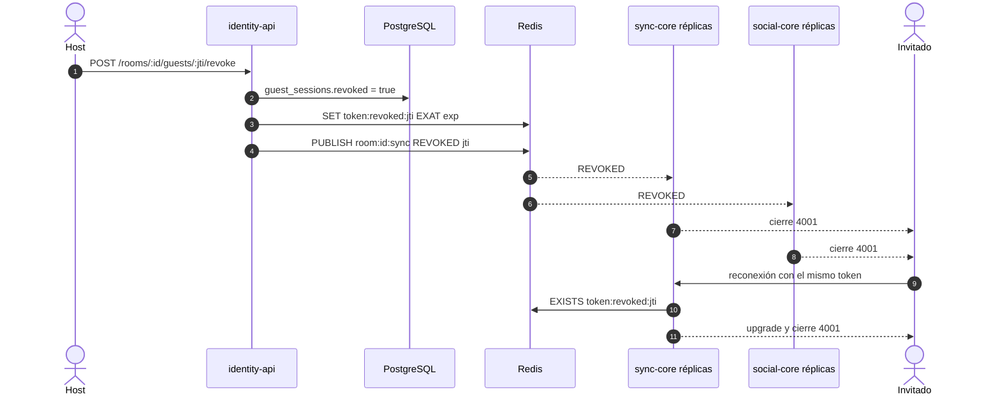

# ADR 0007 — Revocación por clave Redis y cierre `4001`

| Campo | Valor |
| :--- | :--- |
| **Estado** | Aceptada |
| **Fecha** | 2026-10-10 (sync-core e identity-api); social-core se sumó el 2026-10-11 |
| **Dominios afectados** | `services/identity-api`, `services/sync-core`, `services/social-core`, `services/analytics`, `apps/web` |

## Contexto
El host debe poder **retirar** a un invitado en vivo (F5). El guest token es un JWT de 4 h verificado localmente ([ADR 0006](0006-tickets-jwt-hs256-emitidos-por-identity-api.md)), así que seguiría siendo válido hasta caducar. Además hay que cortar las conexiones **ya abiertas** en cualquier réplica de sync-core y social-core, sin que estos servicios llamen a identity-api en tiempo real. El bug hunting encontró que el chat ignoraba la revocación (B1) y que borrar una sala no cortaba a nadie (B2).

## Decisión
Una **marca en Redis** más un **aviso por el canal de la sala**:

1. identity-api marca `guest_sessions.revoked`, hace `SET token:revoked:{jti} 1 EXAT <exp del token>` y `PUBLISH room:{id}:sync REVOKED{jti}`.
2. **En el handshake** (o en cada petición, en analytics) el consumidor comprueba `EXISTS token:revoked:{jti}`. Si Redis no responde → **503: falla cerrado**.
3. **En vivo**, cada réplica de sync-core y social-core que recibe `REVOKED` por `room:{id}:sync` cierra los sockets de ese `jti` con el código **`4001` "token revocado"**. `REVOKED` nunca se reenvía a los clientes.
4. La web trata `4001` como terminal: no reconecta, borra `tint_guest_token` y muestra "Fuiste retirado". identity-api también rechaza el token revocado en `GET /rooms/:id/playback` (401).
5. La misma vía se usa al **borrar una sala** (revoca cada sesión activa) y al **bloquear** un invitado ([ADR 0013](0013-bloqueo-de-invitados-por-dispositivo.md)). Si Redis falla, la respuesta es 503 y el reintento es idempotente.

## Alternativas consideradas
| Alternativa | Por qué no |
| :--- | :--- |
| Tokens de vida muy corta con renovación | Obligaría a los invitados anónimos a renovar constantemente y no corta las conexiones abiertas. |
| Lista negra en PostgreSQL consultada por cada servicio | sync-core y social-core no tienen acceso a PostgreSQL y añadiría latencia al handshake. |
| Llamada HTTP de identity-api a cada réplica | identity-api tendría que conocer las réplicas; Pub/Sub ya llega a todas ([ADR 0003](0003-redis-pubsub-para-fanout-entre-replicas.md)). |
| Cambiar `JWT_SECRET` | Invalida a todos los usuarios de todas las salas. |

## Consecuencias
**Positivas**
- sync-core y social-core no dependen de identity-api en tiempo real ([dominio-reproduccion §15](../dominio-reproduccion.md#15-decisiones-de-diseño)).
- La marca caduca sola con `EXAT` = `exp`: Redis no acumula revocaciones.
- Un único mecanismo para retirar, bloquear y borrar la sala.

**Negativas**
- Una consulta a Redis por handshake, y Redis pasa a ser obligatorio para aceptar conexiones (503 si cae).
- social-core sin `REDIS_URL` (modo memoria) no tiene fuente de revocación.

**Riesgos**
- Si el `PUBLISH` se pierde (réplica desconectada de Redis), la conexión sigue abierta hasta reconectar; la marca evita la reconexión.
- social-core rechaza el handshake revocado con **401 antes del upgrade** (no con `4001`), y `useSocialSocket` reintenta ante cualquier cierre: el navegador solo ve `1006` ([ADR 0014](0014-upgrade-y-cierre-4xxx-para-estados-terminales.md)).
- Lección aplicada: "**Falla cerrado** en todo lo relacionado con autorización".

## Referencias
- Código: `services/identity-api/src` (revocación y `guest_sessions`), `services/sync-core/internal/store` y `internal/ws`, `services/social-core/internal/server/revocation.go`, `services/analytics/src/analytics/api.py`, `apps/web/src/hooks/useSyncSocket.ts`
- Documentos: [dominio-reproduccion §6.6](../dominio-reproduccion.md#66-retirar-a-un-invitado-f5), [usuarios-e-identidad §6.5](../usuarios-e-identidad.md#65-retirar-a-un-invitado), [bug-hunting B1, B2](../bug-hunting-2026-10.md)
- Commits: `16d5da9` feat(sync-core): revocación de tokens de invitados · `b384030` feat(identity-api): revocación de invitados con guest_sessions y REVOKED por Redis (F5) · `2668555` fix(social-core): rechaza y desconecta invitados con el token revocado · `e86155f` fix(identity-api): borrar una sala revoca las sesiones de invitado en vivo
