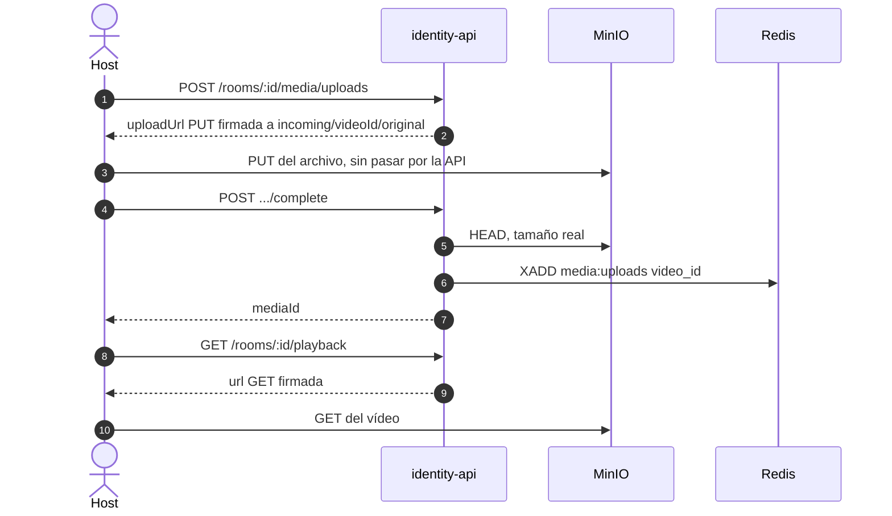

# ADR 0008 — Subida directa a MinIO con URL firmada

| Campo | Valor |
| :--- | :--- |
| **Estado** | Aceptada |
| **Fecha** | 2026-10-11 (subida); la reproducción con GET firmado es del 2026-10-10 |
| **Dominios afectados** | `services/identity-api`, `apps/web`, `services/media-worker`, infra (`docker-compose.yml`) |

## Contexto
El host sube vídeos de hasta 2 GiB (`MAX_UPLOAD_BYTES`) y todos los participantes los reproducen. Hacer pasar esos bytes por identity-api (Express) consumiría memoria, ancho de banda y conexiones del servicio de identidad, y lo convertiría en cuello de botella de la reproducción. El bucket no debe ser público y nada sin validar debe quedar en la clave que se reproduce.

## Decisión
**El archivo nunca pasa por identity-api.** identity-api solo firma (SigV4, en local, con `@aws-sdk/s3-request-presigner`) y valida:

1. **Reservar:** `POST /rooms/:id/media/uploads` crea la fila en `videos` (`pending`) y devuelve una URL **PUT** firmada (15 min, `Content-Type` dentro de la firma) a la zona de **staging** `incoming/{videoId}/original.*`.
2. **Subir:** el navegador hace el `PUT` directo a MinIO con progreso (`apps/web/src/lib/upload.ts`, XHR sin `Authorization`). CORS de MinIO según `MINIO_CORS_ALLOW_ORIGIN`.
3. **Confirmar:** `POST …/uploads/:videoId/complete` hace `HEAD` (409 si no llegó; 413 y `DELETE` si el tamaño real supera el declarado o el máximo), pasa `pending → processing` de forma condicional e idempotente y encola en `media:uploads` ([ADR 0009](0009-procesamiento-asincrono-con-redis-streams.md)).
4. **Reproducir:** `GET /rooms/:id/playback` firma un **GET** (1 h, `PLAYBACK_URL_TTL_SECONDS`) sobre `videos.storage_key`: el original mientras se procesa y `{id}/source.mp4` (más `720p`/`360p` y `ambilight.json`) cuando media-worker lo deja `ready`.
5. `minio-init` crea el bucket y una regla de ciclo de vida que borra `incoming/` a los 2 días.

## Alternativas consideradas
| Alternativa | Por qué no |
| :--- | :--- |
| Subida *multipart* a identity-api y reenvío a MinIO | Duplica el tráfico y la memoria en el servicio de identidad. |
| Bucket público de lectura | Cualquiera con la clave vería los vídeos; la URL firmada caduca y exige ser dueño o invitado de la sala. |
| Subir directo a la clave publicada `{id}/source.*` | Se publicaría un vídeo sin validar; se cambió a staging `incoming/` (`f2da4bb`). |
| Proxy de *streaming* propio | Otro servicio en el camino caliente; MinIO ya sirve rangos HTTP. |

## Consecuencias
**Positivas**
- identity-api no maneja bytes de vídeo; el tráfico pesado va navegador ↔ MinIO.
- Las URLs caducan y la autorización la decide identity-api al firmar.
- Quien ya reproducía el original no se corta al publicarse la versión procesada (staging de 2 días).

**Negativas**
- MinIO debe ser accesible desde el navegador (`MINIO_PUBLIC_ENDPOINT`, CORS).
- La URL PUT no fija el tamaño: el límite se comprueba al confirmar (bug B7, `c8cf79e`).
- La web debe renovar la URL de reproducción antes de `expiresAt`.

**Riesgos**
- `PUT /rooms/:id/media { mediaKey }` acepta cualquier clave del bucket (pendiente en el [bug hunting §3](../bug-hunting-2026-10.md#3-pendiente-de-acordar-no-se-toca-en-esta-rama)).
- **Extensiones desalineadas:** identity-api firma el PUT para `.mp4`, `.webm`, `.mov`, `.mkv`, `.m4v` y `.ogv` (`VIDEO_EXTENSIONS` en `services/identity-api/src/routes/v1.ts`), pero media-worker solo admite `.mp4`, `.mov`, `.mkv` y `.webm`: un `.m4v` o un `.ogv` se sube y confirma bien y después queda `failed` sin procesar.
- La imagen de MinIO es `pgsty/minio:latest` (la oficial no está disponible), sin versión fijada.

## Referencias
- Código: `services/identity-api/src/modules` (media, signer), `apps/web/src/lib/upload.ts`, `docker-compose.yml` (`minio`, `minio-init`)
- Documentos: [dominio-reproduccion §6.7](../dominio-reproduccion.md#67-subida-y-cambio-de-vídeo), [identity-api/AGENTS.md § API](../../services/identity-api/AGENTS.md#api)
- Commits: `5bb127a` feat(identity-api): vínculo sala → vídeo con URL firmada de MinIO (F3) · `ea1e0d8` feat(identity-api): subida de vídeo al Blob Storage y cola media:uploads · `ca7f2ee` chore: CORS de MinIO para la subida y reproducción desde el navegador · `f2da4bb` fix(identity-api): sube a staging y reproduce la clave vigente del vídeo · `c8cf79e` fix(identity-api): comprueba el tamaño real del objeto al confirmar la subida
