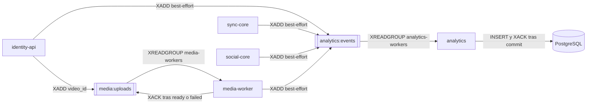

# ADR 0009 — Procesamiento asíncrono con Redis Streams

| Campo | Valor |
| :--- | :--- |
| **Estado** | Aceptada |
| **Fecha** | 2026-10-10 |
| **Dominios afectados** | `services/identity-api`, `services/media-worker`, `services/analytics`, `services/sync-core`, `services/social-core` |

## Contexto
Dos trabajos no deben bloquear a quien atiende al usuario:
- **Procesar un vídeo** (ffprobe, normalización, Ambilight, calidades) puede tardar minutos u horas (timeout de normalización de 4 h).
- **Registrar telemetría** (comandos, drift, chat, reacciones, logins) ocurre en caminos calientes: un `XADD` síncrono no puede retrasar un `PLAY` ni un mensaje.

Ambos necesitan **no perder trabajo** si el consumidor está caído y poder reintentar tras fallos de infraestructura. Redis ya era obligatorio en la plataforma.

## Decisión
Colas con **Redis Streams** y **grupos de consumidores**:

| Stream | Productores | Grupo | Consumidor | Semántica |
| :--- | :--- | :--- | :--- | :--- |
| `media:uploads` | identity-api al confirmar (`XADD * video_id <id>`) | `media-workers` | media-worker (`consumer.py`) | `XACK` solo tras un resultado terminal; un fallo de SQL/S3 deja el mensaje pendiente y se reintenta cada 5 s |
| `analytics:events` | identity-api, sync-core, social-core, media-worker (`XADD MAXLEN ~ 100000`) | `analytics-workers` | analytics (`consumer.py`) | `INSERT … ON CONFLICT (event_id) DO NOTHING` y `XACK` tras el commit; un evento inválido se registra y se confirma |

- **Productores no bloqueantes:** sync-core y social-core encolan en un canal con buffer y una goroutine hace el `XADD` (si se llena, se descarta y se cuenta); identity-api y media-worker publican *best-effort* después de responder o de terminar.
- **Recuperación:** cada consumidor tiene un nombre estable (`MEDIA_WORKER_CONSUMER`, `ANALYTICS_CONSUMER`) y al arrancar recupera sus pendientes.
- **Idempotencia:** media-worker no reprocesa un vídeo ya publicado; analytics deduplica por `event_id`; `complete` solo encola en la transición `pending → processing` (bug B13).

## Alternativas consideradas
| Alternativa | Por qué no |
| :--- | :--- |
| Llamada HTTP síncrona de identity-api a media-worker | El host esperaría el procesamiento; si el worker cae, el trabajo se pierde. |
| Redis Pub/Sub | No persiste ni tiene acuse: un consumidor caído pierde eventos. Pub/Sub queda para el fan-out en vivo ([ADR 0003](0003-redis-pubsub-para-fanout-entre-replicas.md)). |
| Broker dedicado (RabbitMQ, Kafka) | Otro componente que operar; Streams da grupos, pendientes y `XACK` con la infraestructura existente. |
| Escritura directa de cada servicio en PostgreSQL de analytics | Acopla los servicios al esquema de analytics y pone SQL en caminos calientes (límite de dominio de sync-core). |

## Consecuencias
**Positivas**
- La subida responde en cuanto el vídeo está encolado; la web consulta el estado cada ~5 s.
- La telemetría nunca bloquea la reproducción ni el chat.
- Se puede añadir réplicas de media-worker o analytics en el mismo grupo.

**Negativas**
- Consistencia eventual: los KPIs y el estado `ready` llegan con retraso.
- `analytics:events` está acotado (`MAXLEN ~ 100000`) y los productores descartan si su buffer se llena: la analítica puede perder eventos bajo carga.
- Un evento que falla siempre por infraestructura bloquea el avance de ese consumidor (reintenta los pendientes antes de leer nuevos).

**Riesgos**
- Sin monitoreo de la longitud de los pendientes no hay alerta si un consumidor se atasca.
- Lección relacionada: tras integrar `main`, el worker se quedó sin punto de entrada y los vídeos quedaban en `pending` para siempre (`b13b92f`).

## Referencias
- Código: `services/media-worker/src/media_worker/consumer.py` y `jobs.py`, `services/analytics/src/analytics/consumer.py`, `services/sync-core/internal/telemetry`, `services/social-core/internal/analytics`
- Documentos: [dominio-reproduccion §6.7](../dominio-reproduccion.md#67-subida-y-cambio-de-vídeo), [contrato-eventos-analitica](../contrato-eventos-analitica.md)
- Commits: `724c74c` feat(media-worker): consume media:uploads and publish ambilight.json · `a10fa4b` feat(sync-core): bus Pub/Sub entre réplicas y telemetría de drift · `ea1e0d8` feat(identity-api): subida de vídeo al Blob Storage y cola media:uploads · `b13b92f` feat(media-worker): disparador que procesa las subidas directas al bucket · `1df3883` feat(analytics): consumidor de analytics:events con XACK tras el commit
