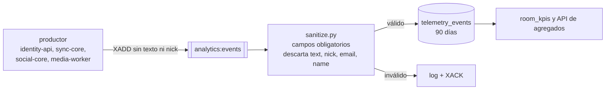

# ADR 0010 — Eventos de analítica sin PII

| Campo | Valor |
| :--- | :--- |
| **Estado** | Aceptada |
| **Fecha** | 2026-10-08 (sanitizador); contrato de eventos del 2026-10-11 |
| **Dominios afectados** | `services/analytics` (dueño del contrato), `services/identity-api`, `services/sync-core`, `services/social-core`, `services/media-worker`, `apps/web` |

## Contexto
TINT procesa datos de usuarios en Colombia, sujetos a la **Ley 1581 de 2012 (Habeas Data)**. La analítica necesita conteos, tiempos y correlaciones (mensajes, reacciones, drift, espectadores, aciertos de trivia), pero no el contenido del chat ni datos que identifiquen directamente a una persona. Cuatro servicios distintos publican eventos, así que la protección no puede depender solo de que cada productor lo haga bien.

## Decisión
**Privacy by Design** en dos capas:

1. **Contrato del productor** ([contrato-eventos-analitica](../contrato-eventos-analitica.md)): campos planos, sin texto libre ni datos personales. Del chat solo viaja `message_length`; nunca `text`, `nick`, `email` ni nombres. `user_id` es el `sub` del token (UID de Firebase para hosts, `guest:<uuid>` para invitados), nunca `users.id` ni el email. **sync-core no envía `user_id`**: publica `role`. media-worker no envía `room_id`.
2. **Sanitización en analytics** (`sanitize.py`): exige `event_id`, `type`, `source`, `occurred_at`, `received_at` (y `room_id` salvo en `user_login`/`media_processed`) y **descarta** los campos `text`, `message`, `content`, `body`, `nick`, `email`, `name` y `display_name` aunque un productor los envíe.

Además: retención de 90 días con purga cada hora, la API de lectura solo devuelve **agregados** de una sala a su host (nunca eventos crudos ni tiempo real), y la web nunca envía texto de chat a telemetría.

## Alternativas consideradas
| Alternativa | Por qué no |
| :--- | :--- |
| Guardar el texto del chat y anonimizar después | Viola el principio de minimización; el texto puede contener datos personales imposibles de limpiar de forma fiable. |
| Confiar solo en los productores | Un error en cualquiera de los cuatro filtraría PII; el sanitizador es la red de seguridad. |
| Seudonimizar `user_id` con un hash en analytics | No implementado: hoy se guarda el `sub` tal cual (ver Riesgos). |

## Consecuencias
**Positivas**
- KPIs útiles (pico y promedio de espectadores, drift, buffering, % de aciertos) sin almacenar contenido.
- Un productor nuevo que se equivoque no contamina la base: el sanitizador lo filtra.

**Negativas**
- No se puede hacer análisis de contenido del chat (sentimiento, temas).
- sync-core sin `user_id` impide métricas por persona en reproducción.

**Riesgos**
- `user_id` (UID de Firebase o `guest:<uuid>`) es un **identificador seudónimo**: no es PII directa, pero permite correlacionar actividad de una misma cuenta. Cualquier cambio que lo cruce con `users` debe revisarse a la luz de la Ley 1581.
- `emoji` y `position_ms` de las reacciones sí se guardan; son datos de comportamiento.

## Referencias
- Código: `services/analytics/src/analytics/sanitize.py`, `services/sync-core/internal/telemetry`, `services/social-core/internal/analytics`, `services/identity-api/src/modules/analytics/analytics.events.ts`, `services/media-worker/src/media_worker/events.py`
- Documentos: [contrato-eventos-analitica](../contrato-eventos-analitica.md), [analytics/AGENTS.md](../../services/analytics/AGENTS.md#reglas-de-dominio), [usuarios-e-identidad §9](../usuarios-e-identidad.md#9-privacidad-ley-1581)
- Commits: `324cf96` feat(analytics): scaffold privacy-first event sanitizer and room KPIs · `821f7a1` docs(analytics): contrato de eventos para analytics:events · `5779dcc` fix(analytics): sanitize respeta message_length y exige source y received_at · `5d94f02` feat(social-core): publicar chat_message, presence y reaction en analytics:events
