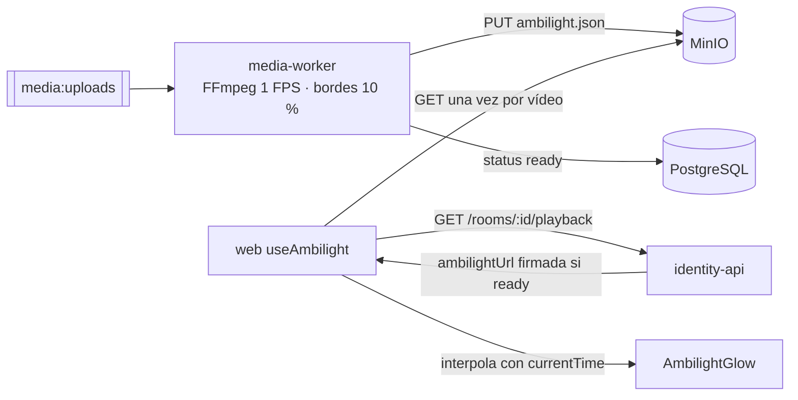

# ADR 0011 — Ambilight precalculado por media-worker

| Campo | Valor |
| :--- | :--- |
| **Estado** | Aceptada |
| **Fecha** | 2026-10-10 (publicación de `ambilight.json`); el brillo en la web es del 2026-10-11 |
| **Dominios afectados** | `services/media-worker`, `services/identity-api`, `apps/web` (`services/social-core` solo como alternativa prevista) |

## Contexto
El Ambilight pinta alrededor del reproductor los colores de los bordes del vídeo. Calcularlos en el navegador exige leer los píxeles del `<video>` en un canvas, lo que obliga a `crossOrigin` con MinIO y gasta CPU en cada cliente (y en móviles). Además los colores deben coincidir con el fotograma que se ve, que en TINT depende de la sincronía de la sala.

## Decisión
Los colores se calculan **una sola vez, al procesar el vídeo**, y se sirven como un archivo estático:

1. **media-worker** (`ambilight.py`), sobre el vídeo ya normalizado, extrae un fotograma por segundo (160×90, `rgb24`) y calcula el color promedio de la franja del **10 % de cada borde**. Escribe `{videoId}/ambilight.json` = `[{ t_ms, top, bottom, left, right }]` (hex, 1 FPS) en MinIO **antes** de marcar el vídeo `ready`. Si el Ambilight falla, el vídeo queda `failed` y no se publica nada.
2. **identity-api** incluye `ambilightUrl` (GET firmado) en `GET /rooms/:id/playback` solo cuando el vídeo está `ready`.
3. **web**: `useAmbilight` descarga la paleta una vez por vídeo (la clave ignora la firma, así un refresco de URL no la vuelve a bajar) y, en cada `requestAnimationFrame`, interpola entre los dos fotogramas vecinos según `videoRef.current.currentTime` (`colorsAt`, búsqueda binaria). `AmbilightGlow` dibuja cuatro manchas con transición de 700 ms; sin transición con `prefers-reduced-motion`; interruptor guardado en `localStorage.tint_ambilight`. **No lee el canvas del vídeo.**
4. Como la web usa la posición local del `<video>`, que el Canal Sync mantiene alineada, el brillo queda sincronizado sin tráfico extra.

## Alternativas consideradas
| Alternativa | Por qué no |
| :--- | :--- |
| Calcular en el navegador con canvas | CPU en cada cliente, canvas "tainted" sin CORS y resultados distintos según el dispositivo. |
| Retransmitir los colores en vivo por social-core | Tráfico por segundo y por cliente para datos que no cambian entre sesiones. Figura como responsabilidad en `services/social-core/AGENTS.md` pero **no está implementado** (previsto). |
| Más de 1 FPS | Más tamaño del JSON y del cálculo; la web ya interpola entre fotogramas. |

## Consecuencias
**Positivas**
- Coste cero por cliente salvo una descarga pequeña; funciona igual en todos los dispositivos.
- El brillo sigue la posición sincronizada del vídeo sin mensajes adicionales.
- Medido y optimizado en el worker (`e22789a`: promedio de franjas sin bucles por fila en Python).

**Negativas**
- Sin Ambilight mientras el vídeo está `pending`/`processing` o si se asignó por `mediaKey` (sin fila en `videos`): la web muestra el halo de respaldo del reproductor.
- Un fallo del Ambilight marca todo el vídeo como `failed`.

**Riesgos**
- La resolución temporal de 1 FPS suaviza cortes de escena rápidos.
- El AGENTS de social-core describe una "emisión de Ambilight en vivo" que no existe: puede confundir a quien lo lea.

## Referencias
- Código: `services/media-worker/src/media_worker/ambilight.py` y `pipeline.py`, `apps/web/src/lib/ambilight.ts`, `apps/web/src/hooks/useAmbilight.ts`, `apps/web/src/components/player/AmbilightGlow.tsx`
- Documentos: [media-worker/AGENTS.md](../../services/media-worker/AGENTS.md#reglas-de-dominio), [apps/web/AGENTS.md § Marca y Ambilight](../../apps/web/AGENTS.md#marca-y-ambilight), [media-worker/README.md](../../services/media-worker/README.md)
- Commits: `32f1c72` feat(media-worker): scaffold ffprobe inspection and ambilight edge sampling · `724c74c` feat(media-worker): consume media:uploads and publish ambilight.json · `e22789a` perf(media-worker): promediar franjas Ambilight sin bucles por fila en Python · `00aa9dc` feat(web): agrega brillo Ambilight sincronizado
