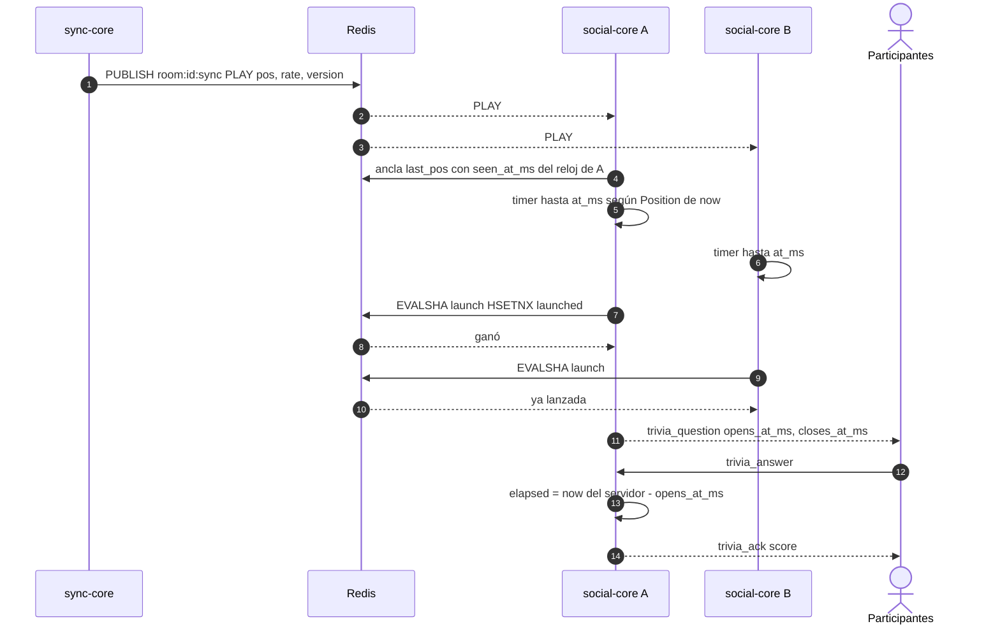

# ADR 0012 — Trivia con el reloj del servidor y el ancla del recap

| Campo | Valor |
| :--- | :--- |
| **Estado** | Aceptada |
| **Fecha** | 2026-10-11 |
| **Dominios afectados** | `services/social-core`, `apps/web` |

## Contexto
El host programa preguntas de trivia en un **momento del vídeo** (`at_ms`) y la pregunta debe salir cuando la sala llega ahí, para todos a la vez y una sola vez aunque haya varias réplicas. El puntaje premia la velocidad (hasta 10 s), así que el tiempo de respuesta tiene que medirse de forma justa. Dos restricciones:
- social-core **no** es dueño de la reproducción (eso es sync-core, [ADR 0002](0002-reloj-maestro-autoritativo-en-sync-core.md)) y no debe emitir comandos.
- Lección del AGENTS raíz: "**No compares relojes distintos** (cliente vs. servidor)": un navegador adelantado perdía el chat en silencio (bug B5, `ceed848`).

## Decisión
1. **Posición de la sala sin preguntarle a sync-core:** social-core ya escuchaba en solo lectura los comandos de `room:{id}:sync` para el recap. Guarda el último como ancla en `room:{id}:recap:last_pos` (`pos`, `status`, `rate`, `updated_at_ms`, `version`) **más `seen_at_ms`, el reloj de social-core al procesar el evento**. La posición proyectada es `recap.Store.Position(now) = pos + (now − seen_at_ms) × rate`. Nunca se usa `updated_at_ms` (reloj de sync-core) para proyectar.
2. **Disparo:** cada réplica con clientes en la sala mantiene un timer hacia la próxima pregunta pendiente con `at_ms ≥ posición`, solo si se reproduce; se rearma con cada evento de sync, al programar o borrar y al entrar alguien. Al vencer, el Lua `launch` (`HSETNX launched`) deja que **una sola réplica** emita `trivia_question` (sin `correct`). Un `SEEK` que salta la marca no la dispara; si el timer vence con la posición más de 1 s por debajo de la marca, se rearma.
3. **Tiempo de respuesta:** `elapsed = now(servidor) − opens_at_ms`. El reloj del cliente no interviene; `trivia.Score` da 0 si falla y 1000 + bono lineal de hasta 1000 si acierta en 10 s.
4. **Cierre:** a `closes_at_ms`, `HSETNX closed` deja que una réplica emita `trivia_result`; cada réplica lo personaliza con `my_score`/`my_total` para sus conexiones. Rankings en Sorted Sets con desempate por la respuesta más temprana.
5. **Web:** la cuenta regresiva se ancla al reloj local de **llegada** del mensaje más `closes_at_ms − opens_at_ms`, sin comparar relojes; solo es informativa.

## Alternativas consideradas
| Alternativa | Por qué no |
| :--- | :--- |
| Que sync-core dispare la trivia | Viola los límites de dominio: sync-core no procesa trivias. |
| Que el navegador del host avise "llegamos a `at_ms`" | Depende de que el host esté conectado y confía en el cliente. |
| Proyectar con `updated_at_ms` de sync-core | Compara el reloj de sync-core con el de social-core; cualquier desfase entre máquinas adelantaría o atrasaría la pregunta. |
| Medir la respuesta con `occurred_at` del cliente | Reloj del cliente: manipulable y con desfase (lección B5). |

## Consecuencias
**Positivas**
- Disparo y puntaje justos y consistentes entre réplicas, sin coordinación extra con sync-core.
- Reutiliza el ancla y la suscripción que ya existían para el recap.

**Negativas**
- Solo se ven los eventos de sync mientras alguna réplica tiene clientes en la sala.
- Las preguntas son de la **sala**, no del vídeo: tras un `LOAD`, las pendientes siguen programadas por posición.
- `trivia_ack` devuelve el puntaje al instante, así que revela si se acertó antes del cierre (la web no lo muestra).

**Riesgos**
- Si se pierde un evento de sync, la proyección se desvía hasta el siguiente (se mitiga con la guarda de 1 s).
- Depende del formato de los comandos de sync-core en `room:{id}:sync`, que es un contrato compartido.

## Referencias
- Código: `services/social-core/internal/recap/store.go` (`Position`, `syncScript`), `services/social-core/internal/trivia`, `apps/web/src/components/quiz/TriviaPanel.tsx`
- Documentos: [social-core/AGENTS.md § Trivias](../../services/social-core/AGENTS.md#protocolo-del-canal-social), [arquitectura §5](../arquitectura.md#5-contratos-compartidos-entre-dominios), [bug-hunting B5](../bug-hunting-2026-10.md)
- Commits: `3529b07` feat(social-core): posición proyectada del vídeo desde el ancla del recap · `b2cfbf9` feat(social-core): almacén Redis de trivias programadas · `b8e04df` feat(social-core): trivias por WebSocket disparadas por la posición del vídeo · `ceed848` fix(social-core): no descarta chat ni reacciones si el reloj del cliente va adelantado · `2dae19a` feat(web): agrega la trivia sincronizada con el vídeo
