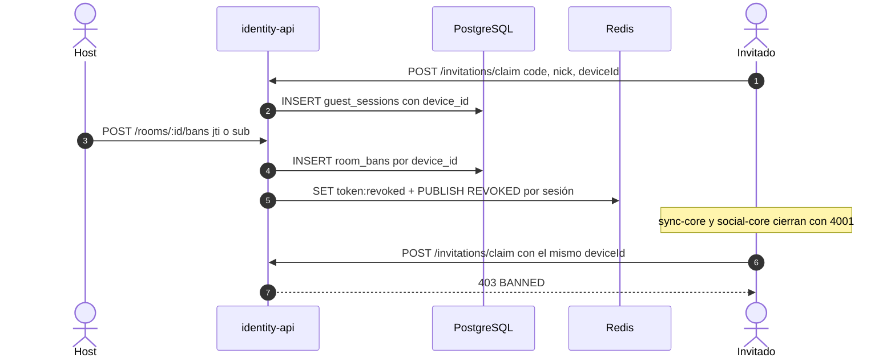

# ADR 0013 — Bloqueo de invitados por dispositivo

| Campo | Valor |
| :--- | :--- |
| **Estado** | Aceptada |
| **Fecha** | 2026-10-11 |
| **Dominios afectados** | `services/identity-api`, `apps/web` (sync-core y social-core sin cambios) |

## Contexto
Retirar a un invitado ([ADR 0007](0007-revocacion-por-clave-redis-y-cierre-4001.md)) corta su sesión, pero puede volver a entrar con el mismo link: cada `POST /invitations/claim` crea un `sub` nuevo (`guest:<uuid>`). Los invitados son **anónimos** por diseño (link + apodo, sin cuenta), así que no hay una identidad de persona a la que atar un bloqueo.

## Decisión
Bloquear **por navegador** con un identificador que elige el cliente:

- La web genera `tint_device_id` (`crypto.randomUUID`, guardado con `safeStorage` en `localStorage`) y lo envía como `deviceId` en `POST /invitations/claim`; identity-api lo guarda en `guest_sessions.device_id` (migración `0007`).
- `POST /rooms/:id/bans` acepta `{ jti }` (desde el panel de participantes) o `{ sub }` (desde el chat): inserta una fila en `room_bans` por cada `device_id` de las sesiones del invitado (único `(room_id, device_id)`, `ON CONFLICT DO NOTHING`) y **después** revoca todas sus sesiones vigentes por la vía de siempre (`token:revoked:{jti}` + `REVOKED`). Si Redis falla → 503, con el ban ya guardado; repetir es idempotente.
- Un claim con un `deviceId` bloqueado responde **403 `{ error: "BANNED" }`**; la web muestra "El host te bloqueó en esta sala".
- `GET /rooms/:id/bans` y `DELETE /rooms/:id/bans/:banId` para listar y desbloquear. Nunca se exponen `device_id` ni `sub`.

## Alternativas consideradas
| Alternativa | Por qué no |
| :--- | :--- |
| Bloquear por IP | Penaliza a quien comparte red (casa, universidad, NAT móvil) y cambia con frecuencia; además es un dato personal. |
| Exigir cuenta a los invitados | Rompe la entrada sin fricción, que es parte del producto. |
| Huella del navegador (*fingerprinting*) | Invasiva y difícil de justificar ante la Ley 1581. |
| Revocar la invitación | Corta a todos los que usan ese link, no solo al invitado molesto. |

## Consecuencias
**Positivas**
- Corta la reentrada casual sin pedir datos personales ni cuenta.
- Reutiliza la revocación existente: sync-core y social-core no cambian.
- Falla cerrado: el ban se guarda antes de tocar Redis, así un 503 nunca deja entrar al invitado.

**Negativas**
- **No es un control de seguridad:** borrar los datos del navegador, una ventana privada, otro navegador u otro dispositivo generan un `deviceId` nuevo; el cliente también puede inventarlo.
- Un claim **sin** `deviceId` no se comprueba contra los bloqueos; las sesiones de clientes viejos sin `deviceId` solo quedan registradas por `sub` y no impiden volver.

**Riesgos**
- Que se perciba como una garantía. La limitación está documentada y aceptada en [usuarios-e-identidad §6.6](../usuarios-e-identidad.md#66-bloquear-a-un-invitado-por-dispositivo).

## Referencias
- Código: `services/identity-api/src/modules/bans/roomBans.repo.ts`, `services/identity-api/src/routes/v1.ts`, `apps/web/src/lib/deviceId.ts`, `apps/web/src/lib/bans.ts`
- Documentos: [usuarios-e-identidad §6.6](../usuarios-e-identidad.md#66-bloquear-a-un-invitado-por-dispositivo), [dominio-reproduccion § Retirar vs. bloquear](../dominio-reproduccion.md#retirar-vs-bloquear)
- Commits: `4bb3bc9` feat(identity-api): migración 0007 con room_bans, guest_sessions.device_id y videos.title · `23312c2` feat(identity-api): agrega bloqueo de invitados por dispositivo · `104d919` feat(web): permite bloquear y desbloquear invitados desde Participantes · `7bc779f` feat(web): envía el deviceId al canjear la invitación y avisa del bloqueo
