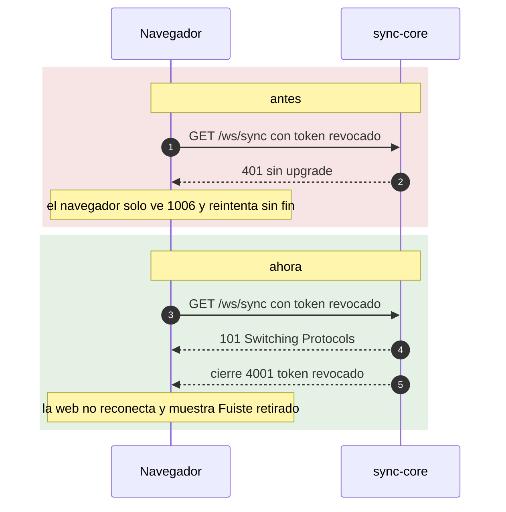

# ADR 0014 — Upgrade y cierre `4xxx` para estados terminales en el Canal Sync

| Campo | Valor |
| :--- | :--- |
| **Estado** | Aceptada (implementada en sync-core y la web; **pendiente en social-core**) |
| **Fecha** | 2026-10-11 |
| **Dominios afectados** | `services/sync-core`, `apps/web` (`services/social-core` como deuda conocida) |

## Contexto
Al principio sync-core rechazaba un token revocado con **401 antes del upgrade** del WebSocket. El navegador no expone el status HTTP de un handshake fallido: solo ve un cierre **`1006`**. La web, que reconecta ante `1006` con *backoff*, reintentaba **para siempre** y nunca mostraba "Fuiste retirado" (bug B11). Lección del AGENTS raíz: "**Rechazar antes del upgrade del WebSocket no le dice nada al navegador** (solo ve `1006` y reintenta): para estados terminales, haz upgrade y cierra con un código `4xxx`".

## Decisión
En `/ws/sync`, los estados **terminales** hacen upgrade y cierran de inmediato con un código de aplicación:

| Situación | Respuesta |
| :--- | :--- |
| Token revocado (`token:revoked:{jti}`) | Upgrade y cierre **`4001`** "token revocado" (sin `STATE`) |
| Token expirado pero bien firmado (`iss`, `aud`, sala y rol correctos) | Upgrade y cierre **`4003`** "token expirado" |
| Firma inválida, `iss`/`aud` incorrectos, algoritmo distinto de HS256 | `401` antes del upgrade (no se filtra información) |
| Token de otra sala | `403` antes del upgrade |
| `Origin` fuera de `ALLOWED_ORIGINS` | `403` (se comprueba **antes** de los cierres terminales) |
| Redis no permite comprobar la revocación | `503` (falla cerrado) |

En la web (`useSyncSocket`, `CLOSE_REVOKED = 4001`, `CLOSE_EXPIRED = 4003`): ante `4001` no reconecta, borra `tint_guest_token` y muestra el retiro; ante `4003` el invitado no reconecta y el host pide **un** sync-ticket nuevo (si se repite, se rinde).

## Alternativas consideradas
| Alternativa | Por qué no |
| :--- | :--- |
| Seguir con 401 y que la web consulte un endpoint HTTP tras cada `1006` | Una petición extra por reconexión y lógica frágil para adivinar el motivo. |
| Upgrade y un mensaje `ERROR` antes de cerrar | El código de cierre es más simple y fiable de leer en `onclose`; además `1008` ya se usa para clientes que no leen. |
| Hacer upgrade para **todos** los rechazos | Revelaría a un atacante si un token de otra sala o mal firmado es "casi válido"; por eso solo los estados terminales de un token bien firmado. |

## Consecuencias
**Positivas**
- El invitado retirado o con token caducado ve un mensaje claro en vez de "Reconectando…" eterno.
- Códigos estables (`4001`, `4003`) que forman parte del contrato del Canal Sync.

**Negativas**
- Un handshake terminal cuesta un upgrade completo.

**Riesgos (deuda conocida)**
- **social-core no cumple esta regla.** En `/ws/social`, un token revocado o expirado responde **401 antes del upgrade** (`services/social-core/internal/server/social.go`), sin cierre `4xxx`; solo cierra con `4001` las conexiones **ya abiertas** cuando llega un `REVOKED` (`revocation.go`). Además, `useSocialSocket` no distingue códigos de cierre y programa una reconexión ante cualquier cierre. En la práctica el Canal Sync (que sí cierra con `4001`/`4003`) lleva a la web a la pantalla terminal, pero el canal social puede seguir reintentando en segundo plano. Corregirlo exige un PR en social-core y otro en la web.

## Referencias
- Código: `services/sync-core/internal/ws`, `services/social-core/internal/server/social.go` y `revocation.go`, `apps/web/src/lib/syncProtocol.ts`, `apps/web/src/hooks/useSyncSocket.ts`, `apps/web/src/hooks/useSocialSocket.ts`
- Documentos: [sync-core/AGENTS.md § Conexión](../../services/sync-core/AGENTS.md#conexión), [dominio-reproduccion §6.6](../dominio-reproduccion.md#66-retirar-a-un-invitado-f5) y [§6.8](../dominio-reproduccion.md#68-ciclo-de-vida-de-una-conexión), [bug-hunting B11](../bug-hunting-2026-10.md), [AGENTS raíz § Lecciones aprendidas](../../AGENTS.md#lecciones-aprendidas-no-repetir)
- Commits: `213118d` fix(sync-core): cierra con 4001/4003 tras el upgrade a tokens revocados o expirados · `394b600` fix(web): trata el cierre 4003 (token caducado) como terminal en el Canal Sync · `e82ed0a` fix(web): corta la reconexión infinita con invitación revocada o sala ajena
