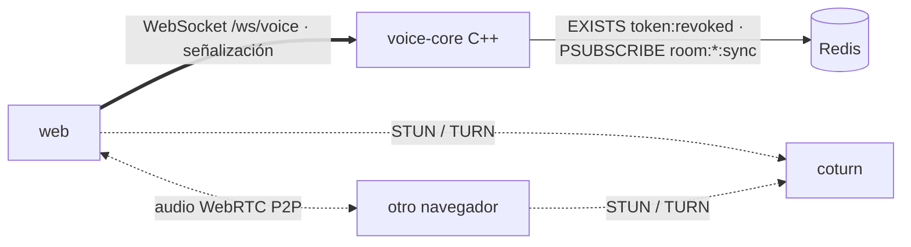

# ADR 0015 — Canal de Voz en un servicio C++ con WebRTC P2P

| Campo | Valor |
| :--- | :--- |
| **Estado** | Aceptada |
| **Fecha** | 2026-10-30 |
| **Dominios afectados** | `services/voice-core` (nuevo), infra (`docker-compose.yml`, CI), `apps/web` (Fase 4) |

## Contexto
Los participantes quieren hablar mientras ven el vídeo (HU-VOZ-01 a 06). La voz tiene que ser **su propio componente** (salas, membresía, moderación) y no puede afectar al Canal Sync ni al Canal Social si falla. El equipo decidió además usar un lenguaje que aún no estuviera en el monorepo (hoy: Go, TypeScript y Python, [ADR 0001](0001-monorepo-multilenguaje-por-dominio.md)). Las salas son de amigos: pocas personas hablando a la vez.

## Decisión
- **Servicio nuevo `services/voice-core` en C++23** (Boost.Beast/Asio, hiredis, nlohmann/json, OpenSSL), puerto **8085**, endpoint `/ws/voice`.
- **Audio P2P en malla (mesh) con WebRTC.** voice-core solo autoriza, lleva la membresía y reenvía la señalización (`signal`). Cupo por sala `VOICE_MAX_MEMBERS` (8).
- **Misma autorización que los otros canales:** JWT HS256 de identity-api ([ADR 0006](0006-tickets-jwt-hs256-emitidos-por-identity-api.md)), `EXISTS token:revoked:{jti}` con falla cerrado y `REVOKED` en vivo por `room:{id}:sync` ([ADR 0007](0007-revocacion-por-clave-redis-y-cierre-4001.md)); cierres `4001`/`4003` tras el upgrade ([ADR 0014](0014-upgrade-y-cierre-4xxx-para-estados-terminales.md)) y `4008` con la voz llena.
- **STUN/TURN con `coturn`** en compose y credenciales efímeras firmadas con `TURN_SECRET` (Fase 3).
- **Calidad:** GoogleTest, gcovr ≥ 85 %, ASan+UBSan y TSan en CI (job `C++ · voice-core`), `clang-format`.

## Alternativas consideradas
| Alternativa | Por qué no |
| :--- | :--- |
| SFU (Pion, mediasoup, LiveKit) | Escala a salas grandes, pero el servidor procesa audio: mucha más complejidad y pruebas para grupos de 2–8. Se puede revisar si crece el cupo. |
| Meter la voz en social-core | Rompe la separación de dominios (HU-VOZ-06) y una caída de la voz arrastraría al chat. |
| Rust en lugar de C++ | Igual de nuevo en el repo y con seguridad de memoria por diseño; el equipo eligió C++. Los sanitizers en CI cubren parte de ese riesgo. |
| Go (como sync-core) | No cumple el requisito de un lenguaje nuevo. |
| Librería de JWT (jwt-cpp) | Una dependencia más para tres verificaciones; el verificador propio tiene pruebas de firma, `alg`, `exp`, `iss`, `aud` y comparación en tiempo constante. |

## Consecuencias
**Positivas**
- La voz es un componente aislado: detenerlo no afecta a sync ni al chat.
- identity-api no cambia: se reutilizan tokens, revocación y bloqueo.
- El servidor no maneja audio: CPU y ancho de banda mínimos.

**Negativas**
- Un cuarto lenguaje y su toolchain (CMake, Boost) en el monorepo y en CI.
- Mesh: la subida de cada participante crece con *n − 1*.
- En P2P el servidor no puede cortar el audio de un cliente modificado: el silencio del host se aplica también en los receptores (Fase 2).

**Riesgos**
- Gestión de memoria manual: mitigado con ASan/UBSan/TSan obligatorios y `weak_ptr` en el Hub (la primera versión tenía un ciclo `Hub → sesión → Hub` que ASan detectó).
- Una sola réplica en la Fase 1 (membresía en memoria).

## Referencias
- Código: `services/voice-core/src/net/server.cpp`, `src/hub/hub.cpp`, `src/net/handshake.cpp`, `src/redis/revocation.cpp`
- Documentos: [dominio-voz](../dominio-voz.md), [voice-core/AGENTS.md](../../services/voice-core/AGENTS.md)
