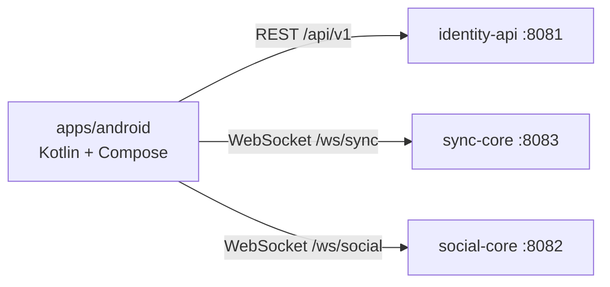

# ADR 0016 — App Android nativa en Kotlin

| Campo | Valor |
| :--- | :--- |
| **Estado** | Aceptada |
| **Fecha** | 2026-10-31 |
| **Dominios afectados** | `apps/android` (nuevo), infra (job de CI); backend sin cambios |

## Contexto
Los tickets AND-01 a AND-09 piden una app Android que haga lo mismo que la web: iniciar sesión con Google, unirse a una sala por link o código, ver el vídeo sincronizado, chat, reacciones y trivia (y, cuando exista su backend, transmisión en vivo y voz). Hasta ahora el monorepo solo tenía `apps/web` y los servicios, sin código móvil ni decisión sobre el stack.

Restricciones: el backend no se toca (AND-08: mismas rutas y mismos WebSockets que la web), la sincronía fina del reproductor y el micrófono dependen de APIs nativas, y el equipo ya había acordado usar Kotlin.

## Decisión
App **nativa en Kotlin** con Jetpack Compose en `apps/android` (un dominio más del monorepo, [ADR 0001](0001-monorepo-multilenguaje-por-dominio.md)).

- **Red:** OkHttp para REST y WebSocket; `kotlinx.serialization` con `ignoreUnknownKeys = true`, de modo que añadir un campo a una respuesta no rompe a la app (AND-08 AC2).
- **Mismos contratos que la web:** identity-api `/api/v1` (`ApiClient`, espejo de `apps/web/src/lib/api.ts`), Canal Sync v2 en `/ws/sync` y Canal Social en `/ws/social`, con el token en la query. Sin subprotocolo `tint.sync.msgpack`: el Canal Sync cae a JSON.
- **Credenciales:** mismas claves que la web (`tint_token` del host, `tint_guest_token`) y un `tint_device_id` propio (UUID persistente) para el bloqueo por dispositivo ([ADR 0013](0013-bloqueo-de-invitados-por-dispositivo.md)).
- **URLs configurables por compilación** (`-PtintIdentityApiUrl`, `-PtintSyncWsUrl`, `-PtintSocialWsUrl`, valores por defecto en `gradle.properties`); en pruebas locales con tablet, `adb reverse` de los puertos 8081 a 8083.
- **Calidad:** JUnit + MockWebServer, cobertura con Kover (mínimo 85 %, excluye solo la capa fina de Android/Compose) y un job `android` en el CI que ejecuta pruebas y construye el APK de debug.

## Alternativas consideradas
| Alternativa | Por qué no |
| :--- | :--- |
| Capacitor sobre `apps/web` | Reutiliza casi todo, pero el reproductor sincronizado y la voz quedarían en un WebView; el equipo ya había acordado Kotlin. |
| TWA / PWA | Exige un dominio público con HTTPS, que hoy no existe, y no da acceso a plugins nativos. |
| Kotlin Multiplatform / Flutter | Añade un toolchain nuevo sin ganancia: la lógica de negocio es del backend y el cliente web ya cubre el resto de plataformas. |

## Consecuencias
**Positivas**
- Control nativo del reproductor (Media3) para corregir el drift y del micrófono para la voz.
- El backend no cambia: la app es un cliente más de los contratos existentes.

**Negativas**
- Hay que portar a Kotlin la lógica de cliente de la web (protocolo Sync v2, social, trivia) y mantener ambas implementaciones alineadas cuando cambie un contrato (los contratos compartidos exigen actualizar los dos lados).
- Un toolchain más (JDK 17, Android SDK) en CI y en las máquinas de desarrollo.

**Riesgos**
- Los tokens se guardan en `SharedPreferences` sin cifrar, igual que la web usa `localStorage`; revisar `EncryptedSharedPreferences` antes de publicar.
- La transmisión en vivo (AND-06) no tiene backend: queda condicionada a que exista. La voz (AND-07) ya tiene `voice-core` ([ADR 0015](0015-voice-core-en-cpp-con-webrtc-p2p.md)) y falta el cliente móvil, que exigiría WebRTC nativo; no se ha revisado si su contrato sirve tal cual.
- Los WebSockets limitan `ALLOWED_ORIGINS`; el cliente nativo no envía `Origin`. Verificado (2026-10-31): un cliente OkHttp sin `Origin` conecta a sync-core desplegado por `wss://`.

## Referencias
- Código: `apps/android/`
- Documentos: [`docs/arquitectura.md`](../arquitectura.md), [`apps/android/AGENTS.md`](../../apps/android/AGENTS.md)
- Tickets: AND-01 a AND-09 (#9 a #17 del tablero TINT-KanbanTable)
