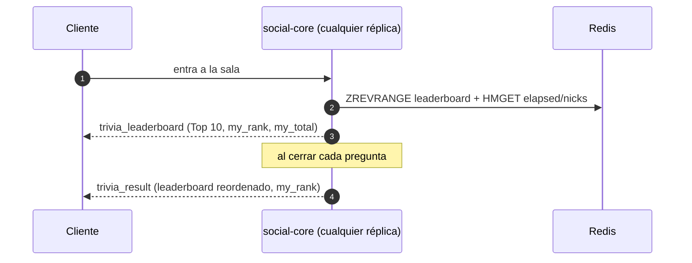

# ADR 0016 — Ranking de trivia persistente y desempate por tiempo acumulado

| Campo | Valor |
| :--- | :--- |
| **Estado** | Aceptada |
| **Fecha** | 2026-10-31 |
| **Dominios afectados** | `services/social-core`, `apps/web` |

## Contexto
La HU "ver un ranking en vivo" pide que el ranking se reordene al cambiar los puntos, que un empate lo gane quien acertó antes y que sobreviva a un reinicio del servicio. Hasta ahora el acumulado solo se veía en el popup de resultado (y desaparecía al cerrarlo), y su desempate lo decidía Redis por el nombre del miembro, no por la velocidad. Restricciones:
- Avisar de cada respuesta revelaría quién acertó antes del cierre ([ADR 0012](0012-trivia-con-reloj-del-servidor-y-ancla-del-recap.md): el `trivia_ack` tampoco dice si acertó).
- Las réplicas de social-core no comparten memoria: cualquier estado del ranking debe estar en Redis.

## Decisión
1. **Persistencia:** el acumulado ya vive en `room:{id}:trivia:leaderboard` (ZSET, TTL 12 h + 1 h). Al entrar, cada cliente recibe `trivia_leaderboard` (Top 10, `my_rank`, `my_total`) si la sala ya tiene puntos; una réplica recién reiniciada lo lee de Redis, no de memoria.
2. **Actualización:** el ranking se reordena en cada `trivia_result` (el cierre de la pregunta), que ahora lleva también `my_rank`. No se emite por respuesta, para no filtrar aciertos mientras la pregunta está abierta.
3. **Desempate:** el script Lua `answer` suma en `room:{id}:trivia:elapsed` (Hash) el tiempo de respuesta de cada respuesta **correcta**. `Store.TotalTop` y `Store.Ranks` ordenan por puntos descendentes y, a igualdad, por menor tiempo acumulado (quien acertó antes); el id fija el orden si todo empata. Se ordena en Go porque un ZSET no puede llevar ese desempate sin perder precisión con puntos y milisegundos juntos.
4. **Web:** `useSocialSocket` expone `triviaLeaderboard`, independiente de la pregunta en pantalla, y `TriviaPanel` lo muestra a todos (invitados y host) de forma permanente.

## Alternativas consideradas
| Alternativa | Por qué no |
| :--- | :--- |
| Emitir el ranking tras cada respuesta | Revela quién acertó antes del cierre y multiplica los mensajes por sala. |
| Fracción de desempate dentro del puntaje del ZSET acumulado | Un `double` no distingue milisegundos con puntos de cinco o seis cifras. |
| Desempatar por el instante del último acierto | Dos aciertos en el mismo milisegundo empatan; la suma de tiempos es determinista. |
| Guardar el ranking en memoria de la réplica | Se pierde al reiniciar y cada réplica vería uno distinto. |

## Consecuencias
**Positivas**
- El ranking está siempre visible y sobrevive a reinicios; el orden de un empate es justo y reproducible.

**Negativas**
- Cada lectura del acumulado trae todo el ZSET y lo ordena en Go: bien para salas de decenas o cientos de jugadores, no para miles.
- Un jugador que falla todo entra al ranking con 0 puntos (como antes), al final.

## Referencias
`services/social-core/internal/trivia/store.go` (`ranking`, `TotalTop`, `Ranks`), `internal/server/trivia.go` (`sendLeaderboardOnJoin`, `deliverTriviaResult`), `apps/web/src/components/quiz/TriviaPanel.tsx` (`LiveLeaderboard`).
