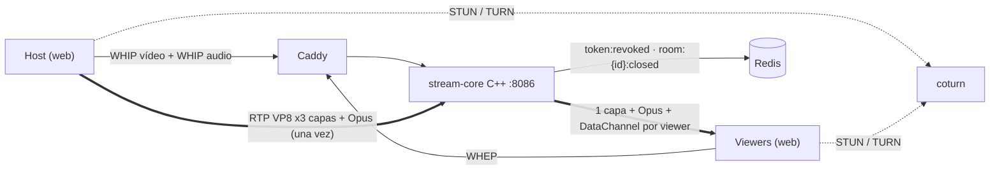

# ADR 0018 — Transmisión en vivo con un SFU propio en C++ sobre libdatachannel

| Campo | Valor |
| :--- | :--- |
| **Estado** | Propuesta (pendiente de los spikes S1–S5 de [dominio-transmision §9](../dominio-transmision.md#9-fase-0-spikes)) |
| **Fecha** | 2026-11-01 |
| **Dominios afectados** | `services/stream-core` (nuevo), infra (`docker-compose.yml`, `gateway/Caddyfile`, CI, `Makefile`), `apps/web` |

## Contexto
El host quiere transmitir su pantalla (cámara opcional y audio del PC) a toda la sala, casi en tiempo real (HU-LIVE-01 a 07). En el mesh P2P de voice-core ([ADR 0015](0015-voice-core-en-cpp-con-webrtc-p2p.md)), cada participante envía una copia de su señal a cada uno de los otros *n − 1*. Con vídeo de 2.5 Mbps y 50 viewers, el host tendría que subir 125 Mbps. Las HU piden lo contrario:
- el host sube **una sola vez** y su subida no cambia con la audiencia (HU-LIVE-02 AC2, HU-LIVE-04 AC1);
- la calidad **baja por viewer** cuando cae su ancho de banda (HU-LIVE-02 AC3);
- un error claro cuando la sala está llena (HU-LIVE-04 AC3).

ADR 0015 ya dejó escrito que un SFU sería una decisión nueva.

Hay dos restricciones más:
- la señalización es **HTTP a través del gateway** (R8, HU-LIVE-06);
- el servicio es **C++ sobre una librería WebRTC existente** (HU-LIVE-07).

## Decisión
- **Servicio nuevo `services/stream-core`**:
  - C++23, mismo estilo que voice-core: Boost.Beast/Asio, hiredis, nlohmann/json, OpenSSL, GoogleTest, gcovr ≥ 85 %, ASan/UBSan y TSan.
  - Usa **[libdatachannel](https://github.com/paullouisageneau/libdatachannel) `v0.24.6`** (ICE/DTLS/SRTP y pistas RTP), incorporada con `FetchContent` porque no está empaquetada en Debian ni en Ubuntu.
  - HTTP en **8086**. Media UDP en **un solo puerto** con ICE UDP mux (`STREAM_UDP_PORT`); el candidato host se reescribe a `STREAM_PUBLIC_IP`.
- **SFU de reenvío**: no decodifica ni transcodifica.
  - **Vídeo VP8 con simulcast de 3 capas**:
    - `h` 1080p30 a 2.5 Mbps;
    - `m` 720p30 a 0.8 Mbps;
    - `l` 360p15 a 0.25 Mbps.
  - Por cada viewer, el SFU elige la capa según la pérdida de los RR y el REMB, con histéresis. Solo cambia de capa en un keyframe. Reescribe SSRC, `seq`, `timestamp`, PT y PictureID para que la secuencia sea continua.
  - Las retransmisiones (NACK) salen de un anillo **por capa** que comparten todos los viewers. Se manda como máximo un PLI por segundo y por capa.
  - **Audio Opus estéreo** (128 kbps) en una **segunda sesión WHIP** del host. libdatachannel solo enruta el simulcast por `rid` (sin `a=ssrc`) cuando la PeerConnection tiene una sola pista.
- **Señalización WHIP/WHEP** en `/api/v1/stream/*`, publicada por Caddy (`@stream_api`, antes de `@identity`):
  - `POST` con la oferta SDP → `201` con la respuesta SDP, `Location` y `Link rel="ice-server"` con credenciales TURN efímeras;
  - `PATCH` para trickle ICE (un ICE restart responde `405` y el cliente hace un POST nuevo);
  - `DELETE` para cerrar.
- **Autorización como el resto**:
  - JWT HS256 de identity-api ([ADR 0006](0006-tickets-jwt-hs256-emitidos-por-identity-api.md));
  - `EXISTS token:revoked:{jti}` con falla cerrado ([ADR 0007](0007-revocacion-por-clave-redis-y-cierre-4001.md));
  - publicar exige `role=host`.
- **Avisos al cliente** (`stream_state`, `viewer_count`, `host_stats`, `scene`): por un **DataChannel** negociado (`id=0`) dentro de la misma sesión WebRTC.
- **Capacidad**: `STREAM_MAX_VIEWERS=50` por sala y una réplica. El viewer 51 recibe `409 ROOM_FULL`.

## Alternativas consideradas
| Alternativa | Por qué no |
| :--- | :--- |
| Ampliar el mesh de voice-core | La subida del host crece con *n − 1*: incumple HU-LIVE-02 AC2 y HU-LIVE-04 AC1. |
| mediasoup (crate de Rust o worker de C++) | Resuelve simulcast y BWE, pero nuestro código quedaría en Rust (la HU pide C++), o tendríamos que hablar con el canal FlatBuffers del worker, que no es una API pública estable. |
| Google libwebrtc | Build de horas con depot_tools, imagen enorme y una API difícil de aislar para TDD. |
| Janus / GStreamer `webrtcbin` | Janus es un servidor en C, no una librería C++. GStreamer es pesado y GObject. |
| Señalización por REST propio en JSON | WHIP/WHEP es estándar (RFC 9725 / borrador WHEP), encaja con R8 y deja abierta la puerta a OBS. |
| SVC (VP9/AV1) | Más eficiente, pero con menos soporte (Safari) y un parseo del payload más complejo. |

## Consecuencias
**Positivas**
- La subida del host es constante (~3.6 Mbps con audio) sin importar la audiencia.
- La CPU del SFU es baja (~12.5k cifrados SRTP/s con 50 viewers en `h`). El cuello de botella es el egreso de red (≤ 125 Mbps).
- Las piezas puras (RTP, RTCP, VP8, selector, reescritor, SDP, máquina de estados) se prueban sin red.

**Negativas**
- Nosotros mantenemos el reenvío RTP, el selector de capas y el control de keyframes.
- libdatachannel no genera transport-cc: la estimación depende de REMB y de la pérdida en los RR.
- El host abre dos PeerConnections (vídeo y audio). La sincronía labial depende de los RTCP SR.
- Una réplica: membresía en memoria.

**Riesgos**
- Que Chrome no suba las capas altas sin transport-cc (spike S1).
- El bug de dirección `rid`/`simulcast` en la respuesta SDP de libdatachannel (se corrige con una función pura y fixtures reales).
- Un solo hilo de recepción mux como cuello de botella (spike S2).
- Sin opción de IP anunciada en Docker (spike S3; plan B `network_mode: host`).
- Carreras entre el hilo de ingesta, los NACK y el plano de control. Se mitigan con un escritor por estado, instantáneas inmutables y TSan.

## Referencias
- Documentos: [dominio-transmision](../dominio-transmision.md), [ADR 0019](0019-salas-live-y-cierre-room-closed.md), [ADR 0015](0015-voice-core-en-cpp-con-webrtc-p2p.md)
- Código: `services/stream-core/` (previsto)
