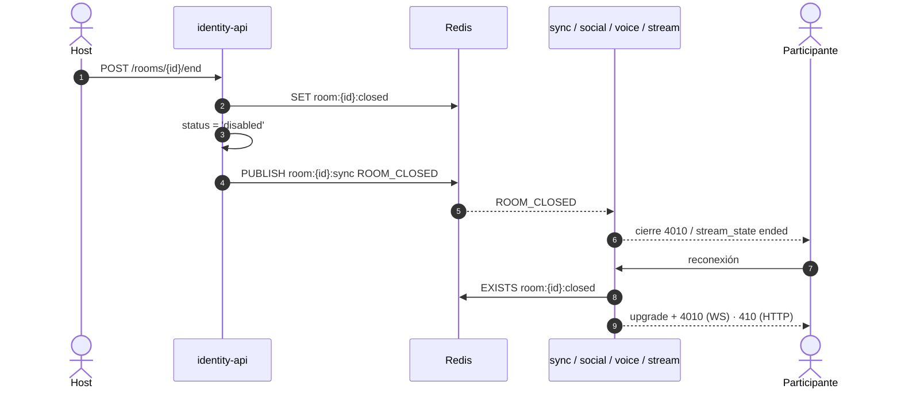

# ADR 0019 — Salas `live` y cierre de sala `ROOM_CLOSED` en todos los servicios

| Campo | Valor |
| :--- | :--- |
| **Estado** | Propuesta |
| **Fecha** | 2026-11-01 |
| **Dominios afectados** | `services/identity-api`, `services/stream-core`, `services/sync-core`, `services/social-core`, `services/voice-core`, `apps/web` |

## Contexto
Cuando el host termina la transmisión, la sala tiene que quedar **deshabilitada en todos los servicios** (HU-LIVE-05, 08 y 09).

Hoy ningún servicio sabe que una sala terminó:
- `DELETE /rooms/:id` solo revoca uno a uno los guest tokens (`REVOKED` → `4001`). El token del host nunca se revoca.
- Los `DELETE /internal/events/start/{id}` de sync-core y social-core no cierran nada.
- La web confunde "terminó" con "te retiraron".
- social-core rechaza tokens caducados o revocados con `401` **antes** del upgrade, en contra del [ADR 0014](0014-upgrade-y-cierre-4xxx-para-estados-terminales.md).

Además, una sala de transmisión no tiene vídeo sincronizado, y la voz *mesh* (cupo de 8) no sirve para 50 espectadores.

## Decisión
- **Tipo de sala** `rooms.kind ∈ {'watch','live'}` (migración 0009, por defecto `'watch'`). Solo las salas `live` tienen transmisión y se deshabilitan al terminarla. En `live` la web no abre `/ws/sync`, y `POST /events/start` registra stream-core en lugar de sync-core.
- **Estado terminal** `rooms.status = 'disabled'`. **identity-api es el único escritor**:
  - `POST /api/v1/rooms/{id}/end`: lo llama el host.
  - `POST /api/v1/internal/rooms/{id}/disable`: lo llama stream-core cuando vence la gracia del host. Exige `X-Internal-Token` (`INTERNAL_API_SECRET`). Caddy responde `404` a `/api/v1/internal/*`, salvo `auth/check`.
  - Los dos hacen, en este orden: `SET room:{id}:closed 1` (sin TTL), `UPDATE rooms SET status='disabled'`, `PUBLISH room:{id}:sync {"type":"ROOM_CLOSED","room_id","reason","event_id","occurred_at"}` y `XADD analytics:events room_closed reason=host_closed|grace_expired`. Si Redis falla, responden `503` y se puede reintentar. Una segunda llamada responde `409`.
- **Consumidores**: sync-core, social-core, voice-core y stream-core leen `ROOM_CLOSED` del canal `room:{id}:sync` (el mismo que ya leen para `REVOKED`):
  - cierran todas las conexiones de la sala con el código **`4010` ROOM_DISABLED**;
  - en cada handshake nuevo consultan `EXISTS room:{id}:closed` (con falla cerrado: `503`) y, si existe, hacen upgrade y cierran con `4010` ([ADR 0014](0014-upgrade-y-cierre-4xxx-para-estados-terminales.md));
  - stream-core responde `410 ROOM_DISABLED` a WHIP/WHEP;
  - social-core además hace upgrade y cierra con `4001`/`4003` donde hoy responde `401`.
- **HTTP**: una sala deshabilitada responde **`410 {error:"Disabled"}`** en `POST /invitations/claim`, `GET /rooms/:id/playback` y en las rutas con `requireActiveRoom`. Siguen abiertos `analytics-ticket`, los KPIs y `GET /api/v1/social/rooms/{id}/chat`; este último es nuevo, solo lo usa el host, y lee mientras duren las claves de Redis (12 h).
- **No se reactiva**: `POST /rooms/{id}/reactivate` responde `409`, y la UI ofrece crear un evento nuevo.
- **Gracia del host**: **60 s** (`STREAM_HOST_GRACE_S`, configurable de 10 a 300) antes de que stream-core pida deshabilitar la sala.
- **Voz en salas `live`: modo escenario.** Solo entran a voice-core el host y los invitados al escenario:
  - el host invita o retira con `PUT/DELETE /api/v1/voice/rooms/{id}/stage/{user_id}`, que escribe el SET de Redis `room:{id}:voice:stage`;
  - voice-core identifica las salas live por `room:{id}:kind=live`, que escribe identity-api;
  - cualquier otro participante recibe upgrade y cierre **`4009` NOT_ON_STAGE**;
  - la audiencia oye a los invitados porque el host los mezcla en el audio del stream.

## Alternativas consideradas
| Alternativa | Por qué no |
| :--- | :--- |
| Orquestación HTTP (`POST /internal/rooms/{id}/close` a cada servicio) | Si un servicio está caído hay que reintentar y compensar, y quien se conecta después no se entera. |
| Que stream-core escriba el estado de la sala | Habría dos escritores de `rooms.status` y se rompe la fuente de verdad. |
| Revocar todos los `jti` de la sala | No alcanza a los tickets del host (no se guardan) y el cliente no distingue "retirado" de "terminado". |
| `403` para una sala deshabilitada | Se confunde con `BANNED` y con la pantalla `/403`. `410` es coherente con el `Deleted` actual. |

## Consecuencias
**Positivas**
- Un solo mensaje cierra todo. La clave `room:{id}:closed` cubre a quien llega tarde y a quien se reconecta (HU-LIVE-08 AC3).
- La web distingue "evento terminado" (`4010`/`410 Disabled`) de "retirado" (`4001`).

**Negativas**
- Cambian contratos compartidos en cinco dominios: hacen falta varios PRs con orden de merge.
- El historial de chat de una sala deshabilitada solo se puede leer durante 12 h.

**Riesgos**
- Un servicio que no implemente `4010` deja conexiones vivas. Se mitiga con pruebas en cada dominio y el E2E de cierre.

## Referencias
- Documentos: [dominio-transmision](../dominio-transmision.md), [ADR 0018](0018-stream-core-sfu-cpp-con-libdatachannel.md), [ADR 0014](0014-upgrade-y-cierre-4xxx-para-estados-terminales.md), [ADR 0007](0007-revocacion-por-clave-redis-y-cierre-4001.md)
