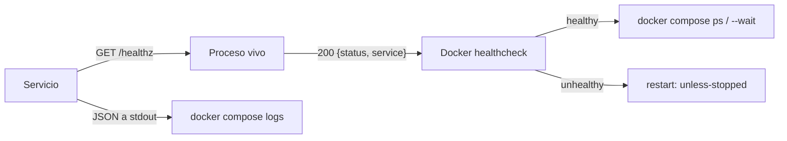

# ADR 0021 — Salud y logs uniformes para operar los contenedores

| Campo | Valor |
| :--- | :--- |
| **Estado** | Aceptada |
| **Fecha** | 2026-11-02 |
| **Dominios afectados** | Todos los servicios, `apps/web`, infraestructura |

## Contexto

R10 exige un despliegue orientado a contenedores y el NFR de observabilidad pide que **cada servicio exponga un endpoint de salud y escriba sus logs a stdout**, con niveles configurables. Sin un contrato común, la historia OPS-04 (#89) no se puede verificar: cada servicio respondía distinto (`/api/v1/healthz` en identity-api, `/healthz` en el resto), varios contenedores no tenían healthcheck en Compose (voice-core, stream-core, coturn), media-worker solo comprobaba que el PID 1 existiera y los logs mezclaban texto libre, `stderr`, JSON parcial y `console.*` sin nivel.

El estado previo, verificado en el repositorio:

| Servicio | Salud antes | Logs antes | Healthcheck en Compose |
| :--- | :--- | :--- | :--- |
| gateway | `/healthz` con body vacío | JSON a stdout, sin nivel configurable | sí |
| web | `/` (SPA) | nginx por defecto | sí |
| identity-api | `/api/v1/healthz` con `service` | `console.*` sin nivel | sí |
| sync-core | `/healthz` con `service` | `log.Printf` a `stderr` | sí |
| social-core | `/healthz` con `service` | `log.Printf` a `stderr` | sí |
| analytics | `/healthz` sin `service` | JSON, INFO fijo, `stderr` | sí |
| media-worker | ninguno | texto a `stderr` | solo `os.kill(1, 0)` |
| voice-core | `/healthz` sin `service` | `std::cout`/`std::cerr` sueltos | no |
| stream-core | `/healthz` con `service` | JSON parcial en `main.cpp` | no |
| coturn | no aplica | `--log-file=stdout` | no |

## Decisión

### 1. `/healthz` es *liveness*, no *readiness*

Cada servicio de aplicación expone `GET /healthz` y responde `200` con:

```json
{"status":"ok","service":"<nombre>"}
```

identity-api conserva `GET /api/v1/healthz` (contrato público existente) y añade un alias interno `GET /healthz` para que la sonda del contenedor no dependa del prefijo de la API.

`/healthz` comprueba **solo** que el proceso vive y puede atender HTTP. No consulta PostgreSQL, Redis, MinIO ni MongoDB. Un fallo de una dependencia compartida no debe reiniciar en cascada servicios que todavía pueden servir (por ejemplo, el chat sigue funcionando sin analítica).

media-worker no tenía servidor HTTP: se añade uno interno en `MEDIA_WORKER_PORT` (por defecto `8088`) con un *heartbeat* que el bucle del consumidor actualiza en cada iteración. Si el consumidor se atasca o muere, `/healthz` responde `503`.

coturn no habla HTTP: su healthcheck usa `turnutils_stunclient -p 3478 127.0.0.1`, incluido en la imagen oficial.

### 2. Logs JSON a stdout

Todos los servicios de aplicación escriben una línea JSON por evento a **stdout**:

```json
{"timestamp":"2026-11-02T14:03:11.123Z","level":"info","service":"sync-core","message":"http_request","correlation_id":"a1b2","method":"GET","path":"/healthz","duration_ms":3}
```

Campos obligatorios: `timestamp` (RFC 3339 UTC con milisegundos), `level` (`debug|info|warn|error`), `service` y `message`. El contexto (`correlation_id`, `method`, `path`, `duration_ms`, `error`) es opcional. Los logs de acceso de Caddy y nginx también van a stdout y conservan `X-Correlation-ID`.

Los datastores (PostgreSQL, Redis, MinIO, MongoDB) conservan su formato nativo; `docker compose logs` ya los muestra.

### 3. Nivel configurable y fallo cerrado

| Variable | Servicios | Valores | Por defecto |
| :--- | :--- | :--- | :--- |
| `LOG_LEVEL` | identity-api, sync-core, social-core, analytics, media-worker, voice-core, stream-core | `debug|info|warn|error` (sin distinguir mayúsculas) | `info` |
| `GATEWAY_LOG_LEVEL` | gateway (Caddy) | idem | `INFO` |
| `NGINX_ERROR_LOG_LEVEL` | web (nginx) | `debug|info|notice|warn|error|crit` | `warn` |

Un valor inválido **impide el arranque** con un mensaje claro; no se ignora en silencio. `env-check` valida las tres variables antes de levantar el resto del stack para que una errata en `.env` no provoque un bucle de reinicios.

Cada lenguaje implementa el mismo contrato con su librería estándar, sin dependencias nuevas: `log/slog` en Go, un módulo `logging` en Python, un logger propio en TypeScript y otro en C++.

### 4. Healthchecks en Compose y en las imágenes

Todo servicio de larga duración declara `healthcheck` en `docker-compose.yml` y `HEALTHCHECK` en su `Dockerfile`, con la misma sonda. Los servicios de un solo uso (`env-check`, `minio-init`) no lo necesitan. `docker compose ps` muestra `(healthy)`/`(unhealthy)` y `docker compose up --wait` bloquea hasta que el stack está sano.



### 5. `/readyz` queda diferido

No se implementa en esta historia. Se documenta como limitación deliberada: la política de dependencias por servicio (qué debe estar disponible para considerarse *listo*) necesita una decisión propia, porque acoplar todos los dominios a Redis o PostgreSQL convertiría un fallo parcial en un reinicio general.

## Alternativas consideradas

| Alternativa | Por qué no |
| :--- | :--- |
| Un `/readyz` con checks de PostgreSQL, Redis, MinIO y MongoDB en todos los servicios | Acopla dominios, provoca reinicios en cascada y hace que el arranque de Compose sea frágil. Se pospone. |
| Un único endpoint `/healthz` gestionado solo por el gateway | No verifica los procesos internos: un contenedor caído detrás de Caddy seguiría pareciendo sano. |
| Logs en texto libre con `LOG_LEVEL` | `docker compose logs` no permite filtrar por campo ni correlacionar peticiones entre servicios. |
| Una librería externa de logging por lenguaje (zap, pino, structlog, spdlog) | Añade dependencias y versiones que fijar sin mejorar el contrato; las librerías estándar bastan. |
| Healthchecks solo en los Dockerfiles | Compose no los usa para `depends_on: condition: service_healthy` ni para `--wait`; se declaran en ambos sitios. |

## Consecuencias

**Positivas**
- Un operador ve el estado de cada contenedor con `docker compose ps` y los logs con `docker compose logs <servicio>`.
- Los logs son legibles por máquina y comparten `correlation_id` con el gateway.
- El nivel se cambia sin reconstruir imágenes, solo con `.env`.
- media-worker deja de mentir cuando su consumidor se atasca.

**Negativas**
- Siete servicios repiten un logger pequeño; no hay librería compartida entre lenguajes.
- Un `LOG_LEVEL` inválido impide arrancar (intencional, pero exige validar `.env`).
- El stack completo tarda más en `--wait` por los `start_period` de los servicios lentos.

**Riesgos**
- `envsubst` de nginx puede borrar variables como `$uri` si se sustituye toda la plantilla. Se mitiga con `NGINX_ENVSUBST_FILTER=NGINX_ERROR_LOG_LEVEL`.
- coturn usa `network_mode: host`; su healthcheck no es fiable en Docker Desktop para Windows/macOS. El smoke lo omite fuera de Linux.
- El smoke completo reconstruye libdatachannel. En CI se usa un stack reducido y los jobs existentes de C++ cubren voice-core y stream-core.

## Referencias

- Código: `docker-compose.yml`, `gateway/Caddyfile`, `apps/web/nginx.conf`, `scripts/observability_smoke.py`.
- Documentos: [`docs/arquitectura.md`](../arquitectura.md), [`docs/dominio-transmision.md`](../dominio-transmision.md), [`docs/dominio-voz.md`](../dominio-voz.md).
- Requisitos: R10, NFR de observabilidad y mantenibilidad, OPS-04 (#89).
- Commits: `feat(infra): healthchecks y logs uniformes (OPS-04 #89)`.
