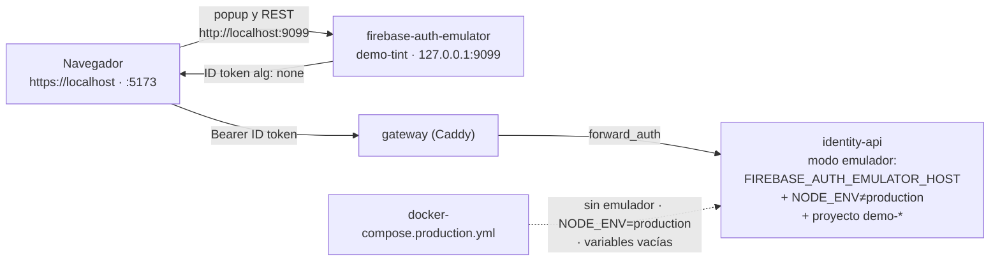

# ADR 0024 — Login local del host con el Firebase Auth Emulator

| Campo | Valor |
| :--- | :--- |
| **Estado** | Aceptada |
| **Fecha** | 2026-11-02 |
| **Dominios afectados** | Infraestructura (`docker-compose*.yml`, `firebase-auth-emulator/`, `.env.example`), `services/identity-api`, `apps/web` |

## Contexto
El host inicia sesión con Google vía Firebase Auth y identity-api verifica su ID token RS256 contra el JWKS de Google (`iss = https://securetoken.google.com/<FIREBASE_PROJECT_ID>`, `aud = FIREBASE_PROJECT_ID`). Con `cp .env.example .env && docker compose up -d --build` ([ADR 0023](0023-instrucciones-de-ejecucion-del-prototipo.md)) todo arrancaba, pero el login del host necesitaba un proyecto real de Firebase con sus credenciales: sin él no se podía crear una sala, y el prototipo no era verificable de punta a punta en local.

El **Firebase Auth Emulator** resuelve el login sin Google, pero sus ID tokens **no llevan firma** (`alg: none`, tercera parte vacía). La regla del repo es "nunca confíes en un token sin verificar su firma" ([AGENTS raíz](../../AGENTS.md#lecciones-aprendidas-no-repetir), bug hunting 2026-10). Aceptarlos es, por construcción, aceptar cualquier identidad que alguien escriba a mano: solo es admisible en desarrollo y con todas las salidas cerradas hacia producción.

La web nunca envía el ID token de Firebase a social-core: el host abre `/ws/social` y pide el historial con el **sync-ticket** HS256 (`useSocialSocket` con `role: 'host'`, `chatHistory.ts`). Por eso social-core no necesita aceptar tokens del emulador y no cambia.

## Decisión
1. **Servicio `firebase-auth-emulator` solo en el Compose de desarrollo.** Imagen propia `firebase-auth-emulator/Dockerfile`: `node:22-alpine` + `firebase-tools@15.34.0` (versión exacta, `ARG FIREBASE_TOOLS_VERSION`), usuario `node`, `firebase emulators:start --only auth --project "$FIREBASE_PROJECT_ID"` con `firebase.json` (Auth en `0.0.0.0:9099`, sin UI). El emulador de Auth es Node puro: no hace falta Java. Healthcheck sobre `GET /` (`"ready": true`). El puerto se publica **solo en loopback** (`127.0.0.1:9099:9099`): nadie de la LAN puede crear cuentas en él. La imagen se niega a arrancar si el proyecto no empieza por `demo-`.
2. **Proyecto de demostración `demo-tint`.** El prefijo `demo-` hace que el emulador no llame a Google. `.env.example` lo deja por defecto: `FIREBASE_PROJECT_ID=demo-tint`, `FIREBASE_AUTH_EMULATOR_HOST=firebase-auth-emulator:9099`, `VITE_FIREBASE_PROJECT_ID=demo-tint` y `VITE_FIREBASE_AUTH_EMULATOR_URL=http://localhost:9099`. `env-check` falla si hay emulador con un proyecto que no sea `demo-*`.
3. **identity-api acepta `alg: none` solo en modo emulador y falla cerrado** (`src/config/env.ts`, `src/modules/auth/firebaseToken.ts`):
   - El modo se activa **solo** si `FIREBASE_AUTH_EMULATOR_HOST` tiene valor (vacío = desactivado).
   - `parseEnv` **impide el arranque** si hay emulador y `NODE_ENV=production`, o si `FIREBASE_PROJECT_ID` no empieza por `demo-`.
   - `isAuthEmulatorEnabled()` repite esas tres condiciones en cada petición (defensa en profundidad).
   - Aun en modo emulador se exige `alg` exactamente `none` con firma vacía, `iss`, `aud`, `exp` vigente y `sub` no vacío. Los RS256 de Google se siguen verificando con el JWKS.
   - Fuera del modo emulador, un `alg: none` responde **401**, tanto en `requireAuthHost` como en `/internal/auth/check` (forward_auth del gateway). Hay pruebas explícitas de ambos casos.
   - Al arrancar en modo emulador se registra un `warn` visible en los logs.
   - El Compose de desarrollo fija `NODE_ENV: development` en identity-api (la imagen trae `production` por defecto).
4. **La web se conecta al emulador solo si se lo piden** (`apps/web/src/lib/authEmulator.ts`): con un origen http(s) en `VITE_FIREBASE_AUTH_EMULATOR_URL`, `connectAuthEmulator(auth, url, { disableWarnings: true })`; vacío o inválido = Firebase real. El navegador habla con el emulador **directamente** en `http://localhost:9099`, tanto desde `https://localhost` (gateway) como desde `http://localhost:5173`: los navegadores tratan `http://localhost` como origen de confianza, así que no hay bloqueo por contenido mixto. No se añade una ruta en Caddy: el gateway es también la entrada de producción y no debe conocer el emulador.
5. **`docker-compose.production.yml` cierra todas las salidas:** pone el emulador tras un perfil que nadie activa (`profiles: ["never-in-production"]`, así `up` no lo arranca y `config` no lo incluye) y sin puertos, fija `NODE_ENV: production` y `FIREBASE_AUTH_EMULATOR_HOST: ""` en identity-api y construye la web con `VITE_FIREBASE_AUTH_EMULATOR_URL: ""`. Aunque alguien volviera a definir la variable, identity-api no arrancaría. `gateway/tests/test_firebase_emulator.py` lo comprueba.

## Alternativas consideradas
| Alternativa | Por qué no |
| :--- | :--- |
| Pedir a cada evaluador un proyecto real de Firebase | Rompe el objetivo de ADR 0023 (clonar y verificar en < 15 min sin credenciales externas) y obliga a manejar claves reales en `.env` |
| Un "login de desarrollo" propio en identity-api (endpoint que emita tokens) | Añade una ruta de autenticación nueva que podría quedar viva en producción; el emulador reproduce el flujo real del SDK (`signInWithPopup`, renovación, `onIdTokenChanged`) sin código de producción adicional |
| Firmar los tokens del emulador con una clave local | El emulador no lo permite: siempre emite `alg: none` |
| Exponer el emulador por el gateway (rutas `/identitytoolkit.googleapis.com/*`, `/emulator/*`) | Mete rutas de desarrollo en la entrada de producción; el acceso directo a `http://localhost:9099` funciona desde HTTPS y HTTP |
| Imagen pública del emulador | No hay una oficial; las de terceros no fijan `firebase-tools` ni se auditan. La propia es pequeña y fija la versión exacta |
| Que social-core acepte también los tokens del emulador | La web le envía siempre el sync-ticket HS256 del host; ampliar la superficie sin necesidad contradice la regla |

## Consecuencias
**Positivas**
- `cp .env.example .env && docker compose up -d --build` deja el sistema completo usable, incluido el login del host, sin cuentas de Google.
- El flujo de la web es el mismo que en producción: solo cambia a dónde apunta el SDK.

**Negativas**
- En modo emulador cualquiera que alcance identity-api puede presentarse como cualquier host (los tokens no tienen firma). Se mitiga con el puerto del emulador en loopback y, sobre todo, con el fallo cerrado fuera de desarrollo.
- Para usar Firebase real en local hay que cambiar cuatro variables (`FIREBASE_PROJECT_ID`, `VITE_FIREBASE_*`, vaciar `FIREBASE_AUTH_EMULATOR_HOST` y `VITE_FIREBASE_AUTH_EMULATOR_URL`) y reconstruir la web.
- Las cuentas del emulador viven en memoria: se pierden al reiniciar el contenedor (las filas de `users` en PostgreSQL no).

**Riesgos**
- Que alguien despliegue el Compose de desarrollo sin el override de producción con el `.env` de ejemplo: el modo emulador quedaría activo. Por eso el emulador solo escucha en loopback, y `.env.example` lo explica. La protección fuerte es el override: con `NODE_ENV=production` identity-api no arranca.

## Referencias
- Código: `firebase-auth-emulator/Dockerfile`, `firebase-auth-emulator/firebase.json`, `docker-compose.yml` (`firebase-auth-emulator`, `env-check`, `identity-api`, `web`), `docker-compose.production.yml`, `services/identity-api/src/config/env.ts`, `services/identity-api/src/modules/auth/firebaseToken.ts`, `apps/web/src/lib/authEmulator.ts`
- Pruebas: `services/identity-api/tests/env.test.ts`, `services/identity-api/tests/firebaseEmulator.auth.test.ts`, `apps/web/src/lib/authEmulator.test.ts`, `gateway/tests/test_firebase_emulator.py`
- Documentos: [usuarios-e-identidad §4](../usuarios-e-identidad.md#4-esquemas-de-tokens), [README › Instrucciones de Ejecución del Prototipo](../../README.md#-instrucciones-de-ejecución-del-prototipo-ops-06)
