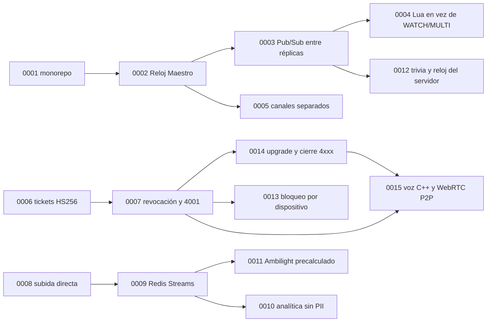

# 🧭 Decisiones de arquitectura (ADRs)

Un **ADR** (*Architecture Decision Record*) registra una decisión de arquitectura importante: el problema, lo que se decidió, qué otras opciones había y qué consecuencias trae. Sirve para que quien llegue después entienda **por qué** el sistema es como es antes de cambiarlo.

Cada ADR de esta carpeta se escribió a partir de evidencia del repositorio (código, `docs/`, la sección "Lecciones aprendidas" del [AGENTS raíz](../../AGENTS.md), el [bug hunting de 2026-10](../bug-hunting-2026-10.md) y `git log`). La fecha es la del commit que implementó la decisión.

## Índice

| # | Decisión | Estado | Fecha | Dominios |
| :--- | :--- | :--- | :--- | :--- |
| [0001](0001-monorepo-multilenguaje-por-dominio.md) | Monorepo multilenguaje organizado por dominio | Aceptada | 2026-10-08 | Todos |
| [0002](0002-reloj-maestro-autoritativo-en-sync-core.md) | Reloj Maestro autoritativo en sync-core | Aceptada | 2026-10-10 | sync-core, web |
| [0003](0003-redis-pubsub-para-fanout-entre-replicas.md) | Redis Pub/Sub para el fan-out entre réplicas | Aceptada | 2026-10-10 | sync-core, social-core |
| [0004](0004-scripts-lua-en-lugar-de-watch-multi.md) | Scripts Lua en lugar de `WATCH/MULTI` | Aceptada | 2026-10-10 | sync-core, social-core |
| [0005](0005-canales-websocket-separados-sync-y-social.md) | Canales WebSocket separados para sync y social | Aceptada | 2026-10-10 | sync-core, social-core, web |
| [0006](0006-tickets-jwt-hs256-emitidos-por-identity-api.md) | Tickets JWT HS256 emitidos por identity-api | Aceptada | 2026-10-10 | identity-api, sync-core, social-core, analytics, web |
| [0007](0007-revocacion-por-clave-redis-y-cierre-4001.md) | Revocación por clave Redis y cierre `4001` | Aceptada | 2026-10-10 | identity-api, sync-core, social-core, analytics, web |
| [0008](0008-subida-directa-a-minio-con-url-firmada.md) | Subida directa a MinIO con URL firmada | Aceptada | 2026-10-11 | identity-api, web, media-worker, infra |
| [0009](0009-procesamiento-asincrono-con-redis-streams.md) | Procesamiento asíncrono con Redis Streams | Aceptada | 2026-10-10 | identity-api, media-worker, analytics, sync-core, social-core |
| [0010](0010-eventos-de-analitica-sin-pii.md) | Eventos de analítica sin PII | Aceptada | 2026-10-08 | analytics y todos los productores |
| [0011](0011-ambilight-precalculado-por-media-worker.md) | Ambilight precalculado por media-worker | Aceptada | 2026-10-10 | media-worker, identity-api, web |
| [0012](0012-trivia-con-reloj-del-servidor-y-ancla-del-recap.md) | Trivia con el reloj del servidor y el ancla del recap | Aceptada | 2026-10-11 | social-core, web |
| [0013](0013-bloqueo-de-invitados-por-dispositivo.md) | Bloqueo de invitados por dispositivo | Aceptada | 2026-10-11 | identity-api, web |
| [0014](0014-upgrade-y-cierre-4xxx-para-estados-terminales.md) | Upgrade y cierre `4xxx` para estados terminales en el Canal Sync | Aceptada | 2026-10-11 | sync-core, web (social-core pendiente) |
| [0015](0015-voice-core-en-cpp-con-webrtc-p2p.md) | Canal de Voz en un servicio C++ con WebRTC P2P | Aceptada | 2026-10-30 | voice-core, infra, web |

## Formato

Copia [`0000-plantilla.md`](0000-plantilla.md) con el siguiente número libre y un nombre en *kebab-case* en español.

- **Encabezado:** Estado (`Propuesta`, `Aceptada`, `Reemplazada por NNNN` u `Obsoleta`), Fecha y Dominios afectados.
- **Contexto:** el problema y las fuerzas en juego (requisitos, mediciones, incidentes).
- **Decisión:** qué se hace, en presente y con nombres reales de archivos, claves y rutas.
- **Alternativas consideradas:** qué más se evaluó y por qué no se eligió.
- **Consecuencias:** positivas, negativas y riesgos.
- **Referencias:** código, documentos y commits.

Reglas:
1. Un ADR aceptado **no se reescribe**: si la decisión cambia, se crea uno nuevo y el viejo pasa a `Reemplazada por NNNN`. Sí se pueden corregir erratas y enlaces.
2. Un ADR nuevo va en el mismo PR que implementa la decisión, como el resto de `docs/`.
3. Si un detalle está previsto y no implementado, se marca así.
4. Los diagramas son Mermaid y deben compilar.
