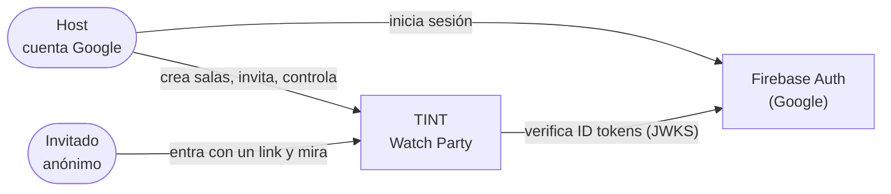
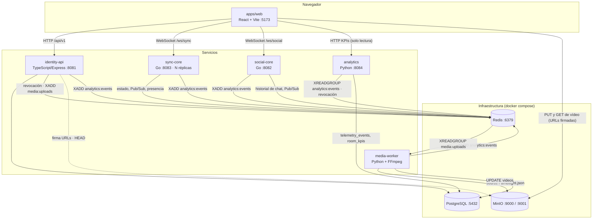
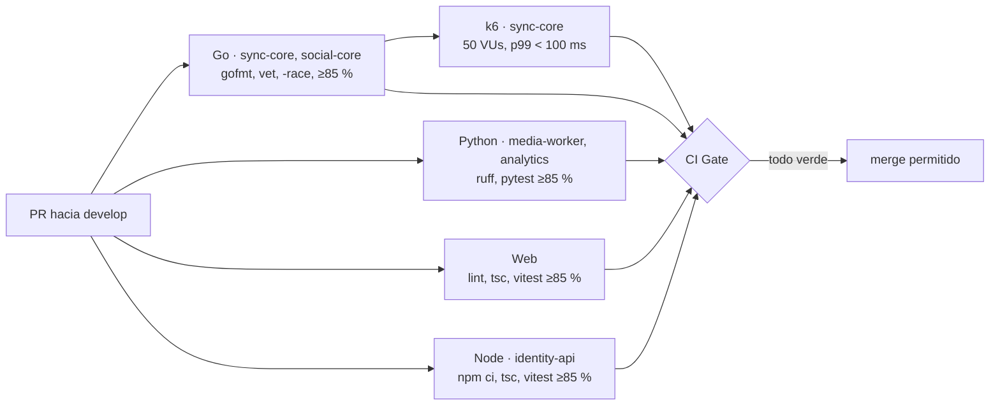

# 🏛️ Arquitectura del sistema

> Vista general de TINT: servicios, almacenes de datos, contratos compartidos y estado de implementación.
> Los detalles de cada feature están en sus propios documentos (ver [índice](README.md)).

## 1. Contexto

## 2. Contenedores

## 3. Servicios y estado

| Servicio | Responsabilidad | Estado | Guía |
| :--- | :--- | :--- | :--- |
| `apps/web` | UI: login, dashboard, gestión de salas, invitación, subida de vídeo, reproductor sincronizado y chat | ✅ Implementado | [AGENTS](../apps/web/AGENTS.md) |
| `services/identity-api` | Usuarios, salas (renombrar, borrado lógico), invitaciones, tokens, subida y reproducción de vídeo, invitados | ✅ Implementado | [AGENTS](../services/identity-api/AGENTS.md) |
| `services/sync-core` | Reloj Maestro, Canal Sync, drift, presencia, delegación | ✅ Implementado (v2) | [AGENTS](../services/sync-core/AGENTS.md) |
| `services/social-core` | Chat en vivo (`/ws/social`) con moderación, reacciones, puntero láser, encuestas, recap, heatmaps, trivias | 🟢 Chat (spoilers, modo lento, silencio), reacciones, láser, encuestas, recap y trivias implementados; heatmaps en curso | [AGENTS](../services/social-core/AGENTS.md) |
| `services/media-worker` | Consume `media:uploads`: valida con `ffprobe`, extrae el Ambilight y publica el vídeo y `ambilight.json`; estado de `videos` | ✅ Implementado (servicio de docker compose, verificado de punta a punta) | [AGENTS](../services/media-worker/AGENTS.md) |
| `services/analytics` | Ingesta de `analytics:events`, sanitización, KPIs por sala, retención de 90 días y API de solo lectura de KPIs para el host | ✅ Implementado (consumidor, migraciones y API; servicio de docker compose) | [AGENTS](../services/analytics/AGENTS.md) · [contrato de eventos](contrato-eventos-analitica.md) |

## 4. Almacenes de datos

| Almacén | Dueño | Contenido principal |
| :--- | :--- | :--- |
| PostgreSQL | identity-api | `users`, `rooms`, `invitations`, `guest_sessions`, `room_bans`, `videos` ([esquema](usuarios-e-identidad.md#3-esquema-de-datos-postgresql)); media-worker lee y actualiza `videos` (no crea filas) |
| PostgreSQL | analytics | `schema_migrations`, `telemetry_events` (90 días), `room_kpis` ([modelo](../services/analytics/AGENTS.md#modelo-de-datos-involucrado)) |
| Redis | sync-core | `room:{id}:*` (estado, Pub/Sub, presencia, delegación) ([modelo](dominio-reproduccion.md#7-modelo-de-datos-en-redis)) |
| Redis | identity-api → sync-core, social-core, analytics | `token:revoked:{jti}` |
| Redis | social-core | `room:{id}:chat:history`, `room:{id}:chat:settings`/`:muted`/`:last:{sub}` (moderación), `room:{id}:poll*` (encuestas), `room:{id}:recap:*` (métricas del recap y ancla de reproducción), `room:{id}:trivia:*` (trivias y rankings), Pub/Sub `room:{id}:social` (chat, reacciones, láser, `poll_state`, `chat_settings`, `trivia_question` y `trivia_result` entre réplicas) |
| Redis Stream | identity-api → media-worker | `media:uploads` (grupo `media-workers`) |
| Redis Stream | identity-api, social-core, sync-core, media-worker → analytics | `analytics:events` (grupo `analytics-workers`) |
| MinIO | web (PUT/GET firmados) · media-worker | Bucket `tint-media`: `incoming/{videoId}/original.*` (staging del navegador, caduca a los 2 días), `{videoId}/source.*` y `{videoId}/ambilight.json` (publicados por el worker) |

## 5. Contratos compartidos entre dominios

Son los únicos puntos en los que un PR puede necesitar coordinar dos dominios (regla 1 de [AGENTS.md](../AGENTS.md)). Si se cambia uno, hay que actualizar **ambos lados y este documento**.

| Contrato | Productor → consumidor | Definición |
| :--- | :--- | :--- |
| JWT HS256 (guest token, sync-ticket) | identity-api → sync-core, social-core | [usuarios-e-identidad §4](usuarios-e-identidad.md#4-esquemas-de-tokens) · `JWT_SECRET`/`JWT_ISSUER`/`JWT_AUDIENCE` iguales en los tres; social-core exige `jti`, `iss`, `aud` y `exp` |
| Firebase ID token RS256 (host en `/ws/social`) | Firebase → social-core | Firma verificada con los certificados x509 públicos de Google por `kid`; `iss`/`aud` = `FIREBASE_PROJECT_ID` (sin él, se rechaza) |
| Protocolo del Canal Sync v2 | sync-core ↔ web | [sync-core/AGENTS.md](../services/sync-core/AGENTS.md#protocolo-del-canal-sync) · comandos `PLAY`/`PAUSE`/`SEEK`/`RATE`/`LOAD`/`VOLUME`/`QUALITY`; `volume` ∈ [0, 1] y `quality` ∈ {`auto`, `source`, `720p`, `360p`} viajan en broadcasts, `STATE` y `SYNC_CORRECTION` ([dominio-reproduccion §6.9](dominio-reproduccion.md#69-volumen-y-calidad-del-host-f8)) |
| Protocolo del Canal Social (`/ws/social`) | social-core ↔ web | [social-core/AGENTS.md](../services/social-core/AGENTS.md#protocolo-del-canal-social) · chat (con `spoiler`), reacciones, `laser_point`/`laser`, `poll_*`/`poll_state`, `recap_request`/`recap`, `chat_slow_mode`/`chat_mute`/`chat_settings`, `trivia_*`. Láser, encuestas, moderación del chat y programación de trivias exigen el **sync-ticket** del host (HS256, `role` host/cohost, `room_id` de la sala): un Firebase ID token no da permisos de moderación |
| Comandos de reproducción en `room:{id}:sync` | sync-core → social-core (solo lectura) | social-core lee `PLAY`, `PAUSE`, `SEEK`, `RATE` y `LOAD` (`event_id`, `position_ms`, `status`, `rate`, `updated_at_ms`, `version`) para contar pausas y rebobinados del recap y para disparar las trivias en su posición (proyecta con su propio reloj, no con `updated_at_ms`); deduplica por `event_id` entre réplicas |
| Revocación (`token:revoked:{jti}` + `REVOKED`) | identity-api → sync-core, social-core | [dominio-reproduccion §6.6](dominio-reproduccion.md#66-retirar-a-un-invitado-f5) · social-core lee `REVOKED` de `room:{id}:sync` y cierra con 4001 |
| `mediaId` / `media_id` | identity-api → web → sync-core | [dominio-reproduccion §6.7](dominio-reproduccion.md#67-cambio-de-vídeo-f3--load) |
| API REST `/api/v1` | identity-api → web | [identity-api/AGENTS.md](../services/identity-api/AGENTS.md#api) |
| `media:uploads` + tabla `videos` | identity-api → media-worker | Evento `{video_id}`; columnas `id`, `storage_key`, `duration_ms`, `status`, `renditions`; original en `incoming/{id}/original.*`, el worker publica `{id}/source.*` y reescribe `storage_key`, y además publica las calidades `{id}/720p.mp4` y `{id}/360p.mp4` y escribe sus alturas en `renditions` (jsonb, p. ej. `[720, 360]`), que identity-api expone como `qualities` en el playback ([dominio-reproduccion §6.7](dominio-reproduccion.md#67-subida-y-cambio-de-vídeo)) |
| `analytics:events` | identity-api, social-core, sync-core, media-worker → analytics | [contrato-eventos-analitica](contrato-eventos-analitica.md) · obligatorios `event_id`, `type`, `source`, `occurred_at`, `received_at`; `room_id` en todo evento de sala; sin texto libre ni PII |
| API de lectura de analytics + `analytics-ticket` | identity-api (emite el ticket) → web → analytics | `POST /api/v1/rooms/:id/analytics-ticket` (host dueño, también con la sala cerrada) → `GET /api/v1/rooms/{id}/kpis`, `/reactions/heatmap`, `/timeline` en el puerto 8084 ([analytics/AGENTS.md](../services/analytics/AGENTS.md#api-solo-lectura-puerto-analytics_port-por-defecto-8084)) · mismos `JWT_SECRET`/`JWT_ISSUER`/`JWT_AUDIENCE`; revocación con falla cerrado |

## 6. Puertos locales

| Servicio | Puerto | Notas |
| :--- | :--- | :--- |
| web | 5173 | `npm run dev` |
| identity-api | 8081 | `npm run dev` |
| social-core | 8082 | `docker compose` (`/ws/social`, `/healthz`) |
| sync-core | 8083 → 8080 | `docker compose` (`/ws/sync`, `/healthz`, `/metrics`) |
| analytics | 8084 | `docker compose` (`/healthz`, `/api/v1/rooms/{id}/kpis`, `/reactions/heatmap`, `/timeline`) |
| PostgreSQL | 5432 | |
| Redis | 6379 | |
| MinIO | 9000 (API) · 9001 (consola) | |

El servicio `gateway` publica `80/443` como entrada única. Redirige HTTP a
HTTPS, termina TLS con Caddy y enruta `/api/*`, `/ws/sync` y `/ws/social` a
los servicios correspondientes; las rutas de KPIs, heatmap y timeline bajo
`/api/v1/rooms/*` se envían a analytics. Las rutas no reconocidas responden
404. Su política `restart: unless-stopped` permite recuperar automáticamente
el punto de entrada después de una caída.

## 7. Calidad y CI

