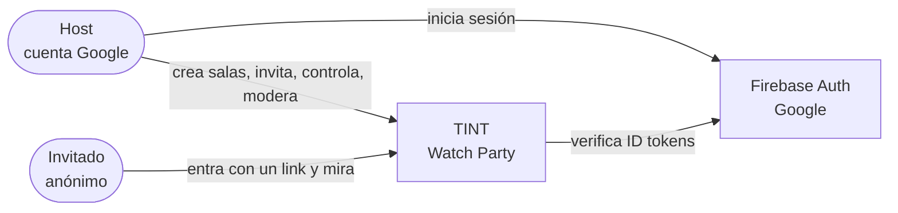
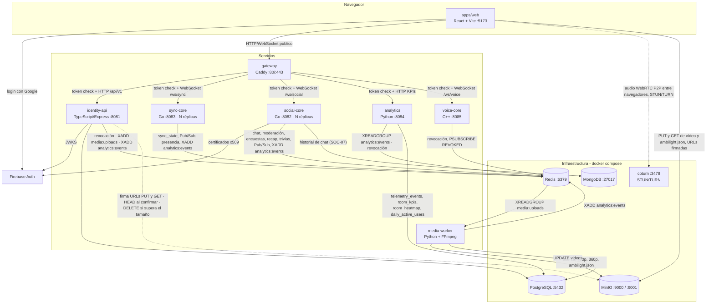
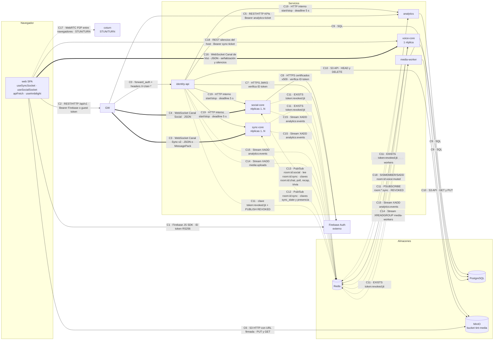
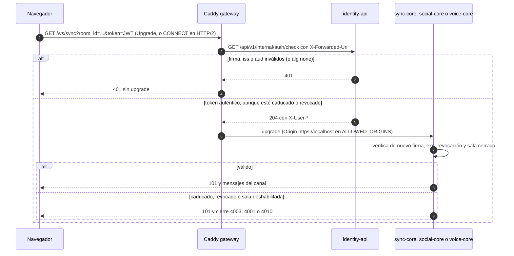
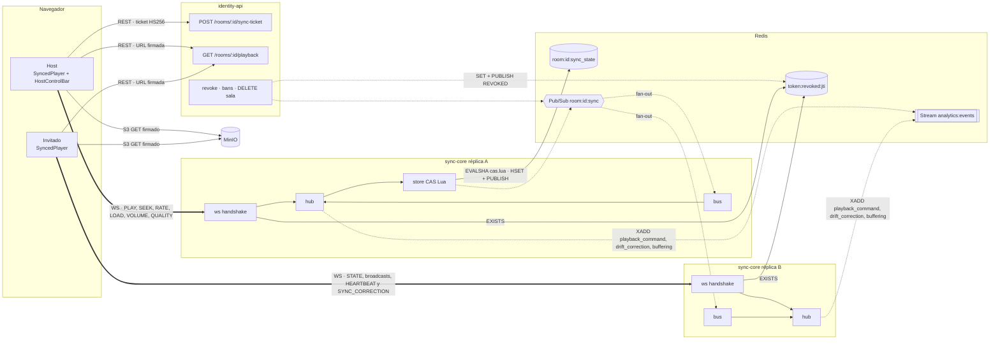
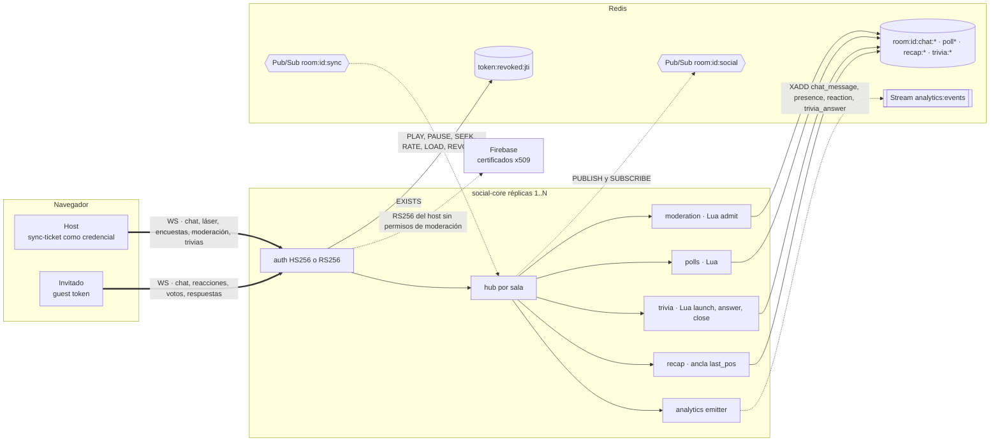
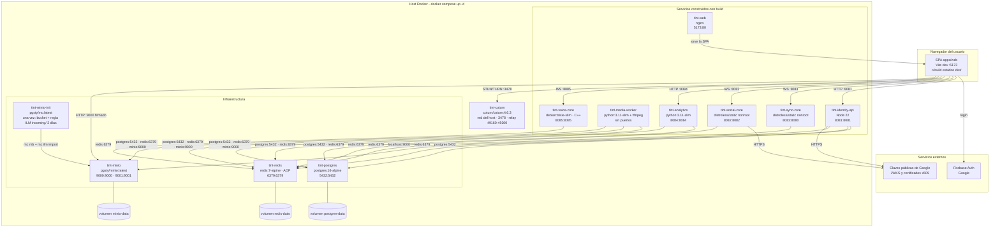
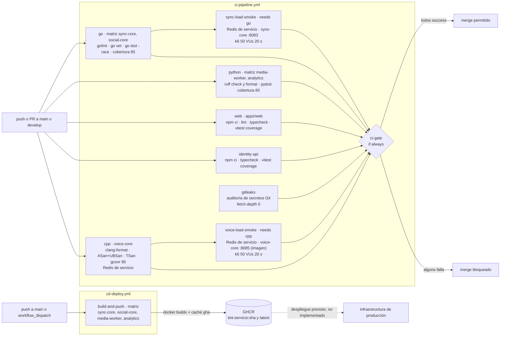
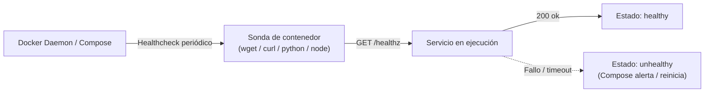

# 🏛️ Arquitectura del sistema

> Vista general de TINT: servicios, componentes y conectores, almacenes de datos, contratos compartidos, despliegue y estado de implementación.
> Los detalles de cada feature están en sus propios documentos (ver [índice](README.md)) y las decisiones de arquitectura, en los [ADRs](adr/README.md).

## Índice
1. [Contexto](#1-contexto)
2. [Contenedores](#2-contenedores)
3. [Servicios y estado](#3-servicios-y-estado)
4. [Vista de componentes y conectores (C&C)](#4-vista-de-componentes-y-conectores-cc)
5. [Contratos compartidos entre dominios](#5-contratos-compartidos-entre-dominios)
6. [Almacenes de datos](#6-almacenes-de-datos)
7. [Vista de despliegue](#7-vista-de-despliegue)
8. [Puertos locales](#8-puertos-locales)
9. [Calidad, CI y CD](#9-calidad-ci-y-cd)
10. [Decisiones de arquitectura (ADRs)](#10-decisiones-de-arquitectura-adrs)
11. [Documentación por servicio](#11-documentación-por-servicio)

## 1. Contexto



## 2. Contenedores



## 3. Servicios y estado

| Servicio | Responsabilidad | Estado | Guía |
| :--- | :--- | :--- | :--- |
| `apps/web` | UI: login, dashboard, gestión de salas, invitación, biblioteca y subida de vídeo, reproductor sincronizado con barra del host (volumen, calidad, velocidad), puntero láser, Ambilight, chat con moderación y spoilers, encuestas, trivia, recap, bloqueo de invitados y analítica de la sala | ✅ Implementado (UI nueva con `framer-motion`, logo SVG, Ambilight y láser) | [README](../apps/web/README.md) · [AGENTS](../apps/web/AGENTS.md) |
| `services/identity-api` | Usuarios, salas (renombrar, borrado lógico), invitaciones, tokens (guest token, sync-ticket, analytics-ticket), subida y reproducción de vídeo, biblioteca `GET /videos`, invitados (retirar y bloquear por dispositivo con `room_bans`) | ✅ Implementado | [README](../services/identity-api/README.md) · [AGENTS](../services/identity-api/AGENTS.md) |
| `services/sync-core` | Reloj Maestro, Canal Sync v2 (`PLAY`/`PAUSE`/`SEEK`/`RATE`/`LOAD`/`VOLUME`/`QUALITY`), drift, presencia, delegación, revocación, métricas | ✅ Implementado (v2) | [README](../services/sync-core/README.md) · [AGENTS](../services/sync-core/AGENTS.md) |
| `services/social-core` | Chat en vivo (`/ws/social`) con moderación (modo lento y silencio) y spoilers, reacciones, puntero láser, encuestas, recap y trivias con rankings | 🟢 Chat, moderación, spoilers, reacciones, láser, encuestas, recap y trivias implementados. Heatmap: solo los buckets de 5 s en memoria (`internal/reactions/buckets.go`); las claves `room:{id}:heatmap` y `video:{id}:heatmap:history` y el evento de heatmap en vivo cada 1 s están **previstos**. La retransmisión de Ambilight en vivo también está **prevista** (hoy la web descarga `ambilight.json` por HTTP) | [README](../services/social-core/README.md) · [AGENTS](../services/social-core/AGENTS.md) |
| `services/media-worker` | Consume `media:uploads`: valida con `ffprobe`, normaliza a MP4 H.264 + AAC, extrae el Ambilight, publica el vídeo, las calidades 720p/360p y `ambilight.json`; estado de `videos`; publica `media_processed` | ✅ Implementado (servicio de docker compose, verificado de punta a punta) | [README](../services/media-worker/README.md) · [AGENTS](../services/media-worker/AGENTS.md) |
| `services/voice-core` | Canal de voz (`/ws/voice`): salas de voz, membresía con cupo, autorización con JWT y revocación, señalización WebRTC P2P, silencio propio y del host (WS y REST) | 🟢 Fases 1 a 4 (unirse, señalización, salida, revocación en vivo, silencios persistidos, TURN efímero y tarjeta "Voz" en `WatchRoom`). Fase 5: carga k6 en CI y E2E con dos navegadores (`make e2e-voice`, local) ([dominio-voz §7](dominio-voz.md#7-plan-por-fases)) | [README](../services/voice-core/README.md) · [AGENTS](../services/voice-core/AGENTS.md) |
| `services/analytics` | Ingesta de `analytics:events`, sanitización, KPIs por sala, retención de 90 días y API de solo lectura de KPIs, heatmap de reacciones y línea de tiempo para el host | ✅ Implementado (consumidor, migraciones y API; servicio de docker compose) | [README](../services/analytics/README.md) · [AGENTS](../services/analytics/AGENTS.md) · [contrato de eventos](contrato-eventos-analitica.md) |

<a id="vista-de-componentes-y-conectores"></a>

## 4. Vista de componentes y conectores (C&C)

Muestra los componentes **en tiempo de ejecución** y los conectores por los que interactúan. Cada conector está rotulado con su tipo y protocolo. Ancla estable para enlazar esta vista: `arquitectura.md#vista-de-componentes-y-conectores`.

> social-core **no** tiene heatmap en vivo ni retransmisión de Ambilight (solo `reactions.Buckets` en memoria y los buckets de 5 s del recap en Redis), y no expone `/metrics`: solo sync-core lo hace.



**Leyenda**

| Trazo | Significado |
| :--- | :--- |
| `──▶` línea continua | Petición/respuesta **síncrona** (HTTP, SQL, S3) |
| `══▶` línea gruesa | Conexión **WebSocket** persistente y bidireccional |
| `- -▶` línea punteada | Interacción **asíncrona** o por estado compartido a través de Redis (Pub/Sub, Streams, claves) |
| `( )` cilindro | Almacén de datos |
| `Cn` | Identificador del conector en la tabla de abajo |

### 4.1 Tabla de conectores

| Id | Tipo | Origen → destino | Protocolo | Sincronía | Contrato o fuente de verdad |
| :--- | :--- | :--- | :--- | :--- | :--- |
| C0 | Autenticación central | gateway → identity-api | Caddy `forward_auth` a `GET /api/v1/internal/auth/check`; copia `X-User-Id`, `X-User-Sub`, `X-User-Role`, `X-User-Room-Id`, `X-User-Nick` solo tras validar el Bearer. En `/ws/*` el navegador no puede mandar `Authorization`: el token va en `?token=` y se lee de `X-Forwarded-Uri`; ahí se exigen firma HS256, `iss` y `aud`, pero la caducidad y la revocación las rechaza cada servicio tras el upgrade (`4003`/`4001`), para que el navegador reciba el código y no un `1006` | Síncrono (caché JWKS) | AC1–AC3 de GW-02; tokens inválidos (firma, emisor o audiencia) se rechazan con 401 antes del upstream |
| C1 | Autenticación externa | web → Firebase Auth | Firebase JS SDK (`signInWithPopup`), ID token RS256 | Síncrono | [usuarios-e-identidad §4](usuarios-e-identidad.md#4-esquemas-de-tokens) |
| C2 | REST | web → identity-api | HTTP/JSON `/api/v1`, `Authorization: Bearer` (ID token de Firebase o guest token) | Síncrono | [identity-api/AGENTS.md § API](../services/identity-api/AGENTS.md#api) |
| C3 | WebSocket Canal Sync v2 | web ↔ sync-core | `GET /ws/sync?room_id&token`; JSON o MessagePack (`tint.sync.msgpack`); cierres terminales `4001`/`4003` | Asíncrono bidireccional (latido 1 s) | [sync-core/AGENTS.md § Protocolo](../services/sync-core/AGENTS.md#protocolo-del-canal-sync) · [dominio-reproduccion](dominio-reproduccion.md) |
| C4 | WebSocket Canal Social | web ↔ social-core | `GET /ws/social?room_id&token` (o `Authorization`); JSON; ping cada 20 s | Asíncrono bidireccional | [social-core/AGENTS.md § Protocolo](../services/social-core/AGENTS.md#protocolo-del-canal-social) |
| C5 | REST de solo lectura | web → analytics | HTTP/JSON `GET /api/v1/rooms/{id}/kpis`, `/reactions/heatmap`, `/timeline`; Bearer `analytics-ticket`; CORS | Síncrono | [analytics/AGENTS.md § API](../services/analytics/AGENTS.md#api-solo-lectura-puerto-analytics_port-por-defecto-8084) |
| C6 | S3 con URL firmada | web → MinIO | HTTP `PUT` (subida a `incoming/{id}/original.*`) y `GET` (vídeo, calidades, `ambilight.json`) con firma SigV4 calculada por identity-api | Síncrono | [dominio-reproduccion §6.7](dominio-reproduccion.md#67-subida-y-cambio-de-vídeo) |
| C7 | Verificación de token | identity-api → Google | HTTPS JWKS `securetoken@system.gserviceaccount.com` (`jwks-rsa`, en caché) | Síncrono (con caché) | [usuarios-e-identidad §4](usuarios-e-identidad.md#4-esquemas-de-tokens) |
| C8 | Verificación de token | social-core → Google | HTTPS certificados x509 públicos por `kid` (caché por `Cache-Control`) | Síncrono (con caché) | [social-core/AGENTS.md § Autenticación](../services/social-core/AGENTS.md#autenticación-de-wssocial) |
| C9 | SQL | identity-api, media-worker, analytics → PostgreSQL | Drizzle ORM (identity-api), `psycopg` 3 (Python) | Síncrono | [usuarios-e-identidad §3](usuarios-e-identidad.md#3-esquema-de-datos-postgresql) · [analytics/AGENTS.md](../services/analytics/AGENTS.md#modelo-de-datos-involucrado) |
| C10 | S3 API | identity-api, media-worker → MinIO | `@aws-sdk/client-s3` (HEAD, DELETE) · `boto3` (GET, PUT) | Síncrono | [media-worker/AGENTS.md](../services/media-worker/AGENTS.md#modelo-de-datos-involucrado) |
| C11 | Clave Redis + Pub/Sub | identity-api → sync-core, social-core, analytics, voice-core | `SET token:revoked:{jti} 1 EXAT exp` + `PUBLISH room:{id}:sync REVOKED{jti}`; los consumidores hacen `EXISTS` en el handshake o en cada petición | Asíncrono (aviso) + consulta síncrona | [dominio-reproduccion §6.6](dominio-reproduccion.md#66-retirar-a-un-invitado-f5) · [ADR 0007](adr/0007-revocacion-por-clave-redis-y-cierre-4001.md) |
| C12 | Redis Pub/Sub + claves | sync-core ↔ sync-core (réplicas) | `room:{id}:sync` (JSON), CAS Lua sobre `room:{id}:sync_state`, ZSET de presencia | Asíncrono (fan-out) | [dominio-reproduccion §7](dominio-reproduccion.md#7-modelo-de-datos-en-redis) · [ADR 0003](adr/0003-redis-pubsub-para-fanout-entre-replicas.md) |
| C13 | Redis Pub/Sub + claves | social-core ↔ social-core; sync-core → social-core (solo lectura) | `room:{id}:social` (dedup por `event_id`); suscripción de solo lectura a `room:{id}:sync` (comandos para recap y trivias, `REVOKED`) | Asíncrono | [social-core/AGENTS.md § Modelo de datos](../services/social-core/AGENTS.md#modelo-de-datos-involucrado) |
| C14 | Redis Stream | identity-api → media-worker | `XADD media:uploads MAXLEN ~ 10000 * video_id <id>` → `XREADGROUP` grupo `media-workers` + `XACK` | Asíncrono (cola) | [dominio-reproduccion §6.7](dominio-reproduccion.md#67-subida-y-cambio-de-vídeo) · [ADR 0009](adr/0009-procesamiento-asincrono-con-redis-streams.md) |
| C16 | WebSocket Canal de Voz | web ↔ voice-core | `GET /ws/voice?room_id&token`; JSON (`voice_state`, `peer_joined`/`peer_left`, `signal`, `self_mute`/`host_mute` → `peer_muted`, `leave`, `error`); cierres `4001`/`4003`/`4008`; keep-alive con ping (20 s) | Asíncrono bidireccional | [voice-core/AGENTS.md § Protocolo](../services/voice-core/AGENTS.md#protocolo-del-canal-de-voz) · [dominio-voz](dominio-voz.md) |
| C18 | REST de moderación de voz | web → voice-core · voice-core → Redis | `PUT`/`DELETE /api/v1/voice/rooms/{id}/mutes/{user_id}` con `Bearer` sync-ticket de host/cohost (`403` sin rol); CORS; se guarda en `room:{id}:voice:muted` (SET, TTL 24 h) y se anuncia `peer_muted` | Síncrono | [voice-core/AGENTS.md § API REST](../services/voice-core/AGENTS.md#api-rest-de-moderación) |
| C17 | WebRTC P2P + STUN/TURN | web ↔ web (mesh) · web → coturn | Audio Opus por DTLS-SRTP entre navegadores; ICE con STUN y relay TURN (`coturn` `:3478`) | Asíncrono (medios en tiempo real) | [ADR 0015](adr/0015-voice-core-en-cpp-con-webrtc-p2p.md) |
| C19 | Orquestación de arranque | identity-api → sync-core, social-core, analytics | `POST`/`DELETE /internal/events/start/{room_id}`; identidad llama en orden y compensa en orden inverso; deadline de 5 s por dependencia; no se publica por Caddy | Síncrono | Issue #75; `services/identity-api/src/modules/eventStart` |
| C15 | Redis Stream | identity-api, sync-core, social-core, media-worker → analytics | `XADD analytics:events MAXLEN ~ 100000` → `XREADGROUP` grupo `analytics-workers` + `XACK` tras el commit | Asíncrono, best-effort | [contrato-eventos-analitica](contrato-eventos-analitica.md) · [ADR 0010](adr/0010-eventos-de-analitica-sin-pii.md) |

#### Handshake WebSocket por el gateway (C0)

El navegador no puede mandar `Authorization` al abrir un WebSocket. La web pone el token en `?token=`; Caddy lo reenvía al `forward_auth` en `X-Forwarded-Uri`, e identity-api solo exige firma, `iss` y `aud`. La caducidad y la revocación las decide el servicio **después** del upgrade, para que el navegador reciba un código `4xxx` y no un `1006` ([ADR 0014](adr/0014-upgrade-y-cierre-4xxx-para-estados-terminales.md)).



### 4.2 C&C del flujo de reproducción



### 4.3 C&C del flujo social



## 5. Contratos compartidos entre dominios

Son los únicos puntos en los que un PR puede necesitar coordinar dos dominios (regla 1 de [AGENTS.md](../AGENTS.md)). Si se cambia uno, hay que actualizar **ambos lados y este documento**.

| Contrato | Productor → consumidor | Definición |
| :--- | :--- | :--- |
| JWT HS256 (guest token, sync-ticket, analytics-ticket) | identity-api → sync-core, social-core, analytics, voice-core | [usuarios-e-identidad §4](usuarios-e-identidad.md#4-esquemas-de-tokens) · `JWT_SECRET`/`JWT_ISSUER`/`JWT_AUDIENCE` iguales en los cuatro; social-core y analytics exigen `jti`, `iss`, `aud` y `exp` ([ADR 0006](adr/0006-tickets-jwt-hs256-emitidos-por-identity-api.md)) |
| Firebase ID token RS256 (host en `/ws/social`) | Firebase → social-core | Firma verificada con los certificados x509 públicos de Google por `kid`; `iss`/`aud` = `FIREBASE_PROJECT_ID` (sin él, se rechaza). No da permisos de moderación |
| Protocolo del Canal Sync v2 | sync-core ↔ web | [sync-core/AGENTS.md](../services/sync-core/AGENTS.md#protocolo-del-canal-sync) · comandos `PLAY`/`PAUSE`/`SEEK`/`RATE`/`LOAD`/`VOLUME`/`QUALITY`; `volume` ∈ [0, 1] y `quality` ∈ {`auto`, `source`, `720p`, `360p`} viajan en broadcasts, `STATE` y `SYNC_CORRECTION` ([dominio-reproduccion §6.9](dominio-reproduccion.md#69-volumen-y-calidad-del-host-f8)); `SYNC_CHECK` acepta `version` opcional (última aplicada por el cliente; compatible hacia atrás) y tiene su propio límite de 5/s ([dominio-reproduccion §6.3](dominio-reproduccion.md#63-latido-rtt-y-drift)) |
| Protocolo del Canal Social (`/ws/social`) | social-core ↔ web | [social-core/AGENTS.md](../services/social-core/AGENTS.md#protocolo-del-canal-social) · chat (con `spoiler`), reacciones, `laser_point`/`laser`, `poll_*`/`poll_state`, `recap_request`/`recap`, `chat_slow_mode`/`chat_mute`/`chat_settings`, `trivia_*` (incluido `trivia_launch_now`). Handshake: upgrade y cierre `4001`/`4003`/`4010` ([ADR 0014](adr/0014-upgrade-y-cierre-4xxx-para-estados-terminales.md)). REST `GET /api/v1/social/rooms/{id}/chat` (historial para el host, también con la sala deshabilitada). Láser, encuestas, moderación del chat y programación de trivias exigen el **sync-ticket** del host (HS256, `role` host/cohost, `room_id` de la sala): un Firebase ID token no da permisos de moderación |
| Comandos de reproducción en `room:{id}:sync` | sync-core → social-core (solo lectura) | social-core lee `PLAY`, `PAUSE`, `SEEK`, `RATE` y `LOAD` (`event_id`, `position_ms`, `status`, `rate`, `updated_at_ms`, `version`) para contar pausas y rebobinados del recap y para disparar las trivias en su posición (proyecta con su propio reloj, no con `updated_at_ms`); deduplica por `event_id` entre réplicas ([ADR 0012](adr/0012-trivia-con-reloj-del-servidor-y-ancla-del-recap.md)) |
| Revocación (`token:revoked:{jti}` + `REVOKED`) | identity-api → sync-core, social-core, analytics, voice-core, web | [dominio-reproduccion §6.6](dominio-reproduccion.md#66-retirar-a-un-invitado-f5) · sync-core, social-core y voice-core leen `REVOKED` de `room:{id}:sync` y cierran con 4001; analytics consulta la clave en cada petición; retirar, bloquear (`room_bans`) y borrar la sala usan la misma vía ([ADR 0007](adr/0007-revocacion-por-clave-redis-y-cierre-4001.md), [ADR 0013](adr/0013-bloqueo-de-invitados-por-dispositivo.md)) |
| `mediaId` / `media_id` | identity-api → web → sync-core | [dominio-reproduccion §6.7](dominio-reproduccion.md#67-subida-y-cambio-de-vídeo) · con la biblioteca, `mediaId = videos.id` |
| API REST `/api/v1` | identity-api → web | [identity-api/AGENTS.md](../services/identity-api/AGENTS.md#api) (incluye `GET /invitations/:code` para metadatos SSR de invitaciones, `GET /videos`, `PATCH /videos/:id`, `PUT /rooms/:id/media {videoId}` y `/rooms/:id/bans`) |
| `media:uploads` + tabla `videos` | identity-api → media-worker | Evento `{video_id}`; columnas `id`, `storage_key`, `duration_ms`, `status`, `renditions`; original en `incoming/{id}/original.*`, el worker publica `{id}/source.*` y reescribe `storage_key`, y además publica las calidades `{id}/720p.mp4` y `{id}/360p.mp4` y escribe sus alturas en `renditions` (jsonb, p. ej. `[720, 360]`), que identity-api expone como `qualities` en el playback ([dominio-reproduccion §6.7](dominio-reproduccion.md#67-subida-y-cambio-de-vídeo)) |
| `analytics:events` | identity-api, social-core, sync-core, media-worker → analytics | [contrato-eventos-analitica](contrato-eventos-analitica.md) · obligatorios `event_id`, `type`, `source`, `occurred_at`, `received_at`; `room_id` en todo evento de sala; sin texto libre ni PII |
| API de lectura de analytics + `analytics-ticket` | identity-api (emite el ticket) → web → analytics | `POST /api/v1/rooms/:id/analytics-ticket` (host dueño, también con la sala cerrada) → `GET /api/v1/rooms/{id}/kpis`, `/reactions/heatmap`, `/timeline` en el puerto 8084 ([analytics/AGENTS.md](../services/analytics/AGENTS.md#api-solo-lectura-puerto-analytics_port-por-defecto-8084)) · mismos `JWT_SECRET`/`JWT_ISSUER`/`JWT_AUDIENCE`; revocación con falla cerrado |
| Protocolo del Canal de Voz (`/ws/voice`, cierres `4008`/`4009`/`4010`) y REST de silencios y escenario (`/api/v1/voice/rooms/{id}/mutes/{user_id}`, `…/stage/{user_id}`) | voice-core ↔ web | [voice-core/AGENTS.md](../services/voice-core/AGENTS.md#protocolo-del-canal-de-voz) · ver [dominio-voz](dominio-voz.md) |
| Cierre de sala `ROOM_CLOSED` + `room:{id}:closed` + cierre `4010` | identity-api → sync-core, social-core, voice-core, stream-core, web | [ADR 0019](adr/0019-salas-live-y-cierre-room-closed.md) · `rooms.status='disabled'` lo escribe solo identity-api; HTTP `410 {error:"Disabled"}` |
| API WHIP/WHEP `/api/v1/stream/*` + DataChannel `stream-events` | stream-core ↔ web | [dominio-transmision §3–4](dominio-transmision.md#3-api-whipwhep-apiv1stream) |
| `POST/DELETE /internal/events/start/{id}` (salas `live`) y `POST /api/v1/internal/rooms/{id}/disable` (`X-Internal-Token`) | identity-api ↔ stream-core | [dominio-transmision §6](dominio-transmision.md#6-contratos-con-otros-dominios) |
| `room:{id}:stream` `STREAM_STARTED`/`STREAM_ENDED` + `room:{id}:stream:started_at` | stream-core → social-core | Trivia por minuto del stream ([formatos](dominio-transmision.md#61-formatos-estándar)) |
| `room:{id}:kind` (`live`, TTL 24 h) | identity-api → voice-core, social-core | Escenario de voz (`4009`) y trivia por minuto del stream |
| `TURN_SECRET` | voice-core ↔ coturn | Credenciales TURN efímeras (REST API de TURN), `.env.example` raíz |
| `MONGO_URI` + colección `social.chat_message_meta` (índice `{room_id, received_at}` y TTL) | social-core ↔ mongodb | Metadatos del chat sin texto, con escritura diferida por la cola `chat:meta:outbox` (SOC-07/DAT-02, [ADR 0025](adr/0025-metadatos-del-chat-en-mongodb.md)); `.env.example` raíz |
| Puertos locales | infra ↔ web | social-core 8082, sync-core 8083, analytics 8084, voice-core 8085, stream-core 8086 (+ UDP `STREAM_UDP_PORT`), coturn 3478, Firebase Auth Emulator 9099 (solo `127.0.0.1`, desarrollo) (`docker-compose.yml`, `apps/web/.env.example`) |
| Observabilidad y salud (`/healthz` con `status`/`service`; logs JSON a stdout con `LOG_LEVEL` configurable) | Todos los servicios | [ADR 0021](adr/0021-observabilidad-salud-y-logs.md) · [§8.2](#82-observabilidad-salud-y-logs) |

## 6. Almacenes de datos

| Almacén | Dueño | Contenido principal |
| :--- | :--- | :--- |
| PostgreSQL | identity-api | `users`, `rooms`, `invitations`, `guest_sessions` (con `device_id`), `room_bans`, `videos` (con `renditions` y `title`) ([esquema](usuarios-e-identidad.md#3-esquema-de-datos-postgresql)); media-worker lee y actualiza `videos` (no crea filas) y lee `users.provider_sub` |
| PostgreSQL | analytics | `schema_migrations`, `telemetry_events` (90 días), `room_kpis`, `room_heatmap`, `daily_active_users` ([modelo](../services/analytics/AGENTS.md#modelo-de-datos-involucrado)) |
| Redis | sync-core | `room:{id}:sync_state`, `:evt:{event_id}`, `:hosts_online`, `:members`, `:host_online`, `:hostless_since`, `:delegate` y Pub/Sub `room:{id}:sync` ([modelo](dominio-reproduccion.md#7-modelo-de-datos-en-redis)) |
| Redis | identity-api → sync-core, social-core, analytics, voice-core | `token:revoked:{jti}` (voice-core además lee `REVOKED` de `room:*:sync` y guarda los silencios del host en `room:{id}:voice:muted`; su membresía vive en memoria) |
| Redis | social-core | `room:{id}:chat:history`, `room:{id}:chat:settings`/`:muted`/`:last:{sub}` (moderación), `room:{id}:poll*` (encuestas), `room:{id}:recap:*` (métricas del recap y ancla de reproducción), `room:{id}:trivia:*` (trivias y rankings), Pub/Sub `room:{id}:social` (chat, reacciones, láser, `poll_state`, `chat_settings`, `trivia_question` y `trivia_result` entre réplicas) |
| Redis Stream | identity-api → media-worker | `media:uploads` (grupo `media-workers`) |
| Redis Stream | identity-api, social-core, sync-core, media-worker → analytics | `analytics:events` (grupo `analytics-workers`) |
| MongoDB | social-core | `social.chat_message_meta`: metadatos de cada intento de envío del chat, sin texto (SOC-07, DAT-02, [ADR 0025](adr/0025-metadatos-del-chat-en-mongodb.md)). El texto sigue solo en Redis (`room:{id}:chat:history`, 12 h) |
| Redis Stream | social-core | `chat:meta:outbox` (grupo `chat-meta-writer`): metadatos del chat pendientes de escribir en MongoDB |
| MinIO | web (PUT/GET firmados) · media-worker | Bucket `tint-media`: `incoming/{videoId}/original.*` (staging del navegador, caduca a los 2 días), `{videoId}/source.mp4`, `{videoId}/720p.mp4`, `{videoId}/360p.mp4` y `{videoId}/ambilight.json` (publicados por el worker) |

<a id="vista-de-despliegue"></a>

## 7. Vista de despliegue

### 7.1 Entorno local (el único que existe hoy)



- **Contenedores de aplicación:** `web` construye la SPA y la sirve con nginx en `5173`; `identity-api` compila Node 22, aplica las migraciones y escucha en `8081`. El gateway usa ambos servicios por sus nombres internos.
- **Orden de arranque** (`depends_on`): `env-check` valida `.env` antes de crear servicios; `minio-init` espera a que MinIO esté sano; `identity-api` y `media-worker` esperan a PostgreSQL, Redis y el bucket; analytics espera a PostgreSQL y Redis; los canales esperan a Redis.
- **Salud y métricas:** gateway, web, identity-api, analytics, social-core, sync-core y voice-core tienen healthcheck; media-worker se comprueba por proceso (no tiene HTTP). Solo sync-core expone `/metrics` (Prometheus). `env-check` y `minio-init` son tareas de una sola ejecución y deben terminar correctamente.
- **Réplicas:** compose levanta **una** réplica de cada servicio. El diseño soporta N réplicas de sync-core y social-core (Pub/Sub, CAS y `HSETNX` entre réplicas); voice-core solo admite **una** (membresía en memoria, [dominio-voz §9](dominio-voz.md#9-limitaciones-conocidas)). No no hay balanceador ni configuración multirréplica en el repositorio.

| Nodo | Artefacto | Puertos (host → contenedor) | Volúmenes | Variables principales |
| :--- | :--- | :--- | :--- | :--- |
| `tint-postgres` | Imagen `postgres:16-alpine` | 5432 → 5432 | `postgres-data:/var/lib/postgresql/data` | `POSTGRES_USER`, `POSTGRES_PASSWORD`, `POSTGRES_DB` |
| `tint-redis` | Imagen `redis:7-alpine` (`--appendonly yes`) | 6379 → 6379 | `redis-data:/data` | — |
| `tint-minio` | Imagen `pgsty/minio` fijada por digest SHA-256 (la oficial no está disponible) | 9000 → 9000 (API) · 9001 → 9001 (consola) | `minio-data:/data` | `MINIO_ROOT_USER`, `MINIO_ROOT_PASSWORD`, `MINIO_API_CORS_ALLOW_ORIGIN` (de `MINIO_CORS_ALLOW_ORIGIN`) |
| `tint-minio-init` | Imagen `pgsty/mc` fijada por digest SHA-256, se ejecuta una vez | — | — | `MINIO_ROOT_USER`, `MINIO_ROOT_PASSWORD`, `MINIO_BUCKET` |
| `tint-media-worker` | `build: ./services/media-worker` (`python:3.11-slim` + `ffmpeg`, usuario `worker`, `python -m media_worker`) | — | — | `DATABASE_URL`, `REDIS_URL`, `S3_ENDPOINT_URL`, `S3_ACCESS_KEY`, `S3_SECRET_KEY`, `MINIO_BUCKET`, `MEDIA_WORKER_CONSUMER` |
| `tint-analytics` | `build: ./services/analytics` (`python:3.11-slim`, usuario `worker`, `python -m analytics`) | `ANALYTICS_PORT` (8084) → 8084 | — | `DATABASE_URL`, `REDIS_URL`, `JWT_SECRET`, `JWT_ISSUER`, `JWT_AUDIENCE`, `ANALYTICS_PORT`, `ANALYTICS_ALLOWED_ORIGINS`, `ANALYTICS_CONSUMER` |
| `tint-social-core` | `build: ./services/social-core` (multi-stage `golang:1.22-alpine` → `distroless/static-debian12:nonroot`) | 8082 → 8082 | — | `SOCIAL_CORE_ADDR`, `REDIS_URL`, `JWT_*`, `FIREBASE_PROJECT_ID`, `ALLOWED_ORIGINS` (de `SOCIAL_ALLOWED_ORIGINS`), `SOCIAL_REACTION_LIMIT`, `SOCIAL_REACTION_IP_LIMIT`, `SOCIAL_REACTION_WINDOW_MS`, `MONGO_URI` (usuario de aplicación), `CHAT_META_PEPPER`, `CHAT_META_RETENTION_DAYS`. No depende de `mongodb` para arrancar |
| `tint-voice-core` | `build: ./services/voice-core` (multi-stage `debian:trixie-slim` dev → build → runtime, usuario `voicecore`) | 8085 → 8085 | — | `VOICE_CORE_ADDR`, `REDIS_URL`, `JWT_*`, `ALLOWED_ORIGINS` (de `VOICE_ALLOWED_ORIGINS`), `VOICE_MAX_MEMBERS`, `STUN_URLS`, `TURN_URLS`, `TURN_SECRET`, `TURN_TTL_SECONDS` |
| `tint-mongodb` | Imagen `mongo:8.0` (`restart: unless-stopped`) | 27017 → 27017 | `mongo-data:/data/db` | `MONGO_INITDB_ROOT_USERNAME`, `MONGO_INITDB_ROOT_PASSWORD`, `MONGO_INITDB_DATABASE` |
| `tint-mongo-init` | Imagen `mongo:8.0`, se ejecuta una vez tras `mongodb` sano | — | — | `MONGO_ROOT_USER`, `MONGO_ROOT_PASSWORD`, `MONGO_APP_USER`, `MONGO_APP_PASSWORD`. Crea o actualiza (idempotente) el usuario de aplicación de social-core: `readWrite` y el rol `chat_meta_schema` (solo `collMod`) sobre la base `social` ([ADR 0025](adr/0025-metadatos-del-chat-en-mongodb.md)) |
| `tint-coturn` | Imagen `coturn/coturn:4.6.3`, `network_mode: host` (en Linux el relay debe anunciar direcciones alcanzables; en Docker Desktop no alcanza clientes externos fuera de localhost; limitación de portabilidad documentada) | 3478 (UDP/TCP) · relay 49160–49200 | — | `TURN_SECRET` (`--static-auth-secret`) |
| `tint-firebase-auth-emulator` | `build: ./firebase-auth-emulator` (`node:22-alpine` + `firebase-tools@15.34.0`, usuario `node`). **Solo desarrollo** ([ADR 0024](adr/0024-login-local-con-firebase-auth-emulator.md)): el override de producción no lo arranca | `127.0.0.1:9099` → 9099 | — | `FIREBASE_PROJECT_ID` (`demo-*`) |
| `tint-sync-core` | `build: ./services/sync-core` (multi-stage `golang:1.22-alpine` → `distroless/static-debian12:nonroot`) | 8083 → 8080 | — | `SYNC_CORE_ADDR`, `REDIS_URL`, `JWT_*`, `ALLOWED_ORIGINS` (de `SYNC_ALLOWED_ORIGINS`) |
| `tint-identity-api` | `build: ./services/identity-api` (Node 22, migraciones al arrancar) | 8081 → 8081 | — | `DATABASE_URL`, `REDIS_URL`, `FIREBASE_PROJECT_ID`, `FIREBASE_AUTH_EMULATOR_HOST` (solo desarrollo), `NODE_ENV`, `JWT_*`, `MINIO_*`, `SYNC_CORE_URL`, `SOCIAL_CORE_URL`, `ANALYTICS_URL` |
| `tint-web` | `build: ./apps/web` (build Vite + nginx) | 5173 → 80 | — | `VITE_IDENTITY_API_URL`, `VITE_FIREBASE_*`, `VITE_SYNC_WS_URL`, `VITE_SOCIAL_WS_URL`, `VITE_SYNC_ENCODING`, `VITE_ANALYTICS_API_URL` |
| Firebase Auth | Servicio externo de Google | HTTPS | — | `FIREBASE_PROJECT_ID` (identity-api, social-core), `VITE_FIREBASE_*` (web) |

Los valores por defecto de compose salen del [`.env.example` raíz](../.env.example). `JWT_SECRET`, `JWT_ISSUER` y `JWT_AUDIENCE` deben ser idénticos en identity-api, sync-core, social-core y analytics.

### 7.2 Producción

**No hay despliegue a producción en el repositorio.** Lo único que existe es el workflow [`cd-deploy.yml`](../.github/workflows/cd-deploy.yml): en cada `push` a `main` (o a mano) construye y publica en GHCR las imágenes `ghcr.io/<owner>/tint-{sync-core,social-core,media-worker,analytics}` con las etiquetas `sha` y `latest`. El propio archivo dice que el despliegue a infraestructura (Kubernetes o VM) "se añadirá en una HU posterior". Las imágenes locales de identity-api y la web aún no se publican. Pendientes que ya están documentados para producción: `/metrics` de sync-core detrás del ingress, hash tags de Redis para un cluster y el índice de `guest_sessions.room_id` ([dominio-reproduccion §16](dominio-reproduccion.md#16-limitaciones-conocidas)).

### 7.3 Pipeline de CI y CD




### 7.4 Gestión de secretos y variables de entorno (OPS-05, ADR 0022)

Ningún secreto del sistema se versiona en Git ni se hornea en capas de las imágenes Docker:
- **Almacenamiento y paso**: los secretos (`POSTGRES_PASSWORD`, `MINIO_ROOT_PASSWORD`, `MONGO_ROOT_PASSWORD`, `MONGO_URI`, `JWT_SECRET`, `TURN_SECRET`, `INTERNAL_API_SECRET`, y desde ADR 0025 `MONGO_APP_PASSWORD` y `CHAT_META_PEPPER`) se configuran en `.env` (ignorado en `.gitignore` y excluido en `.dockerignore`). Compose los inyecta al crear o arrancar cada contenedor.
- **Fail-closed en arranque**: el servicio `tint-env-check` comprueba que ninguna variable secreta obligatoria esté vacía. Si falta alguna, el stack no arranca. El mensaje indica ejecutar `make env-sync` (`scripts/env_sync.py`), que crea `.env` o le añade solo las variables que falten de `.env.example`, sin tocar las existentes; `make up` lo ejecuta antes de `docker compose up -d --build`. Es para desarrollo: en producción los secretos se definen a mano.
- **Sin fallbacks inseguros**: `docker-compose.yml` interpola secretos como `${VAR}` sin alternativas `:-dev-...`.
- **Actualización de secretos**: Docker Compose no relee el archivo `.env` del host tras una edición al hacer `docker restart`. La regla operativa para aplicar un secreto actualizado sin reconstruir imágenes es:
  ```bash
  docker compose up -d --no-build
  ```
- **Variables públicas del cliente**: las variables `VITE_*` (por ejemplo `VITE_FIREBASE_*`) son configuraciones públicas consumidas en el navegador e integradas durante el build de `apps/web/Dockerfile`. No son secretos de servidor.
- **Auditoría CI con Gitleaks**: el pipeline ejecuta un escaneo completo de historial con `.gitleaks.toml` permitiendo únicamente marcadores didácticos de `.env.example`.

### 7.5 Instrucciones de ejecución del prototipo (OPS-06, ADR 0023)

El requerimiento R10 y la historia OPS-06 (#91) establecen que el despliegue del software debe ser 100 % orientado a contenedores y reproducible por un evaluador en menos de 15 minutos. Las instrucciones concisas de una página, los pasos de verificación y la matriz de solución de problemas (AC1, AC2, AC3) están centralizados en la sección [Instrucciones de Ejecución del Prototipo](../README.md#-instrucciones-de-ejecución-del-prototipo-ops-06) del `README.md` y formalizados en el [ADR 0023](adr/0023-instrucciones-de-ejecucion-del-prototipo.md).

## 8. Puertos locales

| Servicio | Puerto | Notas |
| :--- | :--- | :--- |
| web | 5173 | `docker compose` (`nginx`) |
| identity-api | 8081 | `docker compose` (aplica migraciones al arrancar) |
| social-core | 8082 | `docker compose` (`/ws/social`, `/healthz`) |
| sync-core | 8083 → 8080 | `docker compose` (`/ws/sync`, `/healthz`, `/metrics`) |
| analytics | 8084 | `docker compose` (`/healthz`, `/api/v1/rooms/{id}/kpis`, `/reactions/heatmap`, `/timeline`) |
| voice-core | 8085 | `docker compose` (`/ws/voice`, `/api/v1/voice/rooms/{id}/mutes/{user_id}`, `/healthz`) |
| stream-core | 8086 · UDP `STREAM_UDP_PORT` | `docker compose` (`/api/v1/stream/*` WHIP/WHEP, `/healthz`) |
| coturn | 3478 · 49160–49200 | `docker compose` (STUN/TURN, red del host) |
| Firebase Auth Emulator | 9099 (solo `127.0.0.1`) | `docker compose` de desarrollo: login local del host ([ADR 0024](adr/0024-login-local-con-firebase-auth-emulator.md)); no existe en producción |
| PostgreSQL | 5432 | |
| Redis | 6379 | |
| MinIO | 9000 (API) · 9001 (consola) | |
| MongoDB | 27017 | `docker compose` (metadatos del chat; social-core) |

El servicio `gateway` publica `80/443` como entrada única. Redirige HTTP a
HTTPS, termina TLS con Caddy y mantiene el contrato público de rutas:

| Ruta pública | Servicio | Upstream configurable |
| :--- | :--- | :--- |
| `/api/*` (excepto analytics y voz) | identity-api | `IDENTITY_API_UPSTREAM` |
| `/api/v1/rooms/{id}/kpis`, `/reactions/heatmap`, `/timeline` | analytics | `ANALYTICS_UPSTREAM` |
| `/api/v1/voice/*` | voice-core | `VOICE_CORE_UPSTREAM` |
| `/api/v1/stream/*` | stream-core | `STREAM_CORE_UPSTREAM` |
| `/api/v1/social/*` | social-core | `SOCIAL_CORE_UPSTREAM` |
| `/ws/sync` | sync-core | `SYNC_CORE_UPSTREAM` |
| `/ws/social` | social-core | `SOCIAL_CORE_UPSTREAM` |
| `/ws/voice` | voice-core | `VOICE_CORE_UPSTREAM` |

Los clientes usan estas rutas públicas; para añadir un servicio se incorpora su
matcher y upstream en `gateway/Caddyfile`, y para moverlo se cambia únicamente
la variable `*_UPSTREAM` del gateway. Las rutas no reconocidas responden 404.
La SPA se compila para usar `/api/v1` y las rutas `/ws/*` relativas: en una
página HTTPS construye conexiones `wss://` con el mismo host público, sin
conocer los puertos internos de los servicios. El Compose base conserva puertos
directos para diagnóstico local; el despliegue público combina
`docker-compose.yml` con `docker-compose.production.yml`, que deja web,
identity-api, analytics, sync-core, social-core y voice-core accesibles solo
desde la red Compose. Esta entrada única cubre web/API/WebSocket; las URLs S3
firmadas de MinIO y el relay TURN quedan fuera de ese alcance.
Cada upstream tiene un timeout de conexión y de cabeceras de 5 s; si un
servicio está caído o excede ese límite, el gateway responde 503 con el error
JSON `service_unavailable`, sin conservar un estado de circuito que impida
atenderlo cuando se recupere. Su política `restart: unless-stopped` permite
recuperar automáticamente el punto de entrada después de una caída.

### 8.1 Trazabilidad de solicitudes

El gateway administra el encabezado `X-Correlation-ID`: conserva un valor
entrante seguro o genera un UUID cuando falta, lo reenvía a cada upstream y lo
devuelve al cliente. Caddy registra ese mismo valor en logs JSON mediante el
campo `correlation_id`.

Identity API, analytics, sync-core y social-core mantienen el contrato: cada
request responde con `X-Correlation-ID`, registra una línea JSON con
`correlation_id` y, ante errores HTTP, incluye también `correlation_id` en el
JSON de respuesta. Así el cliente puede entregar el identificador de un fallo
al equipo y las búsquedas de logs pueden seguir el request entre conectores.

La ruta `/` sirve la SPA desde el contenedor `web`; `identity-api` y la web
forman parte del mismo stack Compose, por lo que el upstream de identidad
apunta por defecto a `identity-api:8081`.

### 8.2 Observabilidad: salud y logs (OPS-04, ADR 0021)

Cada contenedor expone una sonda de salud liveness (`/healthz`) y emite registros estructurados en una línea JSON por evento a **stdout** con nivel configurable.

#### Matriz de salud (/healthz)
| Servicio | Endpoint | Respuesta 200 | Sonda en contenedor |
| :--- | :--- | :--- | :--- |
| `gateway` | `GET /healthz` | `{"status":"ok","service":"gateway"}` | `wget --spider` |
| `web` | `GET /healthz` | `{"status":"ok","service":"web"}` | `wget --spider` |
| `identity-api` | `GET /api/v1/healthz` (alias `GET /healthz`) | `{"status":"ok","service":"identity-api"}` | `node -e fetch` |
| `sync-core` | `GET /healthz` | `{"status":"ok","service":"sync-core"}` | `wget --spider` |
| `social-core` | `GET /healthz` | `{"status":"ok","service":"social-core"}` | `wget --spider` |
| `analytics` | `GET /healthz` | `{"status":"ok","service":"analytics"}` | `python urllib` |
| `media-worker` | `GET /healthz` en `:8088` | `{"status":"ok","service":"media-worker"}` | `python urllib` |
| `voice-core` | `GET /healthz` | `{"status":"ok","service":"voice-core"}` | `curl -fs` |
| `stream-core` | `GET /healthz` | `{"status":"ok","service":"stream-core"}` | `curl -fs` |
| `coturn` | — (protocolo STUN) | — | `turnutils_stunclient -p 3478 127.0.0.1` |

`/healthz` es una sonda de **liveness** (proceso vivo y receptivo a HTTP/red). No consulta bases de datos ni dependencias externas ([ADR 0021](adr/0021-observabilidad-salud-y-logs.md)).



#### Esquema de logs
Una línea JSON por evento a stdout:
```json
{"timestamp":"2026-11-02T14:03:11.123Z","level":"info","service":"sync-core","message":"http_request","correlation_id":"a1b2","method":"GET","path":"/healthz"}
```
Campos obligatorios: `timestamp` (ISO UTC con ms), `level` (`debug|info|warn|error`), `service`, `message`. Campos opcionales: `correlation_id`, `method`, `path`, `duration_ms`, `error`.

#### Variables de configuración
- `LOG_LEVEL`: nivel mínimo para los servicios de aplicación (`debug|info|warn|error`, default `info`).
- `GATEWAY_LOG_LEVEL`: nivel de log de Caddy (default `INFO`).
- `NGINX_ERROR_LOG_LEVEL`: nivel de log de errores de Nginx en la web (default `warn`).
- `MEDIA_WORKER_PORT`: puerto del servidor de salud interno de media-worker (default `8088`).
- `MEDIA_WORKER_HEARTBEAT_MAX_AGE_S`: antigüedad máxima del latido del consumidor antes de reportar 503 (default `30`).

## 9. Calidad, CI y CD

- **CI** (`.github/workflows/ci-pipeline.yml`): ver el diagrama de la [§7.3](#73-pipeline-de-ci-y-cd). Cobertura mínima `COVERAGE_MIN = 85` en todos los jobs (en Go con `scripts/check-go-coverage.sh`; en web e identity-api con los umbrales de `vitest.config.ts`). El job `ci-gate` corre siempre y falla si algún job no termina en `success`.
- **Diferencia con el gate de AGENTS:** el gate de `apps/web` en el [AGENTS raíz](../AGENTS.md#gates-por-dominio) incluye `npm run build`, pero el job `web` del CI no lo ejecuta (solo lint, typecheck y vitest).
- **Carga:** el job `voice-load-smoke` corre 50 VUs de señalización de voz (rotación en salas de 5, umbrales de entrada, reenvío y autorización); el job `sync-load-smoke` corre 50 VUs; la prueba completa de 500 conexiones (SYNC-TEST-01) se corre a mano desde otra máquina ([dominio-reproduccion §14](dominio-reproduccion.md#14-verificación-y-resultados)).
- **Local:** `make test-all` (Go, Python, web, identity-api y C++) y `make up`/`make down`.
- **E2E con navegador real (local, fuera de CI):** `make e2e-system` recorre el sistema completo por `https://localhost` con el login del Firebase Auth Emulator: flujo `watch` (subida, invitada, sincronía, chat, encuesta, trivia y KPIs) y flujo `live` (WHIP/WHEP, encuesta, trivia, voz en escenario y fin del evento). `make e2e-voice` y `make e2e-stream` prueban cada servicio por separado contra sus puertos.

## 10. Decisiones de arquitectura (ADRs)

Índice y formato en [adr/README.md](adr/README.md).

| ADR | Decisión |
| :--- | :--- |
| [0001](adr/0001-monorepo-multilenguaje-por-dominio.md) | Monorepo multilenguaje organizado por dominio |
| [0002](adr/0002-reloj-maestro-autoritativo-en-sync-core.md) | Reloj Maestro autoritativo en sync-core |
| [0003](adr/0003-redis-pubsub-para-fanout-entre-replicas.md) | Redis Pub/Sub para el fan-out entre réplicas |
| [0004](adr/0004-scripts-lua-en-lugar-de-watch-multi.md) | Scripts Lua en lugar de `WATCH/MULTI` |
| [0005](adr/0005-canales-websocket-separados-sync-y-social.md) | Canales WebSocket separados para sync y social |
| [0006](adr/0006-tickets-jwt-hs256-emitidos-por-identity-api.md) | Tickets JWT HS256 emitidos por identity-api |
| [0007](adr/0007-revocacion-por-clave-redis-y-cierre-4001.md) | Revocación por clave Redis y cierre `4001` |
| [0008](adr/0008-subida-directa-a-minio-con-url-firmada.md) | Subida directa a MinIO con URL firmada |
| [0009](adr/0009-procesamiento-asincrono-con-redis-streams.md) | Procesamiento asíncrono con Redis Streams |
| [0010](adr/0010-eventos-de-analitica-sin-pii.md) | Eventos de analítica sin PII |
| [0011](adr/0011-ambilight-precalculado-por-media-worker.md) | Ambilight precalculado por media-worker |
| [0012](adr/0012-trivia-con-reloj-del-servidor-y-ancla-del-recap.md) | Trivia con el reloj del servidor y el ancla del recap |
| [0013](adr/0013-bloqueo-de-invitados-por-dispositivo.md) | Bloqueo de invitados por dispositivo |
| [0014](adr/0014-upgrade-y-cierre-4xxx-para-estados-terminales.md) | Upgrade y cierre `4xxx` para estados terminales en el Canal Sync |
| [0015](adr/0015-voice-core-en-cpp-con-webrtc-p2p.md) | Canal de Voz en un servicio C++ con WebRTC P2P |
| [0016](adr/0016-ranking-de-trivia-persistente-y-desempate.md) | Ranking de trivia persistente y desempate por tiempo acumulado |
| [0017](adr/0017-despliegue-orientado-a-contenedores.md) | Despliegue orientado a contenedores y aprovisionamiento de MongoDB |
| [0018](adr/0018-stream-core-sfu-cpp-con-libdatachannel.md) | Transmisión en vivo con un SFU propio en C++ sobre libdatachannel (propuesta) |
| [0019](adr/0019-salas-live-y-cierre-room-closed.md) | Salas `live` y cierre de sala `ROOM_CLOSED` en todos los servicios |
| [0020](adr/0020-entrada-unica-https-y-topologia-produccion.md) | Entrada única HTTPS y topología de producción Compose |
| [0021](adr/0021-observabilidad-salud-y-logs.md) | Salud y logs uniformes para operar los contenedores |
| [0022](adr/0022-secretos-por-variables-de-entorno.md) | Secretos exclusivamente por variables de entorno |
| [0023](adr/0023-instrucciones-de-ejecucion-del-prototipo.md) | Instrucciones de ejecución del prototipo y guía de revisión (OPS-06) |
| [0024](adr/0024-login-local-con-firebase-auth-emulator.md) | Login local del host con el Firebase Auth Emulator |
| [0025](adr/0025-metadatos-del-chat-en-mongodb.md) | Metadatos del chat en MongoDB, sin el texto (SOC-07, DAT-02) (propuesta) |

## 11. Documentación por servicio

| Servicio | README | AGENTS |
| :--- | :--- | :--- |
| web | [apps/web/README.md](../apps/web/README.md) | [apps/web/AGENTS.md](../apps/web/AGENTS.md) |
| identity-api | [services/identity-api/README.md](../services/identity-api/README.md) | [services/identity-api/AGENTS.md](../services/identity-api/AGENTS.md) |
| sync-core | [services/sync-core/README.md](../services/sync-core/README.md) | [services/sync-core/AGENTS.md](../services/sync-core/AGENTS.md) |
| social-core | [services/social-core/README.md](../services/social-core/README.md) | [services/social-core/AGENTS.md](../services/social-core/AGENTS.md) |
| media-worker | [services/media-worker/README.md](../services/media-worker/README.md) | [services/media-worker/AGENTS.md](../services/media-worker/AGENTS.md) |
| analytics | [services/analytics/README.md](../services/analytics/README.md) | [services/analytics/AGENTS.md](../services/analytics/AGENTS.md) |
| voice-core | [services/voice-core/README.md](../services/voice-core/README.md) | [services/voice-core/AGENTS.md](../services/voice-core/AGENTS.md) |
| stream-core | [services/stream-core/README.md](../services/stream-core/README.md) | [services/stream-core/AGENTS.md](../services/stream-core/AGENTS.md) |
