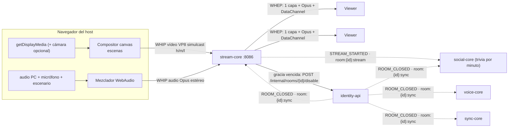
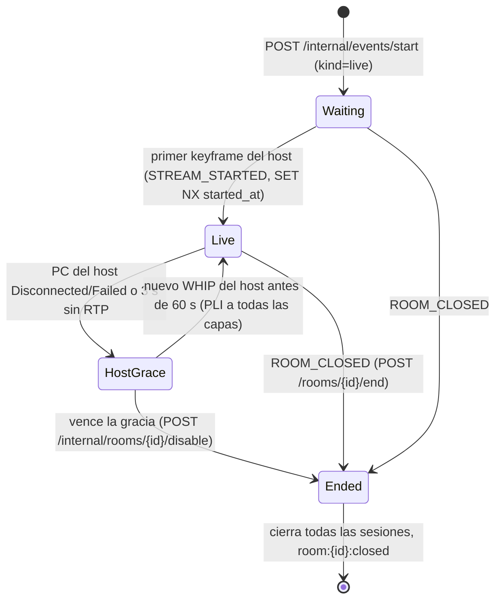

# 📡 Dominio de Transmisión en vivo (stream-core)

> El host transmite su pantalla (con cámara opcional y audio del PC) a la sala, y el servidor reenvía esa señal a cada espectador (SFU). Es un servicio propio en C++ (`services/stream-core`) sobre libdatachannel, con señalización WHIP/WHEP por el gateway.
> Decisiones: [ADR 0018](adr/0018-stream-core-sfu-cpp-con-libdatachannel.md) (SFU en C++) · [ADR 0019](adr/0019-salas-live-y-cierre-room-closed.md) (salas `live` y `ROOM_CLOSED`).
> Estado: **especificación** (SDD). Cada AC tiene pruebas con nombre fijo (§8). Los umbrales no se relajan.

## 1. Historias de usuario y criterios de aceptación

| HU | Criterios verificables | Estado |
| :--- | :--- | :--- |
| **HU-LIVE-01** Iniciar la transmisión (host) | **AC1** `POST /api/v1/stream/rooms/{id}/whip` con un ticket de host y un SDP válido devuelve `201`, `Content-Type: application/sdp`, `Location: /api/v1/stream/sessions/{sid}` y `Link rel="ice-server"`. · **AC2** Con un token `participant`: `403 {error:"FORBIDDEN_ROLE"}`. · **AC3** Si el host niega o cancela la **pantalla**, ve un error claro y no se hace POST. La **cámara es opcional**: por defecto se transmite solo la pantalla y la cámara se activa o desactiva en vivo. Si se niega la cámara o el micrófono, aparece un aviso que no bloquea y el stream sigue. | ⚪ Especificada |
| **HU-LIVE-01b** Transmitir el audio del PC | **AC1** Se transmite el audio del sistema o de la pestaña (`getDisplayMedia({audio:true, systemAudio:'include'})`). · **AC2** Mezclador con ganancia, silencio y vúmetro **por fuente** (PC, micrófono, escenario). · **AC3** El audio del PC va sin AEC, NS ni AGC, en Opus **estéreo a 128 kbps**. · **AC4** Si el navegador o el sistema no entrega pista de audio, aparece un aviso claro y el stream sigue con el micrófono. · **AC5** Sin eco ni audio duplicado (`suppressLocalAudioPlayback`/`restrictOwnAudio`; si no existen, se sugieren auriculares). | ⚪ Especificada |
| **HU-LIVE-02** Ver con muy poca latencia | **AC1** El primer frame decodificado llega en p95 < **2 s** (el máximo es 5 s). · **AC2** Lo que sube el host varía como mucho ±10 % entre 1 y 50 viewers. · **AC3** Si un viewer pierde ancho de banda, en < 3 s baja a `m`/`l` sin congelarse más de 1 s, y los demás siguen en `h`. | ⚪ |
| **HU-LIVE-03** Redes restrictivas | **AC1** Con `iceTransportPolicy:'relay'` el par elegido es `relay` y el vídeo llega. · **AC2** Con coturn detenido, la ruta directa funciona. · **AC3** Cada WHIP/WHEP o `GET …/ice-servers` entrega credenciales TURN nuevas. | ⚪ |
| **HU-LIVE-04** Un solo upload (operador) | **AC1** Con 10 viewers, el host tiene 1 PeerConnection de vídeo con 3 SSRC salientes. · **AC2** Un `DELETE` o la caída de un viewer libera su sesión y su lugar en el cupo. · **AC3** El viewer 51 recibe `409 {error:"ROOM_FULL"}`. | ⚪ |
| **HU-LIVE-05** Terminar y deshabilitar | **AC1** `POST /rooms/{id}/end` devuelve `200`, la sala queda en `disabled` y se publica `ROOM_CLOSED`. · **AC2** Si el host no vuelve en **60 s**, la sala se deshabilita sola. · **AC3** Si vuelve antes, los viewers conservan su sesión y la sala sigue `active`. · **AC4** Sobre una sala deshabilitada, WHIP/WHEP responde `410 ROOM_DISABLED` y reactivar responde `409`. | ⚪ |
| **HU-LIVE-06** Señalización HTTP por el gateway | **AC1** Una oferta que pasa por Caddy recibe su respuesta. · **AC2** Sin token: `401`. · **AC3** Si el SDP no es válido: `400 {error:"INVALID_SDP", message}`. Si el `Content-Type` es incorrecto: `415`. | ⚪ |
| **HU-LIVE-07** C++ sobre una librería WebRTC | **AC1** `docker build` compila. · **AC2** `GET /healthz` devuelve `200 {"status":"ok","service":"stream-core"}`. · **AC3** Con el README se corren las pruebas. | ⚪ |
| **HU-LIVE-08** Aviso de fin al participante | **AC1** Con `stream_state:ended` o el cierre `4010`, aparece el aviso "El evento terminó y la sala fue deshabilitada". · **AC2** El botón lleva a `/dashboard` (host) o al inicio (invitado). · **AC3** Al reconectarse después del fin, ve el mismo aviso. | ⚪ |
| **HU-LIVE-09** Deshabilitar en todos los servicios | **AC1** sync, social (chat y trivia), voz y stream cierran con `4010`. · **AC2** Unirse por enlace o código devuelve `410 {error:"Disabled"}`. · **AC3** El resumen de analítica y el historial del chat siguen siendo legibles (el chat, mientras dure Redis: 12 h). · **AC4** No se puede reactivar (`409`). | ⚪ |

**Extras de la v1:**
- escena "Empezamos pronto" / "Ya volvemos";
- contador de viewers y estadísticas del host;
- trivia o encuesta "lanzar ahora";
- trivia programada por minuto del stream;
- voz en modo escenario.

**Backlog:** grabación VOD, restream RTMP, momentos destacados, viewer en Android, publicar desde OBS (WHIP sin DataChannel).

## 2. Vista general

- **stream-core no decodifica.** Reenvía RTP, elige la capa de cada viewer y reescribe las cabeceras.
- **Toda la señalización pasa por el gateway** (`/api/v1/stream/*`). El `forward_auth` de Caddy y el propio servicio verifican el JWT.
- **Aislado:** si stream-core se cae, el chat, la voz y la analítica siguen funcionando.

## 3. API WHIP/WHEP (`/api/v1/stream`)

Para todas las rutas: `Authorization: Bearer <ticket de host | guest token>` (HS256, `iss`, `aud`, `exp`, `room_id`), `EXISTS token:revoked:{jti}` con falla cerrado, y los errores en JSON `{error, message}`.

| Método y ruta | Quién | Cuerpo | Éxito |
| :--- | :--- | :--- | :--- |
| `GET /api/v1/stream/rooms/{id}/ice-servers` | host o participante | — | `200 {ice_servers:[…]}` + `Link`; las credenciales TURN son nuevas en cada llamada |
| `POST /api/v1/stream/rooms/{id}/whip?kind=video\|audio` | host | `application/sdp`; vídeo: VP8, 3 `rid` y `m=application`; audio: Opus | `201` + SDP + `Location` + `Link` |
| `POST /api/v1/stream/rooms/{id}/whep` | host o participante | `application/sdp` `recvonly` (vídeo + audio) + `m=application` | `201` + SDP + `Location` + `Link` |
| `PATCH /api/v1/stream/sessions/{sid}` | dueño de la sesión | `application/trickle-ice-sdpfrag` | `204`; un ICE restart responde `405` (el cliente hace un POST nuevo) |
| `DELETE /api/v1/stream/sessions/{sid}` | dueño de la sesión | — | `200` |
| `GET /healthz` | — | — | `200 {"status":"ok","service":"stream-core"}` |

| Caso | Respuesta |
| :--- | :--- |
| Falta `Authorization`, la firma, `iss`, `aud` o los claims no son válidos, el token caducó o fue revocado | `401` |
| El token es de otra sala o la sesión es de otro | `403 FORBIDDEN` |
| Un participante intenta publicar | `403 FORBIDDEN_ROLE` |
| `Content-Type` distinto de `application/sdp` | `415 UNSUPPORTED_MEDIA_TYPE` |
| SDP vacío, de más de 64 KiB, sin VP8/Opus o sin `rid` (vídeo) | `400 INVALID_SDP` |
| Oferta sin `m=application` | `400 DATACHANNEL_REQUIRED` |
| WHEP que no es `recvonly` | `400 INVALID_SDP` |
| La sala no tiene transmisión habilitada (`room:{id}:stream:enabled` no existe) | `404 STREAM_NOT_FOUND` |
| Sala deshabilitada (`room:{id}:closed`) | `410 ROOM_DISABLED` |
| 50 viewers ya conectados | `409 ROOM_FULL` |
| `Origin` fuera de `ALLOWED_ORIGINS` | `403` |
| Redis no responde | `503` (falla cerrado) |

Otras reglas:
- Si el host repite el WHIP mientras transmite, **reemplaza** su sesión anterior (por ejemplo, al recargar la pestaña).
- Un viewer que llega antes que el host queda en `waiting`.

## 4. DataChannel `stream-events` (S → C, JSON)

Se negocia `negotiated:true, id:0`, y el cliente lo crea antes de `createOffer`.

| `type` | Campos | Para |
| :--- | :--- | :--- |
| `stream_state` | `state` ∈ `waiting`, `live`, `reconnecting`, `ended`; `reason?`; `grace_deadline_ms?` | todos |
| `viewer_count` | `count` (1 Hz, solo si cambia) | todos |
| `scene` | `name` ∈ `live`, `starting_soon`, `brb` | todos |
| `host_stats` | por capa: `bitrate_bps` y `active`; `viewers_per_layer`; `nacks`; `plis` (1 Hz) | host |

El host envía `scene` al servidor (C → S) por su DataChannel de vídeo, y el servidor lo reenvía a todos.

## 5. Ciclo de vida

## 6. Contratos con otros dominios

| Contrato | Lados | Detalle |
| :--- | :--- | :--- |
| `ROOM_CLOSED` en `room:{id}:sync` + `room:{id}:closed` + cierre `4010` | identity-api → sync, social, voice, stream, web | [ADR 0019](adr/0019-salas-live-y-cierre-room-closed.md) |
| `POST/DELETE /internal/events/start/{roomId}` | identity-api → stream-core | Alta y baja de una sala `live`: `SET`/`DEL room:{id}:stream:enabled`. No pasa por el gateway. |
| `POST /api/v1/internal/rooms/{id}/disable` + `X-Internal-Token` | stream-core → identity-api | Gracia vencida. Tres reintentos con espera creciente; stream-core termina localmente igual. |
| `room:{id}:stream` `{"type":"STREAM_STARTED","room_id","started_at"}` / `STREAM_ENDED` | stream-core → social-core | Trivia por minuto del stream (`at_ms` relativo a `started_at`). |
| `room:{id}:kind=live` · `room:{id}:voice:stage` | identity-api / voice-core | Voz en modo escenario (cierre `4009 NOT_ON_STAGE`). |
| `analytics:events`: `stream_started`, `stream_ended`, `stream_viewer_joined`, `stream_viewer_left`; `room_closed` `reason=host_closed\|grace_expired` | stream-core, identity-api → analytics | Sin PII ([contrato](contrato-eventos-analitica.md)). |

## 7. Análisis de performance

| Recurso | Cálculo (50 viewers) | Meta o límite |
| :--- | :--- | :--- |
| Subida del host | vídeo 2.5 + 0.8 + 0.25 Mbps + audio 0.128 Mbps ≈ **3.7 Mbps**, sin importar la audiencia | Constante ±10 % (HU-LIVE-02 AC2) |
| Egreso del SFU | 50 × (2.5 + 0.128) ≈ **131 Mbps** en el peor caso | Es el cuello de botella real |
| CPU del SFU | ~250 paquetes/s en `h` × 50 ≈ 12.5k cifrados SRTP/s + audio | Hilo mux < 70 % de un núcleo (S2) |
| Memoria | Anillo NACK por capa: 3 × 512 × 1.2 KB ≈ 2 MB por sala, más cada PeerConnection | Decenas de MB por sala |
| Tiempo al primer frame | POST + ICE + DTLS (0.3–1 s) + PLI → keyframe; el viewer entra en `l` | p95 < 2 s |
| Glass-to-glass | Captura → codificación → SFU (sin buffer) → jitter buffer del viewer | p95 < 500 ms (E2E con código de barras de `Date.now()` en el canvas) |
| Tormenta de PLI | 1 PLI por segundo por capa, compartido por todos los que entran | Cada entrada no provoca un keyframe |
| Camino caliente | `atomic<shared_ptr<const vector>>` de viewers; un escritor por reescritor; capa deseada atómica | Sin mutex por paquete (TSan) |
| Señalización | Decisión pura → Redis (500 ms) → `setRemoteDescription` → recolección ≤ 1.5 s | < 5 s (timeout de Caddy) |

## 8. Plan de pruebas (TDD)

Las pruebas unitarias (GoogleTest) cubren el código puro, sin libdatachannel: `request_decision`, `stream_state`, `room`, `layer_selector`, `rtp_rewriter`, `vp8`, `rtp_packet`, `rtcp`, `simulcast_demux`, `nack_buffer`, `pli_throttle`, `sdp_munge`, `ice_servers`, `internal_api`, `sync_listener`, `room_store`, `identity_client`, `config` y `server`. La lista de casos está en [stream-core/AGENTS.md](../services/stream-core/AGENTS.md#pruebas).

Las demás pruebas:
- **Integración:** `rtc_loopback_test` (dos peers de libdatachannel en el mismo proceso).
- **Carga** (`make load-stream`): bots en C++, un publicador VP8 sintético y 50 viewers. Exige TTFF p95 < 2 s, 0 fallos, `409` para el viewer 51 y una subida del host constante.
- **E2E** (`make e2e-stream`, local): Chromium como host y dos viewers. Mide glass-to-glass p95 < 500 ms y prueba el modo `relay`, la gracia y el aviso de fin.

## 9. Fase 0: spikes

| Spike | Se sigue si… | Si no, la alternativa | Dónde corre |
| :--- | :--- | :--- | :--- |
| S1 Simulcast: Chrome y Firefox publican 3 `rid` a libdatachannel | Se aprenden 3 SSRC y las 3 capas están activas en < 10 s | transport-cc o 2 capas | Navegador real |
| S2 Fan-out: 1 publicador + 50 viewers bot en un puerto mux, con 4 vCPU | Hilo mux < 70 %, TTFF p95 < 2 s, 0 errores SRTP | Rango de puertos sin mux | Docker (CI/local) |
| S3 Docker: bridge + UDP publicado + reescritura del candidato | Conexión directa desde la LAN; `relay` por coturn | `network_mode: host` | Navegador real |
| S4 Build en `debian:trixie-slim` y `ubuntu-24.04` | Release, ASan y TSan enlazan | Imagen dev precompilada | Docker |
| S5 Audio del PC: Chrome/Edge/Firefox × Windows/Linux/macOS, pantalla vs pestaña | Matriz documentada; música estéreo sin eco en Chrome+Windows y en pestaña de Chrome | Solo audio de pestaña + aviso | Equipos del equipo |

## 10. Limitaciones conocidas
- Una réplica, con la membresía en memoria.
- Máximo 50 viewers por sala.
- El historial de chat de una sala deshabilitada se puede leer durante 12 h (TTL de Redis).
- El audio del sistema depende del navegador y del sistema operativo (S5). Firefox y Safari no lo entregan.
