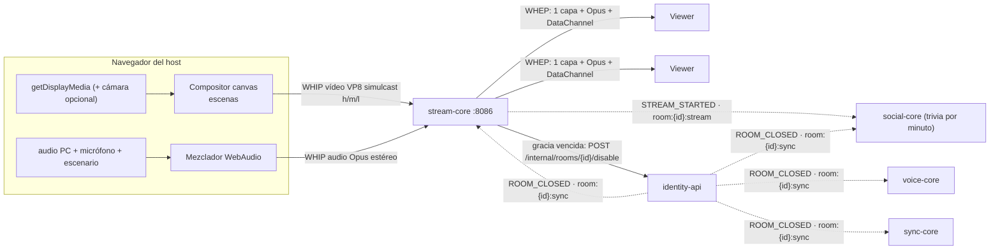
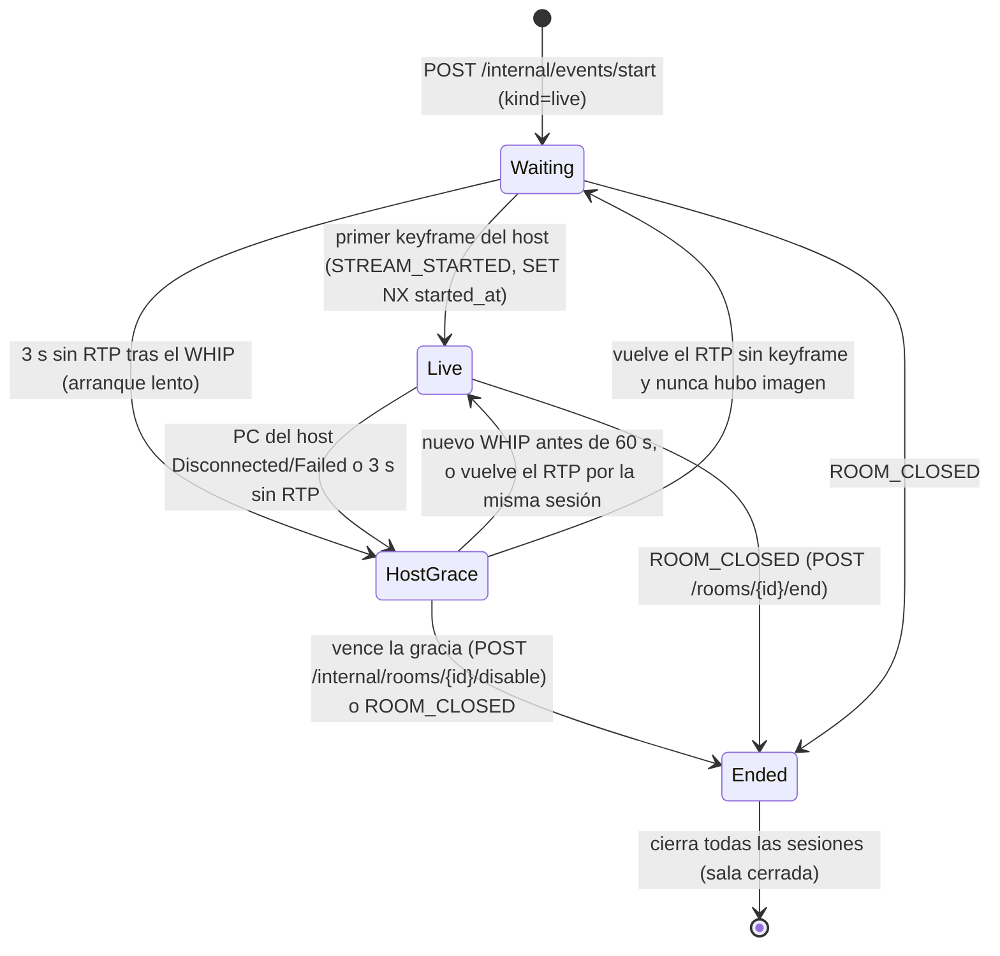

# 📡 Dominio de Transmisión en vivo (stream-core)

> El host transmite su pantalla (con cámara opcional y audio del PC) a la sala, y el servidor reenvía esa señal a cada espectador (SFU). Es un servicio propio en C++ (`services/stream-core`) sobre libdatachannel, con señalización WHIP/WHEP por el gateway.
> Decisiones: [ADR 0018](adr/0018-stream-core-sfu-cpp-con-libdatachannel.md) (SFU en C++) · [ADR 0019](adr/0019-salas-live-y-cierre-room-closed.md) (salas `live` y `ROOM_CLOSED`).
> Estado: **implementado en todos los dominios** (stream-core, identity-api, sync-core, social-core, voice-core y web), con sus gates en verde y la carga S2 medida (§7.1). Pendientes: spikes S1, S3 y S5 en navegador real y el E2E de punta a punta (§8). Los umbrales no se relajan.

## 1. Historias de usuario y criterios de aceptación

| HU | Criterios verificables | Estado |
| :--- | :--- | :--- |
| **HU-LIVE-01** Iniciar la transmisión (host) | **AC1** `POST /api/v1/stream/rooms/{id}/whip` con un ticket de host y un SDP válido devuelve `201`, `Content-Type: application/sdp`, `Location: /api/v1/stream/sessions/{sid}` y `Link rel="ice-server"`. · **AC2** Con un token `participant`: `403 {error:"FORBIDDEN_ROLE"}`. · **AC3** Si el host niega o cancela la **pantalla**, ve un error claro y no se hace POST. La **cámara es opcional**: por defecto se transmite solo la pantalla y la cámara se activa o desactiva en vivo. Si se niega la cámara o el micrófono, aparece un aviso que no bloquea y el stream sigue. | ✅ Implementada |
| **HU-LIVE-01b** Transmitir el audio del PC | **AC1** Se transmite el audio del sistema o de la pestaña (`getDisplayMedia({audio:true, systemAudio:'include'})`). · **AC2** Mezclador con ganancia, silencio y vúmetro **por fuente** (PC, micrófono, escenario). · **AC3** El audio del PC va sin AEC, NS ni AGC, en Opus **estéreo a 128 kbps**. · **AC4** Si el navegador o el sistema no entrega pista de audio, aparece un aviso claro y el stream sigue con el micrófono. · **AC5** Sin eco ni audio duplicado (`suppressLocalAudioPlayback`/`restrictOwnAudio`; si no existen, se sugieren auriculares). | 🟡 Implementada; falta verificar en navegador (S5) |
| **HU-LIVE-02** Ver con muy poca latencia | **AC1** El primer frame decodificado llega en p95 < **2 s** (el máximo es 5 s). · **AC2** Lo que sube el host varía como mucho ±10 % entre 1 y 50 viewers. · **AC3** Si un viewer pierde ancho de banda, en < 3 s baja a `m`/`l` sin congelarse más de 1 s, y los demás siguen en `h`. | 🟡 Implementada. AC1 verificado en Chrome (E2E: TTFF p95 0.86–0.99 s, glass-to-glass p95 ~145 ms) y AC2 en S2. Falta AC3 con la red limitada |
| **HU-LIVE-03** Redes restrictivas | **AC1** Con `iceTransportPolicy:'relay'` el par elegido es `relay` y el vídeo llega. · **AC2** Con coturn detenido, la ruta directa funciona. · **AC3** Cada WHIP/WHEP o `GET …/ice-servers` entrega credenciales TURN nuevas. | 🟡 Implementada. AC1 verificado en Chrome (E2E `relay`). Faltan AC2 (coturn detenido) y S3 (LAN) |
| **HU-LIVE-04** Un solo upload (operador) | **AC1** Con 10 viewers, el host tiene 1 PeerConnection de vídeo con 3 SSRC salientes. · **AC2** Un `DELETE` o la caída de un viewer libera su sesión y su lugar en el cupo. · **AC3** El viewer 51 recibe `409 {error:"ROOM_FULL"}`. | ✅ Implementada |
| **HU-LIVE-05** Terminar y deshabilitar | **AC1** `POST /rooms/{id}/end` devuelve `200`, la sala queda en `disabled` y se publica `ROOM_CLOSED`. · **AC2** Si el host no vuelve en **60 s**, la sala se deshabilita sola. · **AC3** Si vuelve antes, los viewers conservan su sesión y la sala sigue `active`. · **AC4** Sobre una sala deshabilitada, WHIP/WHEP responde `410 ROOM_DISABLED` y reactivar responde `409`. | ✅ Implementada |
| **HU-LIVE-06** Señalización HTTP por el gateway | **AC1** Una oferta que pasa por Caddy recibe su respuesta. · **AC2** Sin token: `401`. · **AC3** Si el SDP no es válido: `400 {error:"INVALID_SDP", message}`. Si el `Content-Type` es incorrecto: `415`. | ✅ Implementada |
| **HU-LIVE-07** C++ sobre una librería WebRTC | **AC1** `docker build` compila. · **AC2** `GET /healthz` devuelve `200 {"status":"ok","service":"stream-core"}`. · **AC3** Con el README se corren las pruebas. | ✅ Implementada |
| **HU-LIVE-08** Aviso de fin al participante | **AC1** Con `stream_state:ended` o el cierre `4010`, aparece el aviso "El evento terminó y la sala fue deshabilitada". · **AC2** El botón lleva a `/dashboard` (host) o al inicio (invitado). · **AC3** Al reconectarse después del fin, ve el mismo aviso. | ✅ Implementada |
| **HU-LIVE-09** Deshabilitar en todos los servicios | **AC1** sync, social (chat y trivia), voz y stream cierran con `4010`. · **AC2** Unirse por enlace o código devuelve `410 {error:"Disabled"}`. · **AC3** El resumen de analítica y el historial del chat siguen siendo legibles (el chat, mientras dure Redis: 12 h). · **AC4** No se puede reactivar (`409`). | ✅ Implementada |

**Extras de la v1:**
- escena "Empezamos pronto" / "Ya volvemos";
- contador de viewers y estadísticas del host;
- trivia o encuesta "lanzar ahora";
- trivia programada por minuto del stream;
- voz en modo escenario.

**Backlog:** grabación VOD, restream RTMP, momentos destacados, viewer en Android, publicar desde OBS (WHIP sin DataChannel).

## 2. Vista general



- **stream-core no decodifica.** Reenvía RTP, elige la capa de cada viewer y reescribe las cabeceras.
- **Toda la señalización pasa por el gateway** (`/api/v1/stream/*`). El `forward_auth` de Caddy y el propio servicio verifican el JWT.
- **Aislado:** si stream-core se cae, el chat, la voz y la analítica siguen funcionando.

## 3. API WHIP/WHEP (`/api/v1/stream`)

Para todas las rutas: `Authorization: Bearer <ticket de host | guest token>` (HS256, `iss`, `aud`, `exp`, `room_id`), `EXISTS token:revoked:{jti}` con falla cerrado, y los errores en JSON `{error, message}`.

| Método y ruta | Quién | Cuerpo | Éxito |
| :--- | :--- | :--- | :--- |
| `GET /api/v1/stream/rooms/{id}/ice-servers` | host o participante | — | `200 {ice_servers:[…]}` + `Link`; las credenciales TURN son nuevas en cada llamada |
| `POST /api/v1/stream/rooms/{id}/whip?kind=video\|audio` | host | `application/sdp`; vídeo: VP8, 3 `rid` y `m=application`; audio: Opus | `201` + SDP + `Location` + `Link` |
| `POST /api/v1/stream/rooms/{id}/whep` | host o participante | `application/sdp` `recvonly` (vídeo + audio) + `m=application` | `201` + SDP + `Location` + `Link` |
| `PATCH /api/v1/stream/sessions/{sid}` | dueño de la sesión | `application/trickle-ice-sdpfrag` | `204`; un ICE restart responde `405` (el cliente hace un POST nuevo) |
| `DELETE /api/v1/stream/sessions/{sid}` | dueño de la sesión | — | `200` |
| `GET /healthz` | — | — | `200 {"status":"ok","service":"stream-core"}` |

| Caso | Respuesta |
| :--- | :--- |
| Falta `Authorization`, la firma, `iss`, `aud` o los claims no son válidos, el token caducó o fue revocado | `401` |
| El token es de otra sala o la sesión es de otro | `403 FORBIDDEN` |
| Un participante intenta publicar | `403 FORBIDDEN_ROLE` |
| `Content-Type` distinto de `application/sdp` | `415 UNSUPPORTED_MEDIA_TYPE` |
| SDP vacío, de más de 64 KiB, sin VP8/Opus o sin `rid` (vídeo) | `400 INVALID_SDP` |
| Oferta sin `m=application` | `400 DATACHANNEL_REQUIRED` |
| WHEP que no es `recvonly` | `400 INVALID_SDP` |
| La sala no tiene transmisión habilitada (`room:{id}:stream:enabled` no existe) | `404 STREAM_NOT_FOUND` |
| Sala deshabilitada (`room:{id}:closed`) | `410 ROOM_DISABLED` |
| 50 viewers ya conectados | `409 ROOM_FULL` |
| `Origin` fuera de `ALLOWED_ORIGINS` | `403` |
| Redis no responde | `503` (falla cerrado) |

Otras reglas:
- Si el host repite el WHIP mientras transmite, **reemplaza** su sesión anterior (por ejemplo, al recargar la pestaña).
- Un viewer que llega antes que el host queda en `waiting`.

## 4. DataChannel `stream-events` (S → C, JSON)

Se negocia `negotiated:true, id:0`, y el cliente lo crea antes de `createOffer`.

| `type` | Campos | Para |
| :--- | :--- | :--- |
| `stream_state` | `state` ∈ `waiting`, `live`, `reconnecting`, `ended`; `reason?` ∈ `host_ended`, `grace_expired` (solo con `ended`); `grace_deadline_ms?` (solo con `reconnecting`) | todos |
| `viewer_count` | `count` (1 Hz, solo si cambia) | todos |
| `scene` | `name` ∈ `live`, `starting_soon`, `brb` | todos |
| `host_stats` | `layers[]` con `rid`, `bitrate_bps` (último segundo, lo que recibe el SFU, padding incluido), `active` y `viewers`; `nacks` y `plis` (acumulados) (1 Hz) | host |

El host envía `scene` al servidor (C → S) por su DataChannel de vídeo, y el servidor lo reenvía a todos.

## 5. Ciclo de vida



La gracia tiene dos orígenes y no se tratan igual:

- **Watchdog (3 s sin RTP) con la PeerConnection del host abierta.** Es un parón: el codificador arranca tarde con la CPU cargada, la pestaña pasa a segundo plano, etc. Si el RTP vuelve por esa misma sesión, la sala vuelve a `live`, o a `waiting` si nunca hubo keyframe. Se avisa por el DataChannel y no se reinicia `STREAM_STARTED`. Antes de 2026-11-02 ese RTP se ignoraba y la sala se deshabilitaba a los 60 s con el host transmitiendo; lo encontró `make e2e-system`.
- **PeerConnection del host cerrada o fallida (`on_host_lost`).** Solo un WHIP nuevo devuelve al host. Los paquetes rezagados no lo reviven.

## 6. Contratos con otros dominios

| Contrato | Lados | Detalle |
| :--- | :--- | :--- |
| `ROOM_CLOSED` en `room:{id}:sync` + `room:{id}:closed` + cierre `4010` | identity-api → sync, social, voice, stream, web | [ADR 0019](adr/0019-salas-live-y-cierre-room-closed.md) |
| `POST/DELETE /internal/events/start/{roomId}` | identity-api → stream-core | Alta y baja de una sala `live`: `SET`/`DEL room:{id}:stream:enabled`. No pasa por el gateway. |
| `POST /api/v1/internal/rooms/{id}/disable` + `X-Internal-Token` | stream-core → identity-api | Gracia vencida. Tres reintentos con espera creciente; stream-core termina localmente igual. |
| `room:{id}:stream` `STREAM_STARTED` / `STREAM_ENDED` (formato en §6.1) | stream-core → social-core | Trivia por minuto del stream (`at_ms` relativo a `started_at_ms`). |
| `room:{id}:kind=live` · `room:{id}:voice:stage` | identity-api / voice-core | Voz en modo escenario (cierre `4009 NOT_ON_STAGE`). |
| `analytics:events`: `stream_started`, `stream_ended`, `stream_viewer_joined`, `stream_viewer_left`; `room_closed` `reason=host_ended\|grace_expired` | stream-core, identity-api → analytics | Sin PII ([contrato](contrato-eventos-analitica.md)). |

### 6.1 Formatos estándar

Todos los mensajes nuevos de esta feature siguen las mismas reglas. Un mensaje que no las cumpla se descarta (bus) o se responde con `400`/`INVALID_PAYLOAD` (cliente).

| Regla | Valor |
| :--- | :--- |
| `type` en el bus de Redis (`room:{id}:sync`, `room:{id}:stream`) | `UPPER_SNAKE` (`ROOM_CLOSED`, `STREAM_STARTED`), igual que `REVOKED` |
| `type` en WebSocket y DataChannel | `lower_snake` (`trivia_launch_now`, `stream_state`), igual que el Canal Social |
| Identificador del mensaje | `event_id`: UUID v4. En el bus lo genera quien publica; en C → S, el cliente (deduplicación) |
| Fechas legibles | `occurred_at`, `started_at`: RFC 3339 en UTC con milisegundos (`2026-11-01T18:00:00.000Z`) |
| Instantes para cálculo | Sufijo `_ms`, milisegundos desde epoch, entero (`started_at_ms`, `grace_deadline_ms`) |
| Duraciones | Sufijo `_ms` o `_s` explícito (`retry_after_ms`, `STREAM_HOST_GRACE_S`) |
| `reason` de cierre | `host_ended` (el host terminó con `POST /rooms/{id}/end`) o `grace_expired` (el host no volvió a tiempo). Es el mismo valor en `ROOM_CLOSED`, `STREAM_ENDED`, `stream_state` y en el evento `room_closed` de analítica |
| Errores HTTP de identity-api | `{error:"PascalCase"}`, como los existentes (`Deleted`, `Forbidden`): `Disabled`, `AlreadyDisabled`, `NotLive`, `NotReactivable` |
| Errores HTTP de las rutas nuevas de stream-core, social-core y voice-core | `{error:"UPPER_SNAKE", message?}` (`ROOM_DISABLED`, `ROOM_FULL`, `FORBIDDEN_ROLE`, `NOT_ON_STAGE`) |
| Errores por WebSocket | `{type:"error", code:"UPPER_SNAKE", message?, event_id_ref?}`, igual que el Canal Social |

**Códigos de cierre de WebSocket** (todos tras el upgrade, [ADR 0014](adr/0014-upgrade-y-cierre-4xxx-para-estados-terminales.md)):

| Código | Nombre | Cuándo | La web muestra |
| :--- | :--- | :--- | :--- |
| `4001` | `REVOKED` | El host retiró al invitado | "Fuiste retirado de la sala" |
| `4003` | `TOKEN_EXPIRED` | El token caducó | Reconecta con un token nuevo |
| `4008` | `VOICE_FULL` | La voz está llena | Aviso de voz llena |
| `4009` | `NOT_ON_STAGE` | Voz de una sala `live` sin estar en el escenario | Botón "Pedir subir al escenario" desactivado |
| `4010` | `ROOM_DISABLED` | La sala fue deshabilitada | "El evento terminó y la sala fue deshabilitada" (HU-LIVE-08) |

**Mensajes del bus**

```jsonc
// room:{id}:sync — lo publica solo identity-api
{"type":"ROOM_CLOSED","event_id":"<uuid>","room_id":"r1","reason":"host_ended","occurred_at":"2026-11-01T18:00:00.000Z"}
// room:{id}:stream — lo publica solo stream-core
{"type":"STREAM_STARTED","event_id":"<uuid>","room_id":"r1","started_at":"2026-11-01T17:00:00.000Z","started_at_ms":1793552400000,"occurred_at":"2026-11-01T17:00:00.000Z"}
{"type":"STREAM_ENDED","event_id":"<uuid>","room_id":"r1","reason":"grace_expired","occurred_at":"2026-11-01T18:00:00.000Z"}
```

Los consumidores son **idempotentes**: un `ROOM_CLOSED` repetido no hace nada nuevo, y un `STREAM_STARTED` repetido con el mismo `started_at_ms` no reprograma trivias. Un mensaje del bus con `room_id` distinto del canal o con un `reason` desconocido se descarta. Para no perder un `ROOM_CLOSED` publicado entre el handshake y la suscripción, cada consumidor vuelve a leer `room:{id}:closed` después de suscribirse (sync-core en `Init`; voice-core recuerda las salas cerradas 60 s). Al terminar, stream-core borra `room:{id}:stream:started_at` antes de publicar `STREAM_ENDED`. Al terminar la sala, stream-core borra `room:{id}:stream:started_at` antes de publicar `STREAM_ENDED`: un social-core que arranque después del fin no encuentra la clave y no rearma trivias.

**identity-api** (`/api/v1`, Firebase ID token del dueño salvo la ruta interna)

| Ruta | Éxito | Errores |
| :--- | :--- | :--- |
| `POST /rooms/{id}/end` | `200 {"room_id","status":"disabled","reason":"host_ended","closed_at"}` | `403 Forbidden` (no es el dueño) · `404` · `409 NotLive` (sala `watch`: se borra con `DELETE`) · `409 AlreadyDisabled` · `410 Deleted` · `503` (Redis o BD: se puede reintentar) |
| `POST /internal/rooms/{id}/disable` (`X-Internal-Token`, cuerpo opcional `{"reason":"grace_expired"}`) | `200` (mismo cuerpo, `reason:"grace_expired"`) | `401` (token ausente o incorrecto) · `400` (otro `reason`) · `404` · `409 NotLive` · `409 AlreadyDisabled` · `410 Deleted` · `503` (Redis o BD, o `INTERNAL_API_SECRET` sin configurar: falla cerrado) |
| `POST /rooms/{id}/reactivate` | — | `409 NotReactivable` (siempre; se crea un evento nuevo) |
| `POST /invitations/claim`, `GET /rooms/{id}/playback`, `PATCH /rooms/{id}`, `POST /rooms/{id}/invitations` y las rutas con `requireActiveRoom` | — | `410 Disabled` |
| `POST /invitations/claim` (sala activa) | `200 {token, roomId, nick, roomTitle, roomKind}`; `roomKind ∈ watch, live` decide si la web abre `/watch/:id` o `/live/:id` | — |
| `POST /events/start {title, kind?}` | `kind:'live'` registra stream-core (no sync-core) y escribe `room:{id}:kind=live` (24 h); `sessions = {stream, social, analytics}` | `503` con compensación |
| `POST /rooms/{id}/sync-ticket` y `POST /rooms/{id}/analytics-ticket` | Siguen emitiéndose al dueño con la sala `disabled` (para leer el chat y los KPIs); los WebSocket igual cierran con `4010` | `410 Deleted` |

El evento de analítica `room_closed` lleva `user_id` (uid del host) solo con `host_ended`; con `grace_expired` no hay usuario.

**Orden de escritura del cierre** (para no perder el aviso): `SET room:{id}:closed 1` → `PUBLISH ROOM_CLOSED` → `UPDATE rooms SET status='disabled'` → `XADD room_closed`. Si falla cualquiera de los tres primeros pasos, la respuesta es `503` y la sala sigue `active` en la BD, así que el reintento repite los pasos (todos idempotentes) y vuelve a publicar. `409 AlreadyDisabled` solo sale cuando la BD ya dice `disabled`, y eso implica que el aviso ya se publicó. El `XADD` de analítica es de mejor esfuerzo, como el resto de eventos.

**social-core**

```jsonc
// C → S, solo host o cohost (sync-ticket). Abre ya una trivia programada que aún no salió.
{"event_id":"<uuid>","type":"trivia_launch_now","trivia_id":"t1"}
// S → sala: el trivia_question habitual (opens_at_ms = ahora); al host: trivia_schedule_state actualizado.
// Errores: FORBIDDEN (no es host/cohost), TRIVIA_NOT_FOUND, TRIVIA_CLOSED (ya salió), UNAVAILABLE (sin Redis).
```

`GET /api/v1/social/rooms/{id}/chat` (sync-ticket de host o cohost de esa sala; también con la sala deshabilitada):

```jsonc
200 {"room_id":"r1","messages":[ /* objetos chat_message idénticos a los del WebSocket, del más antiguo al más nuevo, máx. 100 (el WebSocket entrega los 50 más recientes) */ ]}
// 401 UNAUTHORIZED · 403 FORBIDDEN (no es host/cohost o es de otra sala) · 503 UNAVAILABLE (sin Redis)
```

En una sala `live`, una trivia programada con `at_ms` se abre en `started_at_ms + at_ms` (reloj del servidor). Sin `STREAM_STARTED` todavía, queda pendiente. En `watch` no cambia nada: sigue el reloj del vídeo.

**voice-core**

| Ruta | Quién | Éxito | Errores |
| :--- | :--- | :--- | :--- |
| `PUT /api/v1/voice/rooms/{id}/stage/{user_id}` | host o cohost | `204` (`SADD room:{id}:voice:stage`, TTL 24 h) | `401 UNAUTHORIZED` · `403 FORBIDDEN` · `404 NOT_FOUND` · `405 METHOD_NOT_ALLOWED` · `503 UNAVAILABLE` |
| `DELETE /api/v1/voice/rooms/{id}/stage/{user_id}` | host o cohost | `204` (`SREM`; en salas `live` cierra con `4009` la conexión de ese usuario, nunca la del host o el cohost) | igual |

Orden del handshake de voz: revocado (`4001`) → sala cerrada (`4010`) → fuera del escenario (`4009`) → silencios.

**DataChannel `stream-events`**: ver §4. `stream_state.reason` usa los mismos valores que `ROOM_CLOSED`.

**Web**: la sala `live` vive en `/live/:roomId` (sin `/ws/sync`). `VITE_STREAM_API_URL` vacía significa mismo origen (el gateway enruta `/api/v1/stream/*`, R8); sin definir, en `npm run dev` apunta a `http://localhost:8086`.

## 7. Análisis de performance

| Recurso | Cálculo (50 viewers) | Meta o límite |
| :--- | :--- | :--- |
| Subida del host | vídeo 2.5 + 0.8 + 0.25 Mbps + audio 0.128 Mbps ≈ **3.7 Mbps**, sin importar la audiencia | Constante ±10 % (HU-LIVE-02 AC2) |
| Egreso del SFU | 50 × (2.5 + 0.128) ≈ **131 Mbps** en el peor caso | Es el cuello de botella real |
| CPU del SFU | ~250 paquetes/s en `h` × 50 ≈ 12.5k cifrados SRTP/s + audio | Hilo mux < 70 % de un núcleo (S2) |
| Memoria | Anillo NACK por capa: 3 × 512 × 1.2 KB ≈ 2 MB por sala, más cada PeerConnection | Decenas de MB por sala |
| Tiempo al primer frame | POST + ICE + DTLS (0.3–1 s) + PLI → keyframe; el viewer entra en `l` | p95 < 2 s |
| Glass-to-glass | Captura → codificación → SFU (sin buffer) → jitter buffer del viewer | p95 < 500 ms (E2E con código de barras de `Date.now()` en el canvas) |
| Tormenta de PLI | 1 PLI por segundo por capa, compartido por todos los que entran | Cada entrada no provoca un keyframe |
| Camino caliente | `atomic<shared_ptr<const vector>>` de viewers; un escritor por reescritor; capa deseada atómica | Sin mutex por paquete (TSan) |
| Señalización | Decisión pura → Redis (500 ms) → `setRemoteDescription` → recolección ≤ 1.5 s | < 5 s (timeout de Caddy) |

### 7.1 Medido (2026-11-01)
| Medición | Resultado | Cómo |
| :--- | :--- | :--- |
| Camino caliente del SFU (demux + buffer NACK + reescritura por viewer), **sin SRTP** | **261 ns por paquete saliente** con 50 viewers; 4.3 µs por paquete del host repartido a 50. A la tasa real (~370 paquetes/s del host) es **0.16 % de un núcleo** | `stream_core_bench 50 20000` (Release, 4 vCPU, `loadtest/forward_bench.cpp`) |
| Imagen de runtime | 148 MB | `docker images` |
| Señalización contra el servicio real | `/healthz` 200; smoke 13/13 (401/403/404/410/415/400/201/DELETE) | `scripts/smoke.py` |
| **S2: TTFF** con 50 viewers que entran a la vez (WHEP + ICE + DTLS + PLI → keyframe), keyframe pedido **al entrar** (`add_viewer`) | p50 1159 ms · p95 1163 ms · máx 1166 ms (< 2 s). Señalización WHEP p50 48 ms, p95 72 ms | `make load-stream` (`loadtest/loadbot.cpp`, 4 vCPU, contenedor de compose, 30 s) |
| S2: TTFF con el keyframe pedido **al abrir la pista del viewer** en el SFU (descartado) | p50 1162 ms · p95 1165 ms: sin mejora | ídem |
| **S2: TTFF** con el keyframe pedido **en el primer RTCP del viewer** (actual) | **p50 161–166 ms** en 3 de 4 corridas (1217 ms en la otra) · **p95 1222–1231 ms** · máx 1231 ms. Fases p50: Connected ~140 ms, primer RTP ~165 ms. Entre 12 y 15 de los 50 viewers (45 en la corrida mala) esperan la siguiente ventana | 1 corrida de 30 s + 3 de 8 s |
| S2: errores y cupo | 50/50 viewers con vídeo, audio y DataChannel; 0 fallos; el viewer 51 recibe `409 ROOM_FULL` | ídem |
| S2: CPU con SRTP y 50 PeerConnections reales | Contenedor: media 14.7 %, máx 18.4–22.9 % de **un** núcleo (`docker stats`). Hilo más cargado (mux UDP de libdatachannel): **4.4 %** (< 70 %, `top -H`). Memoria ~26 MiB | ídem |
| S2: tráfico | Subida del host 3.8 Mbps constante (VP8 l/m/h 250k/800k/2.5M + Opus); egreso medio 89 Mbps con los viewers subiendo de `l` a `h` por REMB (régimen en `h` ≈ 130 Mbps) | ídem |

**E2E en navegador** (`make e2e-stream`, 2026-11-02). Chromium headless de `minlag/mermaid-cli:11.4.2`, 4 vCPU, todo en la misma máquina (`--network host`, candidato del SFU en la IP de la LAN). Host y viewers usan la web real (`/live/:id`). La pantalla es un canvas que dibuja `Date.now()` en binario; ver §8.

| Medición (E2E) | Ruta libre | Solo TURN (`relay`) | Meta |
| :--- | :--- | :--- | :--- |
| **S1:** Chrome publica `l`/`m`/`h` y el SFU aprende las 3 capas activas (`host_stats`) | **1362 ms** desde el WHIP. Chrome: 640×360 a 15 fps, 1280×720 y 1920×1080 a 30 fps, `qualityLimitationReason: none` | 1274 ms | < 10 s |
| **TTFF** (POST WHEP → `framesDecoded > 0`), 10 conexiones (2 viewers × 5 recargas) | p50 682 ms · **p95 987 ms** · máx 987 ms. `connected` a los 24–52 ms | p50 503 ms · **p95 864 ms** | < 5 s siempre; p95 < 2 s |
| **Glass-to-glass** (código de barras de `Date.now()`, mismo reloj) | 49 muestras · **p50 103 ms · p95 142 ms** · máx 145 ms | 49 muestras · p50 98 ms · p95 146 ms · máx 194 ms | p95 < 500 ms |
| Capa del viewer | `l` (640 px) → `m` a los ~6 s → `h` (1920 px) a los ~11 s | `m` a los ~5 s, `h` a los ~10 s | — |
| **Audio** | Opus, 2 canales, ~128 kbps por viewer | igual | bytes > 0 |
| **Rutas** | `host->host` en los 4 pares | `relay->host` en los 4 pares; vídeo llega (≥ 451 frames) | `relay` |
| **Gracia** (`STREAM_HOST_GRACE_S=10`) | `reconnecting` (con `grace_deadline_ms`) a los 71 ms de cerrar la pestaña; `ended`/`grace_expired` a los 10.13 s; `POST …/disable` con `X-Internal-Token`; aviso "El evento terminó…" | 25 ms · 10.23 s | — |
| Subida del host en régimen (~40 s) | Medios: `l` 184 + `m` 402 + `h` 860 kbps + Opus 131 kbps. Además, **~1.15 Mbps de padding** en el SSRC de `l` (`headerBytesSent`); `availableOutgoingBitrate` 300 kbps | `h` 783 kbps; padding 1.2 Mbps | §7: ≈ 3.7 Mbps |
| Subida del host **con REMB del SFU** (2026-11-02, misma máquina, antes → después) | `targetBitrate` del codificador **2500 → 3550 kbps**. Medios `l`/`m`/`h` 198/483/877 → 196/457/933 kbps. Padding en `l` (`headerBytesSent`) 1123 → 1458 kbps: **no baja**. `availableOutgoingBitrate` sigue en 300 kbps | `targetBitrate` 2500 → 3550. `h` 836 → 1008 kbps. Padding 1145 → 1396 kbps | Sin padding (no se logró) |

Antes de los arreglos que encontró el E2E, el TTFF era p50 2604 ms y p95 2662 ms, y los viewers no salían de `l`. Ver el análisis abajo. Con los arreglos, S2 se volvió a medir (50 viewers, 3 corridas de 8 s): TTFF p50 161, 158 y 1154 ms; p95 166, 1221 y 1158 ms; 0 fallos. Es la misma distribución que antes.

Conclusión: ni el reenvío ni el cifrado SRTP son el cuello de botella con 50 viewers; queda el egreso de red. Con `STREAM_PUBLIC_IP=127.0.0.1` el UDP pasa por `docker-proxy`, cuya CPU no cuenta en el contenedor; en el humo de CI (`--network host`, 20 viewers) el contenedor usa ~4 %.

**TTFF.** Con el keyframe pedido al entrar, el TTFF era casi constante (~1.16 s). Las fases (`loadbot` imprime Connected, primer RTP y primer keyframe) muestran la causa: el viewer queda Connected a los ~190 ms y recibe deltas a los ~200 ms, pero su primer keyframe llega a ~1.2 s. El keyframe pedido al entrar, o al abrir la pista del lado del SFU (se probó y no mejoró), sale antes de que el viewer tenga sus claves SRTP, porque el DTLS termina antes en el SFU. Ese keyframe se pierde, y el PLI siguiente del viewer cae en la ventana de 1 s de `PliThrottle`. Ahora el SFU pide el keyframe con el **primer RTCP del viewer** (sea RR o PLI), que prueba que ya descifra. Con eso el p50 baja a ~165 ms. El p95 sigue en ~1.2 s porque, con 50 entradas simultáneas, los viewers cuyas claves llegan después del keyframe compartido esperan a la siguiente ventana. Bajarlo exige cambiar `PliThrottle` (más keyframes del host) o reenviar el último keyframe guardado en el `NackBuffer` al viewer que entra. Ninguna de las dos se hizo: el p95 ya cumple la meta de < 2 s. Los bots fuerzan un keyframe solo cada 10 s, así que esa cadencia no influye en las cifras.

**TTFF con Chrome (E2E).** Esperar el primer RTCP funcionaba con los bots, pero con Chrome no: Chrome manda su primer RTCP unos **2.5 s** después de conectar. El TTFF era ~2.6 s en todas las conexiones. Las fases lo mostraban: `connected` a los ~40 ms, el PLI llegaba al host a los ~2.5 s y el keyframe ~70 ms después. Ahora el viewer queda listo con **lo primero que ocurra**: que abra su DataChannel (SCTP viaja sobre su DTLS, así que ya descifra) o que llegue su primer RTCP. Su keyframe lo pide el siguiente `tick` (cada 250 ms). Pedirlo en el instante empeoraba S2: el primer DataChannel abierto disparaba el PLI antes de que los otros 49 tuvieran claves, y el p50 subía a ~1.15 s. El tick agrupa las entradas casi simultáneas.

Ese arreglo destapó otro bug. Un segundo viewer que entraba dentro de la ventana de 1 s de `PliThrottle` perdía su pedido. Como Chrome no envía PLI si no recibió nada, se quedaba sin vídeo. Ahora `Room::tick` vuelve a pedir el keyframe (con el mismo límite) mientras un viewer listo no reciba su capa. Cubre también un cambio de capa cuyo PLI se limitó. El TTFF depende de si la entrada cae en la ventana de 1 s de otra: entre 140 y 350 ms si no cae, y hasta ~1 s si cae. En el E2E, cada viewer recarga justo después de que el otro recibió su primer frame, así que casi todas las entradas caen en una ventana: de ahí el p50 de ~0.5–0.7 s.

**Capas con Chrome (E2E).** Chrome negocia REMB porque el SFU quita transport-cc. Su REMB es una estimación del receptor que no pasa de ~1.5 veces lo que recibe, y el SFU no sondea. El E2E lo midió subiendo de 161k a ~330k mientras el viewer recibía `l` a ~210 kbps, y ahí se estancaba. El selector exigía un REMB ≥ 1.3 × 800k para subir a `m`, así que **ningún viewer salía de 360p**. Ahora el REMB solo cuenta **cuando cae**: por debajo del 90 % de su máximo desde el último cambio indica congestión, y si la capa actual ya no cabe baja a la que cabe. Para subir basta con 5 s sin pérdida en los RR ni caída del REMB. La pérdida sigue bajando una capa tras 2 informes > 10 %, con 8 s de espera antes de volver a subir. Sin red limitada no se midió cuánto tarda en bajar (HU-LIVE-02 AC3).

**Padding del host y REMB hacia el host.** Antes, el SFU no le daba al host ninguna señal de ancho de banda: quita transport-cc y libdatachannel no genera REMB. Chrome mostraba `availableOutgoingBitrate` = 300 kbps y mandaba ~1.1 Mbps de padding en el SSRC de `l`. El SFU no reenvía ese padding, pero es subida desperdiciada, y `host_stats` lo cuenta en el bitrate de `l`.

Ahora el SFU envía un **REMB al host** por la sesión WHIP de vídeo (`sfu/host_remb`, desde `Room::tick`):
- **Cuándo:** en cuanto conoce algún SSRC del host, luego cada 1 s, y enseguida si cambian los SSRC (capa nueva o reconexión) o el objetivo.
- **SSRC:** los de las capas aprendidas.
- **Objetivo:** constante, (2.5 + 0.8 + 0.25 Mbps) × 1.2 = **4.26 Mbps**. No baja con pocos viewers ni sin viewers por dos motivos. La subida del host no debe depender de la audiencia (HU-LIVE-02 AC2). Y un REMB por debajo de la suma haría que Chrome apagara las capas altas: el viewer que suba a `h` tendría que esperar a que se reactiven. El techo real lo siguen poniendo los `maxBitrate` por capa de la web.
- **SDP:** la respuesta WHIP de vídeo anuncia `a=rtcp-fb:<vp8> goog-remb` (`sdp::add_goog_remb`).

Medido con `make e2e-stream` (tabla de arriba, corridas consecutivas en la misma máquina):
- **El REMB llega y Chrome lo usa.** El `targetBitrate` del codificador sube de **2500 kbps** a **3550 kbps**, que es la suma de los `maxBitrate`. Antes, el presupuesto del codificador era el `x-google-start-bitrate` (2500), por debajo de la suma de las capas. Con contenido real, `h` no habría pasado de ~1.45 Mbps. Ahora tiene presupuesto para sus 2.5 Mbps.
- **El 300 kbps de `availableOutgoingBitrate` no era el límite real.** Sin transport-cc, Chrome no actualiza ese dato, y sigue en 300 kbps con REMB.
- **El padding no desaparece** (1.1 → 1.4 Mbps, dentro del ruido). Causa probable: Chrome rellena hasta su tasa de padding de simulcast (objetivo de las capas bajas + mínimo de la alta) cuando el codificador produce menos de eso. Con el canvas sintético, `h` produce ~0.9 Mbps de 2.5. El REMB no lo puede evitar: solo un objetivo por debajo de esa tasa cortaría el padding, y también apagaría capas.
- **Sin regresión:** TTFF p95 866/803 → 762/803 ms (libre/`relay`), glass-to-glass p95 280/165 → 156/168 ms, y S2 (`make load-stream`, 50 viewers) en verde: TTFF p50 70 ms, p95 1132 ms, 0 fallos, `409` al 51 y el hilo más cargado al 4.2 %. La máquina tenía carga de otros procesos (load 6–10 en 4 vCPU): con la carga más alta, el E2E de `develop` tampoco llegaba a las 30 muestras de glass-to-glass.

**Pendiente:**
- Medir el padding con una pantalla real en movimiento: se espera que baje cuando los medios llenen el presupuesto.
- El REMB es fijo y el host no recibe RR, así que en un enlace de subida más lento que 3.55 Mbps Chrome no se entera de la pérdida. Ya pasaba antes con los 2.5 Mbps de arranque. Arreglarlo exige un estimador en el SFU (REMB según la pérdida o el retardo del host) o generar feedback transport-cc.

## 8. Plan de pruebas (TDD)

Las pruebas unitarias (GoogleTest) cubren el código puro, sin libdatachannel: `request_decision`, `stream_state`, `room`, `layer_selector`, `rtp_rewriter`, `vp8`, `rtp_packet`, `rtcp`, `simulcast_demux`, `nack_buffer`, `pli_throttle`, `host_remb`, `sdp_munge`, `ice_servers`, `internal_api`, `sync_listener`, `room_store`, `identity_client`, `config` y `server`. La lista de casos está en [stream-core/AGENTS.md](../services/stream-core/AGENTS.md#pruebas).

Las demás pruebas:
- **Integración:** `rtc_loopback_test` (dos peers de libdatachannel en el mismo proceso).
- **Carga** (`make load-stream`, `loadtest/run.sh`): bots en C++ con libdatachannel, un publicador VP8 simulcast sintético (3 `rid`, keyframe al recibir PLI) y 50 viewers WHEP que piden keyframe y envían REMB. Exige TTFF p95 < 2 s, 0 fallos, `409` para el viewer 51 y el hilo más cargado < 70 %. En CI, `stream-load-smoke` lo corre con 20 viewers durante 15 s.
- **E2E** (`make e2e-stream`, local, fuera de CI; `services/stream-core/e2e/`): Chromium (`minlag/mermaid-cli`) como host y dos viewers, en modo `normal` y `relay`.
  - **Entorno propio y aislado** (`--network host`): Redis en `:16390`, stream-core de este árbol en `:18086` (UDP `:18087`, `STREAM_HOST_GRACE_S=10`, candidato en la IP de la LAN), la web compilada contra él en `:15173` y coturn (si no hay uno en `:3478`). Al terminar borra sus contenedores.
  - **Web real:** host y viewers usan `/live/:id` y el hook `useLiveStream`: 2 WHIP, simulcast `l`/`m`/`h`, DataChannel `negotiated:true,id:0`, compositor, mezclador y WHEP. Lo único que se sustituye es la fuente: `getDisplayMedia` devuelve un canvas con `Date.now()` codificado en bloques blanco y negro (y su complemento, para descartar lecturas corruptas) y un tono como audio del PC.
  - **identity-api es un stub HTTP** del script. Responde a la web: sala `live` y un sync-ticket de host firmado con `JWT_SECRET`, sin Firebase. También registra el `POST …/internal/rooms/{id}/disable` de stream-core.
  - **Qué comprueba:** S1 (3 `outbound-rtp` en Chrome y 3 capas activas en `host_stats` en < 10 s), TTFF < 5 s y p95 < 2 s, glass-to-glass p95 < 500 ms con ≥ 30 muestras, audio Opus, pares `relay` y la gracia (`reconnecting` → `ended`/`grace_expired`, llamada a identity-api y aviso de fin).
- **E2E del sistema** (`make e2e-system`, modo `live`; `scripts/e2e/`). A diferencia del anterior, recorre el stack completo de `make up` por `https://localhost`: gateway con `forward_auth`, identity-api real con login del Firebase Auth Emulator, social-core y voice-core. Pasos: crear la sala `live` → "Empezar a transmitir" → la invitada entra por el link y ve el vídeo → chat, encuesta y trivia "lanzar ahora" → host e invitada en la voz del escenario → "Terminar evento" → la invitada ve "El evento terminó". En verde el 2026-11-02, después de corregir los WS por el gateway (#152), los orígenes por defecto (#154) y la gracia por parón (#153).

## 9. Fase 0: spikes

| Spike | Se sigue si… | Si no, la alternativa | Dónde corre |
| :--- | :--- | :--- | :--- |
| S1 Simulcast: Chrome y Firefox publican 3 `rid` a libdatachannel | Se aprenden 3 SSRC y las 3 capas están activas en < 10 s | transport-cc o 2 capas | Navegador real. **Chrome: pasó** (2026-11-02, `make e2e-stream`). Las 3 capas activas en `host_stats` a los ~1.3 s del WHIP, en ruta libre y en `relay`. Ver §7.1. Firefox: pendiente (el E2E solo trae Chromium) |
| S2 Fan-out: 1 publicador + 50 viewers bot en un puerto mux, con 4 vCPU | Hilo mux < 70 %, TTFF p95 < 2 s, 0 errores SRTP | Rango de puertos sin mux | Docker (CI/local). **Pasó** (2026-11-01): ver §7.1 |
| S3 Docker: bridge + UDP publicado + reescritura del candidato | Conexión directa desde la LAN; `relay` por coturn | `network_mode: host` | Navegador real |
| S4 Build en `debian:trixie-slim` y `ubuntu-24.04` | Release, ASan y TSan enlazan | Imagen dev precompilada | Docker |
| S5 Audio del PC: Chrome/Edge/Firefox × Windows/Linux/macOS, pantalla vs pestaña | Matriz documentada; música estéreo sin eco en Chrome+Windows y en pestaña de Chrome | Solo audio de pestaña + aviso | Equipos del equipo |

## 10. Limitaciones conocidas
- Una réplica, con la membresía en memoria.
- Máximo 50 viewers por sala.
- El historial de chat de una sala deshabilitada se puede leer durante 12 h (TTL de Redis).
- El audio del sistema depende del navegador y del sistema operativo (S5). Firefox y Safari no lo entregan.
- El SFU envía al host un REMB fijo de 4.26 Mbps, sin transport-cc ni RR. Con contenido simple, Chrome sigue mandando ~1.1–1.4 Mbps de padding en `l`, y no se entera si su subida pierde paquetes (§7.1).
- La subida de capa del viewer no se basa en ancho de banda medido: sube tras 5 s sin pérdida y baja por pérdida o caída del REMB. En un enlace justo puede alternar entre subir y bajar, con 8 s de espera entre intentos.
