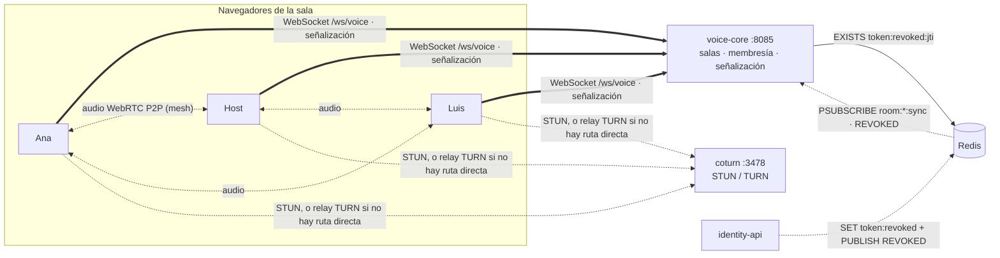
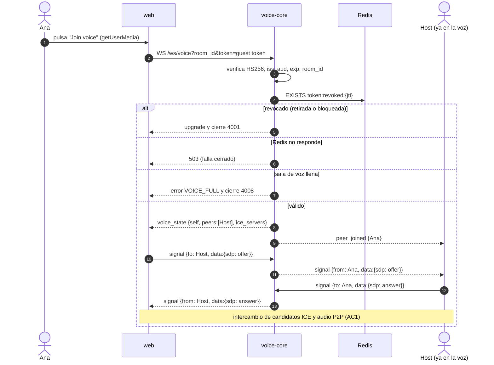
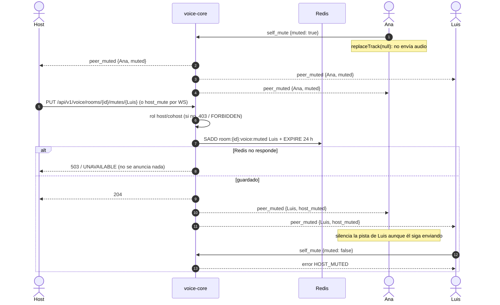

# 🎙️ Dominio de Voz (voice-core)

> Canal de voz de la sala: los participantes hablan entre sí mientras ven el vídeo. Servicio propio en C++ (`services/voice-core`), audio P2P con WebRTC.
> Guía del servicio: [services/voice-core/AGENTS.md](../services/voice-core/AGENTS.md) · Decisión: [ADR 0015](adr/0015-voice-core-en-cpp-con-webrtc-p2p.md).

## 1. Historias de usuario y estado

| HU | Criterios | Estado |
| :--- | :--- | :--- |
| **HU-VOZ-01** Unirse a la voz de la sala | AC1 al pulsar *Join voice* oye a los demás · AC2 un bloqueado es rechazado · AC3 al desconectarse los demás dejan de oírlo | 🟢 Completa (Fases 1 y 4). Probada con dos navegadores reales: audio recibido medido con `getStats`, `peer_left` al salir. |
| **HU-VOZ-02** Silenciar y activar mi micrófono | AC1 silenciado no transmite · AC2 al activar vuelve el audio · AC3 los demás ven el icono | 🟢 Completa (Fases 2 y 4). En navegador real: silenciada → 0 bytes de audio recibidos; al activar vuelve; el otro ve el icono. |
| **HU-VOZ-03** Ver quién habla | AC1 resalta al que habla · AC2 se apaga en silencio · AC3 legible con muchos | 🟢 Completa (Fase 4, solo web): anillo en el avatar de quien habla, con retención de 400 ms; filas de tamaño fijo. Ver §4.2. |
| **HU-VOZ-04** El host silencia a un participante | AC1 deja de oírse para todos · AC2 no puede quitárselo · AC3 un no-host recibe 403 | 🟢 Completa (Fases 2 y 4). En navegador real: tras el `PUT` el silenciado envía 0 bytes, su `<audio>` queda mudo en los demás y no puede activarse; con `DELETE` vuelve. |
| **HU-VOZ-05** Redes restrictivas | AC1 funciona por TURN · AC2 usa la ruta directa si existe · AC3 reconecta | 🟢 AC1: audio por `coturn` con `iceTransportPolicy: 'relay'` en navegador real (par elegido `relay`). AC2: sin forzar, ICE elige la ruta directa (`host`/`prflx`). AC3: ICE restart en `failed` (y tras 3 s en `disconnected`), al evento `online`, y reconexión del WebSocket con espera exponencial; probado con pruebas unitarias, **no** con un cambio de red real. |
| **HU-VOZ-06** Componente propio | AC1 si se detiene, chat y sync siguen · AC2 API de salas, membresía y moderación · AC3 aparece en las vistas | 🟢 AC1, AC2 (salas, membresía y moderación) y AC3 |

## 2. Vista general

- **voice-core no toca audio.** Solo autoriza, lleva la membresía y reenvía `signal` (offer/answer/ICE).
- **Mesh:** cada navegador mantiene una `RTCPeerConnection` con cada otro miembro. Con *n* personas cada uno envía *n − 1* copias de su audio; por eso hay cupo (`VOICE_MAX_MEMBERS`, 8 por defecto).
- **Aislado:** contenedor, puerto y socket propios. Si voice-core se detiene, `/ws/sync` y `/ws/social` siguen funcionando (HU-VOZ-06 AC1).

## 3. Unirse a la voz (HU-VOZ-01)

**Quién ofrece:** el que llega crea la oferta para cada peer de `voice_state.peers`; los que ya estaban esperan. Así no hay ofertas cruzadas en la entrada (la web usará además *perfect negotiation* para renegociar).

### 3.1 Bloqueo (AC2)

Un invitado bloqueado por el host ([ADR 0013](adr/0013-bloqueo-de-invitados-por-dispositivo.md)) tiene sus tokens revocados (`token:revoked:{jti}`) y no puede reclamar uno nuevo desde ese navegador. En la voz:

- **Al intentar entrar:** upgrade y cierre `4001` ([ADR 0014](adr/0014-upgrade-y-cierre-4xxx-para-estados-terminales.md)).
- **Si ya estaba hablando:** voice-core recibe `REVOKED{jti}` por `room:{id}:sync` y cierra con `4001` todas sus conexiones de voz; los demás reciben `peer_left`.

### 3.2 Salir (AC3)

| Cómo sale | Qué detecta voice-core | Tiempo |
| :--- | :--- | :--- |
| Botón "Salir de la voz" (`leave`) | Mensaje `leave`, cierre `1000` | Inmediato |
| Cierra la pestaña | Cierre del WebSocket | Inmediato |
| Se cae la red (sin FIN) | Ping de keep-alive sin respuesta | ≤ 20 s (`idle_timeout`) |
| Revocación | `REVOKED` | Inmediato |

En todos los casos los demás reciben `peer_left` y cierran esa `RTCPeerConnection`, así que dejan de oírlo. WebRTC también detecta la pérdida de ICE por su lado.

## 4. Silencios (HU-VOZ-02 y HU-VOZ-04)

| Regla | Detalle |
| :--- | :--- |
| Quién modera | `host` y `cohost` (como en el Canal Social). Un `participant` recibe `403` del REST o `FORBIDDEN` por WebSocket (HU-VOZ-04 AC3). |
| Dónde se aplica | En P2P el servidor no ve el audio: el silenciado deja de enviar (`replaceTrack(null)`) y **además** cada receptor silencia su pista, así un cliente modificado tampoco se oye (AC1). |
| Persistencia | `room:{id}:voice:muted` (SET de `user_id`, TTL 24 h). Se lee en cada handshake: si sale y vuelve, entra silenciado (AC2). El silencio propio no se guarda. |
| Levantar el silencio | `DELETE` (o `host_mute {muted:false}`): `host_muted` pasa a `false` pero `muted` sigue en `true`; el participante decide cuándo volver a hablar. |
| Varias pestañas | El silencio del host es por usuario: alcanza todas sus conexiones. El propio es por conexión. |

### 4.1 Web (`apps/web`)

| Pieza | Rol |
| :--- | :--- |
| `src/lib/voiceProtocol.ts` | Tipos del protocolo, `parseVoiceMessage` defensivo, `buildSignal`/`buildSelfMute`/`buildHostMute`/`buildLeave`, textos de errores y cierres. `VITE_VOICE_WS_URL` (por defecto `ws://localhost:8085/ws/voice`, declarada en `src/voice-env.d.ts`). |
| `src/lib/voiceMesh.ts` | Una `RTCPeerConnection` por peer. Quien llega ofrece; *perfect negotiation* (cede el de `peer_id` menor) para renegociar; `setSending` con `replaceTrack`; ICE restart en `failed`/`disconnected`; `energySamples()` para quién habla. |
| `src/hooks/useVoiceChannel.ts` | Pide el micrófono al pulsar, abre `/ws/voice` (host: sync-ticket nuevo en cada intento; invitado: `tint_guest_token`), arma la malla, aplica `peer_muted` (propio: corta la pista) y reconecta con espera exponencial salvo `4001`/`4008`/`4003` de invitado. El silencio propio se repite tras reconectar. |
| `src/lib/speaking.ts` · `src/hooks/useSpeaking.ts` | Nivel RMS (propio) y nivel por energía (`getStats`, los demás); histéresis 0,06/0,03 y retención 400 ms. |
| `src/components/voice/VoicePanel.tsx` · `VoiceSection.tsx` | Tarjeta "Voz" bajo el reproductor en `WatchRoom`: "Unirse a la voz", micrófono (`aria-pressed`), "Salir de la voz", lista con anillo de quien habla, icono de silenciado, "Silenciar"/"Permitir hablar" para host/cohost y un `<audio>` por peer (mudo si el host lo silenció). |

### 4.2 Quién habla y Chromium

En la prueba con dos navegadores reales, el resaltado fallaba **solo por TURN**: un `AnalyserNode` sobre la pista remota recibía silencio (o nivel 0,03 en vez de 0,3) aunque el audio se oía y otro `AudioContext` creado después sí lo medía. En vez de depender de cuándo se crea el contexto, el nivel de los demás sale de `getStats` (`inbound-rtp`: `√(ΔtotalAudioEnergy / ΔtotalSamplesDuration)` cada 150 ms), que WebRTC calcula al decodificar. El micrófono propio sigue con Web Audio (pista local, sin ese problema).

## 5. Protocolo

Ver la tabla completa en [voice-core/AGENTS.md § Protocolo](../services/voice-core/AGENTS.md#protocolo-del-canal-de-voz). Todos los eventos llevan `event_id`, `occurred_at` y `received_at` (Documento General §1.2). El `jti` nunca sale del servidor.

## 6. Decisiones de diseño

| Decisión | Por qué |
| :--- | :--- |
| P2P mesh en vez de SFU | Salas de amigos (2–8 en la voz); el servidor no procesa audio y es mucho más simple de probar. |
| Servicio propio, no dentro de social-core | Separación de dominios (HU-VOZ-06) y fallo aislado. |
| Mismo JWT y misma revocación que sync/social | Sin cambios en identity-api; una sola vía para retirar, bloquear y borrar la sala. |
| HS256 con OpenSSL, sin librería de JWT | Una dependencia menos; comparación en tiempo constante y pruebas de firma, `alg`, `exp`, `iss`, `aud`. |
| Silencio del host aplicado también en quien escucha | En P2P el servidor no puede cortar el audio; los receptores silencian la pista de ese peer al recibir `host_muted`. |
| Guardar en Redis antes de anunciar | Si Redis falla no se anuncia un silencio que se perdería al reconectar (falla cerrado). |
| Host y cohost moderan | Igual que la moderación del chat en social-core. |
| `replaceTrack(null)` para silenciarse | `track.enabled = false` sigue enviando paquetes de silencio; AC1 pide que no se transmita audio. |
| Detección de quién habla en el navegador (HU-VOZ-03) | Sin tráfico ni latencia del servidor. El micrófono propio con Web Audio (`AnalyserNode`); los demás con la energía que decodifica WebRTC (`getStats`), porque Web Audio sobre pistas remotas en Chromium recibía silencio por TURN (encontrado en la prueba con navegadores reales, §4.2). |
| TURN con credenciales efímeras | REST API de TURN: `usuario = exp:user_id`, `clave = base64(HMAC-SHA1(TURN_SECRET, usuario))`; nada fijo en la web. |

## 7. Plan por fases

| Fase | Alcance | Dominio / PR | Estado |
| :--- | :--- | :--- | :--- |
| 0 | `voice-core` y `coturn` en compose, `.env.example`, `make test-cpp`, job `C++ · voice-core` en CI | infra | 🟢 |
| 1 | Handshake, membresía, señalización, `peer_left`, revocación en vivo | voice-core | 🟢 |
| 2 | `self_mute`, `host_mute` (WS y REST `PUT/DELETE /api/v1/voice/rooms/{id}/mutes/{user_id}`, 403 sin rol host), persistencia `room:{id}:voice:muted` | voice-core | 🟢 |
| 3 | `ice_servers` con credenciales TURN efímeras | voice-core | 🟢 |
| 4 | `useVoiceChannel`, `VoicePanel` en `WatchRoom`, perfect negotiation, ICE restart, quién habla | web | 🟢 |
| 5 | E2E con dos navegadores (`--use-fake-device-for-media-stream`, `getStats`), `iceTransportPolicy: 'relay'`, k6 de señalización | voice-core + web | ⏳ |

## 8. Verificación (Fases 1 a 4)

| Comprobación | Resultado |
| :--- | :--- |
| GoogleTest (unitarias + integración con Redis real + servidor Beast real) | 143/143 (Fase 1: 91, Fase 2: 138) |
| ASan + UBSan · TSan | 143/143 en ambos |
| Pruebas de red y Redis repetidas 30 veces con TSan (Fase 1) | Sin fallos intermitentes |
| Cobertura de líneas (`src/` sin `main.cpp`, gcovr) | 97 % |
| Imagen final: `/healthz`, 401 antes del upgrade, `PSUBSCRIBE` activo, parada con SIGTERM | OK |
| `scripts/smoke.py` contra `docker compose` (handshake, HU-VOZ-01 sin audio, silencio propio, silencio del host por REST con 204/403, `HOST_MUTED`, persistencia y TURN Allocate contra `coturn` con la credencial efímera; una falsa da 401) | 13/13 |
| Web: Vitest (`voiceProtocol`, `voiceMesh`, `speaking`, `useVoiceChannel`, `useSpeaking`, `VoicePanel`, `VoiceSection`, `WatchRoom.voice`) | 1309/1309 en toda la web; cobertura global 99,7 % líneas / 95,5 % ramas |
| Dos Chromium reales (micrófono falso) contra la web y `docker compose`: entrar, oír (`getStats`), quién habla, silenciarse (0 bytes), activar, silencio del host por REST (403/204, sin audio, `<audio>` mudo, `HOST_MUTED`, `DELETE`), salir | 17/17 por ruta directa y 18/18 forzando TURN, 5 corridas seguidas |

## 9. Limitaciones conocidas
- **Una réplica** (membresía en memoria). Escalar exige un registro compartido en Redis.
- **Mesh:** el ancho de banda de subida crece con el número de participantes.
- **Formato de `REVOKED`:** se asume `{"type":"REVOKED","jti":"…"}`; confirmar con sync-core.
- **Bloqueo por dispositivo:** hereda la limitación de [ADR 0013](adr/0013-bloqueo-de-invitados-por-dispositivo.md) (borrar los datos del navegador lo evade).
- **Credencial TURN por sesión:** caduca en `TURN_TTL_SECONDS` (1 h). Una llamada más larga mantiene su relay (coturn lo refresca), pero un ICE restart después de esa hora necesita credenciales nuevas: la web debe reconectar el WebSocket para recibir otro `voice_state` (Fase 4).
- **coturn local:** `network_mode: host` sin `--external-ip` ni TLS sirve en Linux y en la misma red. En producción hace falta IP pública, `turns:` (TLS 443) y quitar `--no-tls`.
- **Variables de la web fuera de su dominio:** `VITE_VOICE_WS_URL` tiene valor por defecto y está declarada en `src/voice-env.d.ts`, pero falta en `apps/web/.env.example` y en `apps/web/AGENTS.md` (este trabajo solo tocó archivos nuevos de la web y `WatchRoom.tsx`).
- **Prueba con navegadores reales manual:** el script de dos Chromium (micrófono falso, `getStats`, modo `relay`) se corrió a mano; automatizarlo en CI es la Fase 5.
