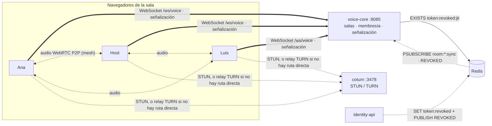
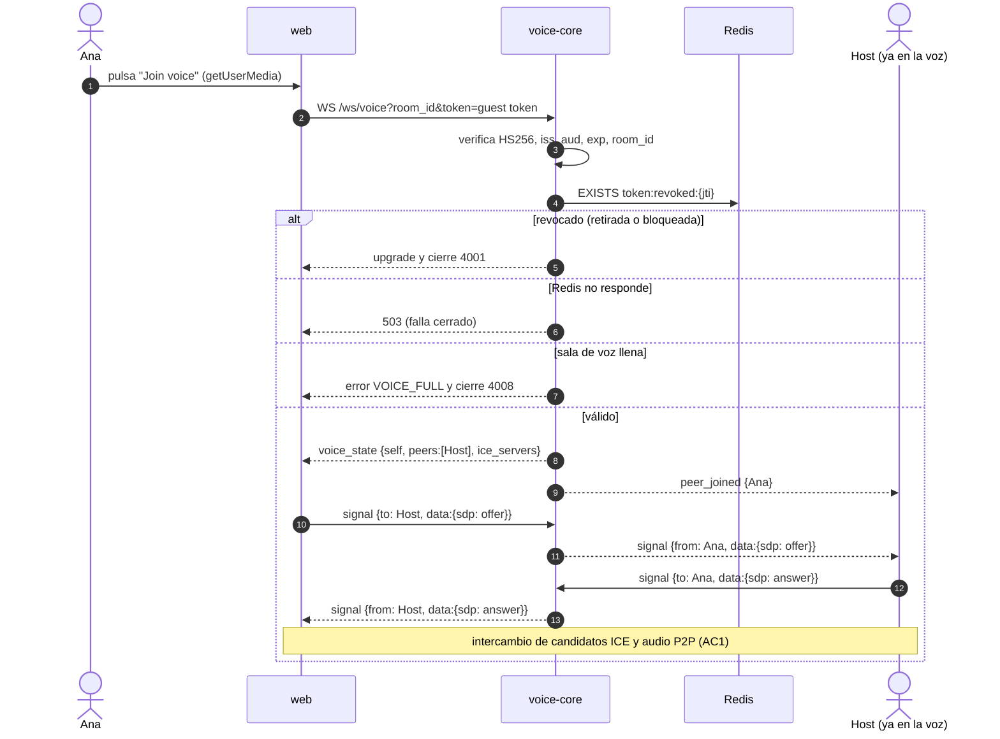

# 🎙️ Dominio de Voz (voice-core)

> Canal de voz de la sala: los participantes hablan entre sí mientras ven el vídeo. Servicio propio en C++ (`services/voice-core`), audio P2P con WebRTC.
> Guía del servicio: [services/voice-core/AGENTS.md](../services/voice-core/AGENTS.md) · Decisión: [ADR 0015](adr/0015-voice-core-en-cpp-con-webrtc-p2p.md).

## 1. Historias de usuario y estado

| HU | Criterios | Estado |
| :--- | :--- | :--- |
| **HU-VOZ-01** Unirse a la voz de la sala | AC1 al pulsar *Join voice* oye a los demás · AC2 un bloqueado es rechazado · AC3 al desconectarse los demás dejan de oírlo | 🟢 Backend implementado (Fase 1). Falta la web (Fase 4) para AC1 de punta a punta. |
| **HU-VOZ-02** Silenciar y activar mi micrófono | AC1 silenciado no transmite · AC2 al activar vuelve el audio · AC3 los demás ven el icono | ⏳ Previsto (Fase 2 + web) |
| **HU-VOZ-03** Ver quién habla | AC1 resalta al que habla · AC2 se apaga en silencio · AC3 legible con muchos | ⏳ Previsto (solo web: Web Audio `AnalyserNode`) |
| **HU-VOZ-04** El host silencia a un participante | AC1 deja de oírse para todos · AC2 no puede quitárselo · AC3 un no-host recibe 403 | ⏳ Previsto (Fase 2) |
| **HU-VOZ-05** Redes restrictivas | AC1 funciona por TURN · AC2 usa la ruta directa si existe · AC3 reconecta | ⏳ Previsto (Fase 3; `coturn` ya está en compose) |
| **HU-VOZ-06** Componente propio | AC1 si se detiene, chat y sync siguen · AC2 API de salas, membresía y moderación · AC3 aparece en las vistas | 🟢 AC1 y AC3 · AC2 parcial (salas y membresía; moderación en Fase 2) |

## 2. Vista general

- **voice-core no toca audio.** Solo autoriza, lleva la membresía y reenvía `signal` (offer/answer/ICE).
- **Mesh:** cada navegador mantiene una `RTCPeerConnection` con cada otro miembro. Con *n* personas cada uno envía *n − 1* copias de su audio; por eso hay cupo (`VOICE_MAX_MEMBERS`, 8 por defecto).
- **Aislado:** contenedor, puerto y socket propios. Si voice-core se detiene, `/ws/sync` y `/ws/social` siguen funcionando (HU-VOZ-06 AC1).

## 3. Unirse a la voz (HU-VOZ-01)

**Quién ofrece:** el que llega crea la oferta para cada peer de `voice_state.peers`; los que ya estaban esperan. Así no hay ofertas cruzadas en la entrada (la web usará además *perfect negotiation* para renegociar).

### 3.1 Bloqueo (AC2)

Un invitado bloqueado por el host ([ADR 0013](adr/0013-bloqueo-de-invitados-por-dispositivo.md)) tiene sus tokens revocados (`token:revoked:{jti}`) y no puede reclamar uno nuevo desde ese navegador. En la voz:

- **Al intentar entrar:** upgrade y cierre `4001` ([ADR 0014](adr/0014-upgrade-y-cierre-4xxx-para-estados-terminales.md)).
- **Si ya estaba hablando:** voice-core recibe `REVOKED{jti}` por `room:{id}:sync` y cierra con `4001` todas sus conexiones de voz; los demás reciben `peer_left`.

### 3.2 Salir (AC3)

| Cómo sale | Qué detecta voice-core | Tiempo |
| :--- | :--- | :--- |
| Botón "Salir de la voz" (`leave`) | Mensaje `leave`, cierre `1000` | Inmediato |
| Cierra la pestaña | Cierre del WebSocket | Inmediato |
| Se cae la red (sin FIN) | Ping de keep-alive sin respuesta | ≤ 20 s (`idle_timeout`) |
| Revocación | `REVOKED` | Inmediato |

En todos los casos los demás reciben `peer_left` y cierran esa `RTCPeerConnection`, así que dejan de oírlo. WebRTC también detecta la pérdida de ICE por su lado.

## 4. Protocolo

Ver la tabla completa en [voice-core/AGENTS.md § Protocolo](../services/voice-core/AGENTS.md#protocolo-del-canal-de-voz). Todos los eventos llevan `event_id`, `occurred_at` y `received_at` (Documento General §1.2). El `jti` nunca sale del servidor.

## 5. Decisiones de diseño

| Decisión | Por qué |
| :--- | :--- |
| P2P mesh en vez de SFU | Salas de amigos (2–8 en la voz); el servidor no procesa audio y es mucho más simple de probar. |
| Servicio propio, no dentro de social-core | Separación de dominios (HU-VOZ-06) y fallo aislado. |
| Mismo JWT y misma revocación que sync/social | Sin cambios en identity-api; una sola vía para retirar, bloquear y borrar la sala. |
| HS256 con OpenSSL, sin librería de JWT | Una dependencia menos; comparación en tiempo constante y pruebas de firma, `alg`, `exp`, `iss`, `aud`. |
| Silencio del host aplicado también en quien escucha (Fase 2) | En P2P el servidor no puede cortar el audio; los receptores silencian la pista de ese peer al recibir `host_muted`. |
| `replaceTrack(null)` para silenciarse (Fase 2) | `track.enabled = false` sigue enviando paquetes de silencio; AC1 pide que no se transmita audio. |
| Detección de quién habla en el navegador (HU-VOZ-03) | Web Audio sobre cada pista: sin tráfico ni latencia del servidor. |
| TURN con credenciales efímeras (Fase 3) | REST API de TURN: `usuario = exp:user_id`, `clave = base64(HMAC-SHA1(TURN_SECRET, usuario))`; nada fijo en la web. |

## 6. Plan por fases

| Fase | Alcance | Dominio / PR | Estado |
| :--- | :--- | :--- | :--- |
| 0 | `voice-core` y `coturn` en compose, `.env.example`, `make test-cpp`, job `C++ · voice-core` en CI | infra | 🟢 |
| 1 | Handshake, membresía, señalización, `peer_left`, revocación en vivo | voice-core | 🟢 |
| 2 | `self_mute`, `host_mute` (WS y REST `PUT/DELETE /api/v1/voice/rooms/{id}/mutes/{user_id}`, 403 sin rol host), persistencia `room:{id}:voice:muted` | voice-core | ⏳ |
| 3 | `ice_servers` con credenciales TURN efímeras | voice-core | ⏳ |
| 4 | `useVoiceChannel`, `VoicePanel` en `WatchRoom`, perfect negotiation, ICE restart, quién habla | web | ⏳ |
| 5 | E2E con dos navegadores (`--use-fake-device-for-media-stream`, `getStats`), `iceTransportPolicy: 'relay'`, k6 de señalización | voice-core + web | ⏳ |

## 7. Verificación (Fase 1)

| Comprobación | Resultado |
| :--- | :--- |
| GoogleTest (unitarias + integración con Redis real + servidor Beast real) | 91/91 |
| ASan + UBSan · TSan | 91/91 en ambos |
| Pruebas de red y Redis repetidas 30 veces con TSan | Sin fallos intermitentes |
| Cobertura de líneas (`src/` sin `main.cpp`, gcovr) | 96 % |
| Imagen final: `/healthz`, 401 antes del upgrade, `PSUBSCRIBE` activo, parada con SIGTERM | OK |
| `scripts/smoke.py` contra `docker compose` (handshake, AC1 sin audio, AC2, AC3) | 9/9 |

## 8. Limitaciones conocidas
- **Una réplica** (membresía en memoria). Escalar exige un registro compartido en Redis.
- **Mesh:** el ancho de banda de subida crece con el número de participantes.
- **Formato de `REVOKED`:** se asume `{"type":"REVOKED","jti":"…"}`; confirmar con sync-core.
- **Bloqueo por dispositivo:** hereda la limitación de [ADR 0013](adr/0013-bloqueo-de-invitados-por-dispositivo.md) (borrar los datos del navegador lo evade).
