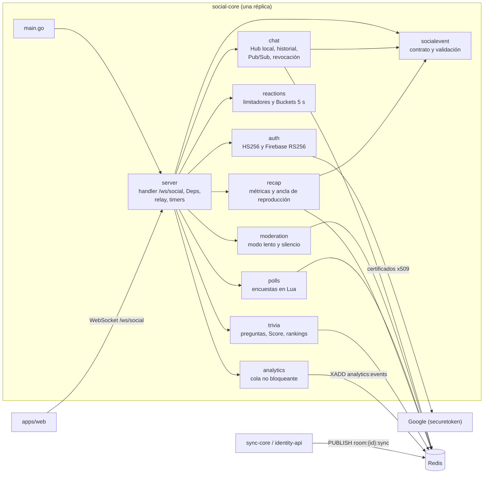
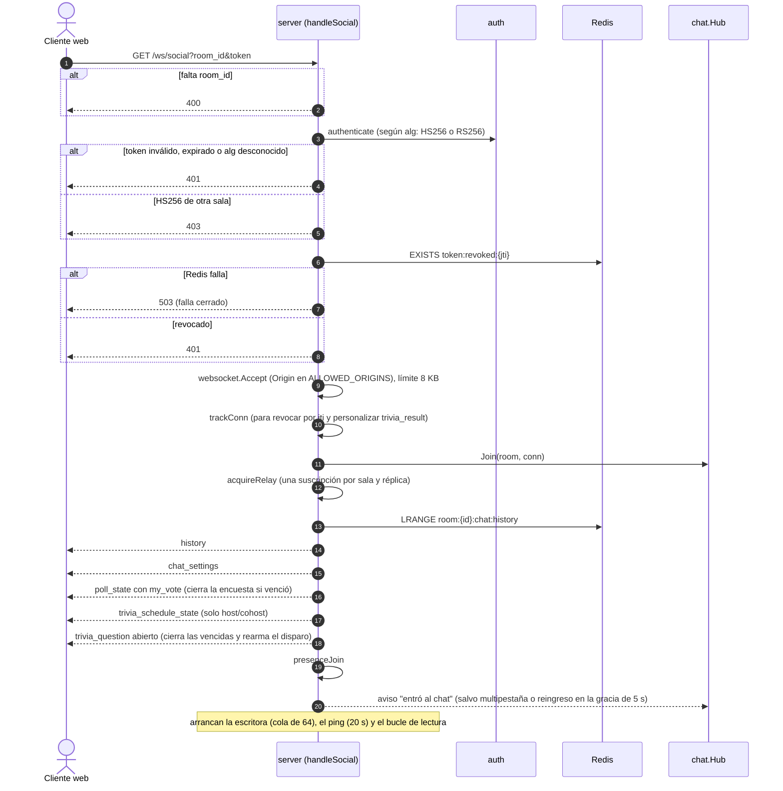
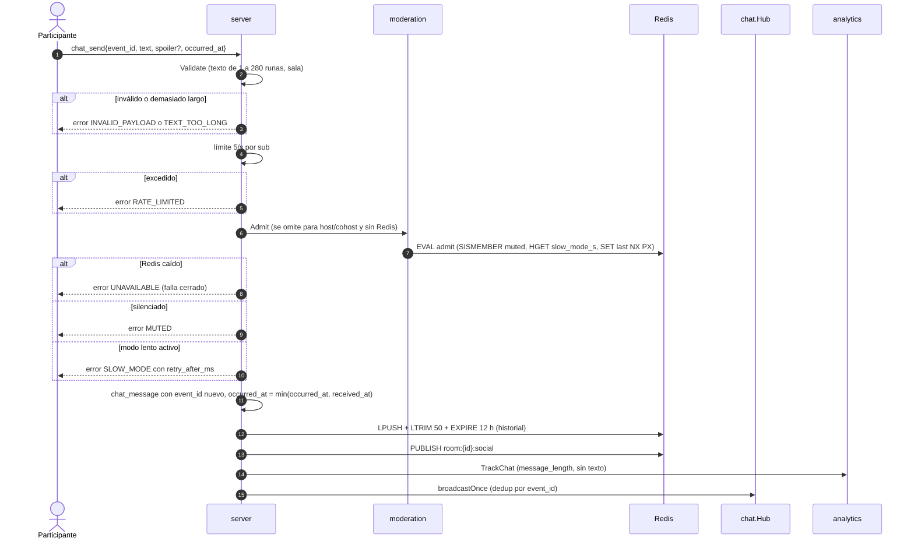
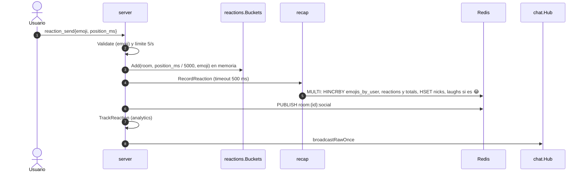
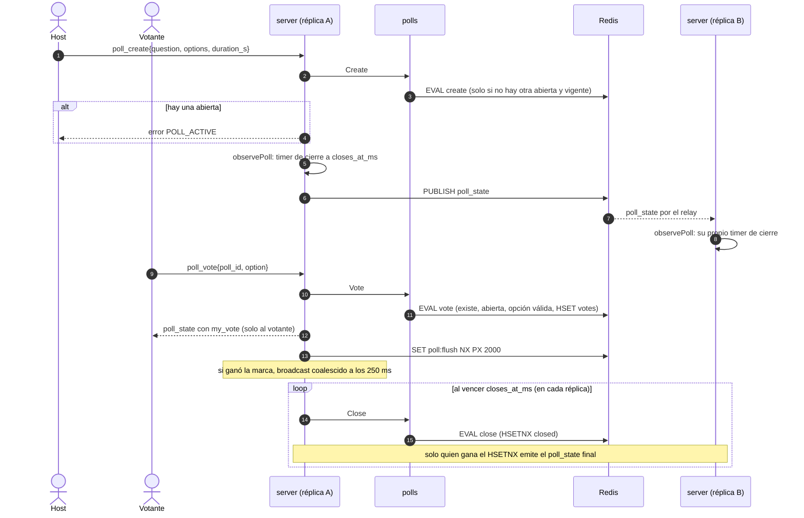
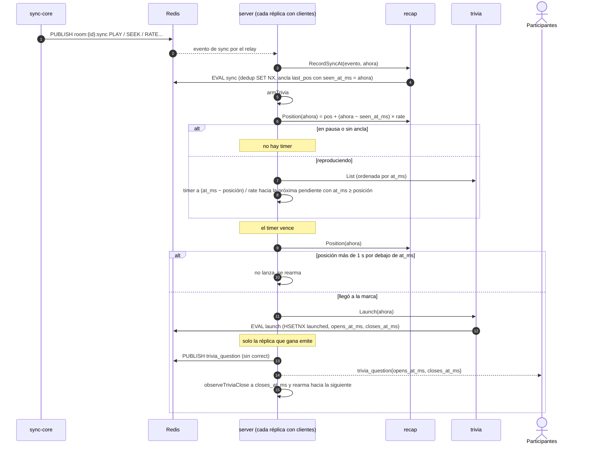
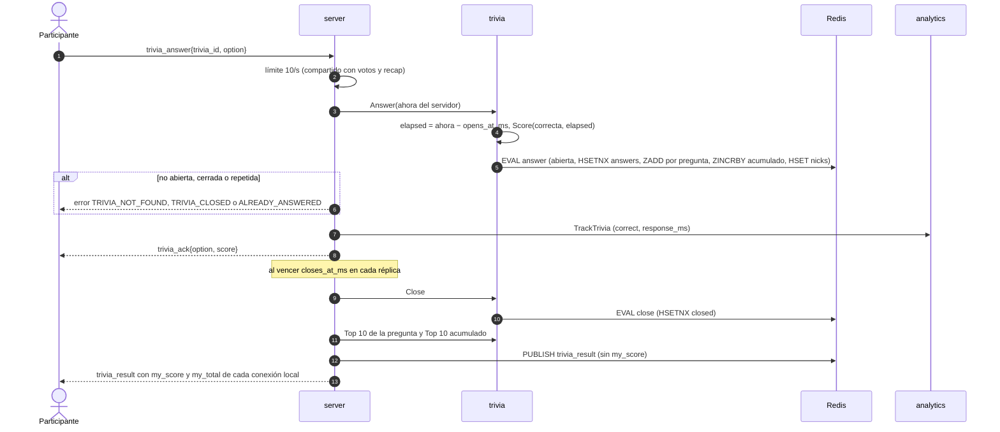
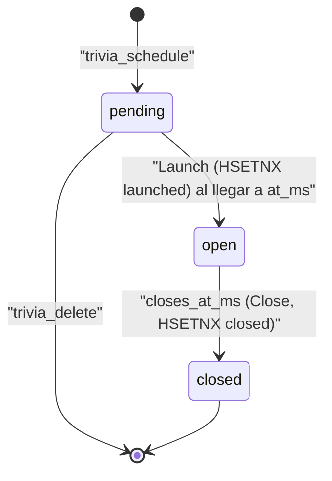
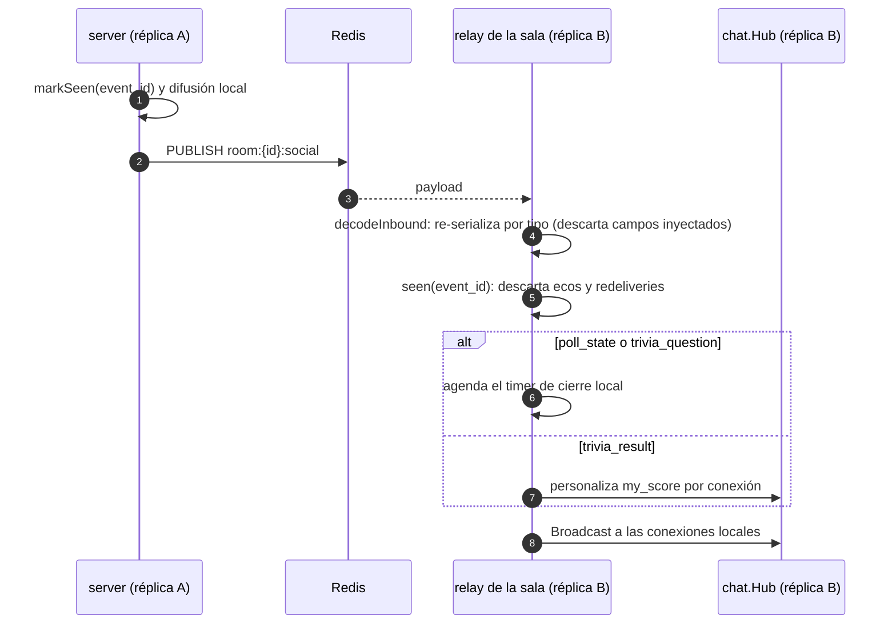
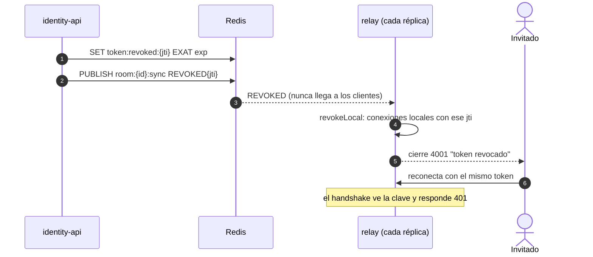

# social-core: Canal Social de TINT

Servicio en Go que lleva la interacción de la audiencia por WebSocket (`/ws/social`): chat con moderación y spoilers, reacciones, puntero láser del host, encuestas, trivias con ranking y el resumen (recap) de la sesión. Este README explica cómo funciona por dentro, pensado para alguien que llega nuevo al código.

> Para el detalle completo del protocolo (todos los mensajes, códigos de error, autenticación) y las reglas del dominio, consulta [`AGENTS.md`](AGENTS.md). La vista general del sistema está en [`docs/arquitectura.md`](../../docs/arquitectura.md).

## Índice
1. [Propósito y límites](#1-propósito-y-límites)
2. [Arquitectura interna](#2-arquitectura-interna)
3. [Cómo funciona, paso a paso](#3-cómo-funciona-paso-a-paso)
4. [Estado y datos en Redis](#4-estado-y-datos-en-redis)
5. [Concurrencia y réplicas](#5-concurrencia-y-réplicas)
6. [Configuración](#6-configuración)
7. [Ejecutar y probar](#7-ejecutar-y-probar)
8. [Observabilidad](#8-observabilidad)
9. [Decisiones de arquitectura](#9-decisiones-de-arquitectura)
10. [Enlaces](#10-enlaces)

## 1. Propósito y límites

**Responsabilidades** (todas implementadas en el código actual)
- Chat en vivo con historial corto (50 mensajes), límite de 5 msg/s, spoilers, modo lento y silencio.
- Reacciones con límite de 5/s, conteo por ventanas de 5 s y métricas para el recap.
- Puntero láser del host/cohost (efímero, 30/s).
- Encuestas en vivo: una activa por sala, voto cambiable, cierre por tiempo o manual.
- Trivias programadas en posiciones del vídeo, con puntaje por velocidad y rankings en Sorted Sets.
- Recap de la sesión: quién reaccionó más, el momento más pausado, el pico de reacciones y los totales.
- Avisos de presencia ("entró"/"salió del chat") con ventana de gracia.
- Cierre con `4001` de las conexiones cuyo token revoca identity-api.
- Publicación de metadatos (sin texto ni nick) en `analytics:events`.

**Lo que NO hace** (ver [Límites de Dominio](AGENTS.md#límites-de-dominio))
- No emite ni modifica comandos de reproducción: solo **lee** `room:{id}:sync` (lo escribe sync-core) para el recap y las trivias.
- No extrae colores de vídeo (eso es media-worker). La retransmisión de Ambilight y el evento de heatmap en vivo figuran en `AGENTS.md` como responsabilidades del dominio, pero **todavía no hay código** que las implemente: hoy solo existe el conteo en memoria `reactions.Buckets`, base del futuro heatmap.
- No persiste el texto del chat en analítica.
- No emite tokens: verifica los HS256 de identity-api y los ID tokens de Firebase.

## 2. Arquitectura interna

`main.go` solo llama a `server.Run(os.Getenv)`. `server.DefaultDeps` decide el modo: **con `REDIS_URL`** cablea los stores de Redis, el Pub/Sub entre réplicas, la revocación y la analítica; **sin `REDIS_URL`** queda en modo memoria (una réplica, sin moderación, encuestas, recap, trivias ni revocación).



| Paquete | Responsabilidad | Archivo principal |
| :--- | :--- | :--- |
| `internal/server` | Arranque y cableado (`DefaultDeps`), handshake y bucle de lectura de `/ws/social`, despacho por `type`, presencia, relay por sala, revocación, ping, y los handlers de reacciones, láser, moderación, encuestas, recap y trivias. | [`server.go`](internal/server/server.go), [`social.go`](internal/server/social.go), [`relay.go`](internal/server/relay.go) |
| `internal/server` (features) | Un archivo por feature: [`moderation.go`](internal/server/moderation.go), [`laser.go`](internal/server/laser.go), [`polls.go`](internal/server/polls.go), [`recap.go`](internal/server/recap.go), [`trivia.go`](internal/server/trivia.go), [`revocation.go`](internal/server/revocation.go), [`liveness.go`](internal/server/liveness.go). | — |
| `internal/auth` | Elige el verificador por el `alg` del header: HS256 (identity-api: firma, `iss`, `aud`, `exp`, `sub`, `jti`, `room_id`) o RS256 (Firebase, certificados de Google por `kid` con caché `max-age`). | [`auth.go`](internal/auth/auth.go), [`firebase.go`](internal/auth/firebase.go) |
| `internal/chat` | `Hub` de difusión local por sala (no bloqueante); historial en LIST de Redis o en memoria; `Publish*`/`Subscribe` sobre `room:{id}:social` y `room:{id}:sync`; `IsRevoked`. | [`hub.go`](internal/chat/hub.go), [`redis.go`](internal/chat/redis.go), [`store.go`](internal/chat/store.go) |
| `internal/reactions` | Limitador de ventana deslizante por usuario y `Buckets` (conteo en memoria por sala, ventana de 5 s y emoji, con poda de salas inactivas). | [`limiter.go`](internal/reactions/limiter.go), [`buckets.go`](internal/reactions/buckets.go) |
| `internal/moderation` | Ajustes del chat y script `admit` (silencio + modo lento en una ida y vuelta). | [`store.go`](internal/moderation/store.go) |
| `internal/polls` | Encuestas en Redis con scripts Lua `create`, `vote` y `close`; marca de flush coalescido. | [`store.go`](internal/polls/store.go) |
| `internal/recap` | Contadores del recap, script `sync` (dedup + clasificación + ancla `last_pos`), `Position` (proyección con el reloj propio) y `Build`. | [`store.go`](internal/recap/store.go) |
| `internal/trivia` | `Score` (puntaje por velocidad) y el store con los scripts `schedule`, `delete`, `launch`, `answer` y `close`; rankings. | [`score.go`](internal/trivia/score.go), [`store.go`](internal/trivia/store.go) |
| `internal/socialevent` | Tipos de mensaje, validación, límites (`MaxTextRunes = 280`, `HistoryLimit = 50`, `TriviaTopN = 10`) y `ClampOccurred`. | [`event.go`](internal/socialevent/event.go) y un archivo por feature |
| `internal/analytics` | Emisor de `chat_message`, `presence`, `reaction` y `trivia_answer`: canal con buffer (4096) y una goroutine que hace `XADD`. | [`analytics.go`](internal/analytics/analytics.go) |

## 3. Cómo funciona, paso a paso

### 3.1 Conexión y la instantánea al entrar

El token llega en `Authorization: Bearer …` o en `?token=`. Al entrar, el cliente recibe en este orden: `history`, `chat_settings`, `poll_state`, `trivia_schedule_state` (solo host/cohost) y el `trivia_question` abierto. Cada envío se omite si no aplica (por ejemplo, sin Redis no hay `chat_settings`).



> A diferencia de sync-core, social-core rechaza un token revocado o expirado **antes** del upgrade (401), sin cierre `4xxx`. La revocación de una conexión ya abierta sí cierra con `4001` (ver 3.9).

**Host/cohost** (moderador) = HS256 de identity-api con `room_id` de la sala y `role` `host` o `cohost`, es decir, el sync-ticket (`isModerator` en `laser.go`). Un Firebase ID token autentica pero no da permisos de moderación.

### 3.2 Chat: validación, modo lento, silencio y spoiler



- El orden importa: el freno de moderación se evalúa al final, así un mensaje inválido o limitado no consume la ventana del modo lento.
- `spoiler` solo se transporta y se guarda; difuminar el texto es cosa de la web.
- `occurred_at` del cliente nunca sirve para rechazar: si viene del futuro se recorta a `received_at` (`ClampOccurred`).
- `chat_slow_mode` (0, 5, 10, 30 o 60 s) y `chat_mute` son solo para moderadores: escriben en Redis y emiten `chat_settings` a la sala y a las demás réplicas.

### 3.3 Reacciones y heatmap



El "heatmap" que existe hoy en Redis son los buckets de 5 s del recap (`room:{id}:recap:reactions` y `:laughs`). `reactions.Buckets` lleva el mismo conteo por emoji pero solo en memoria y por réplica; todavía no se emite un evento de heatmap en vivo ni existe la clave `room:{id}:heatmap`.

### 3.4 Puntero láser

`laser_point{x, y, end?}` (coordenadas en [0, 1]) solo de host/cohost y como mucho 30/s. Se convierte en `laser{user_id, nick, x, y, end}` y se emite con `emitRoom`: `PUBLISH` a `room:{id}:social` + difusión local deduplicada. No se persiste nada.

### 3.5 Encuestas (Lua y timers)



- "Ahora" lo pasa siempre el servidor (`nowMS`), nunca el reloj de Redis. Votar después de `closes_at_ms` ya da `POLL_CLOSED` aunque el cierre no se haya emitido.
- El flush suelta la marca **antes** de leer los conteos: un voto que llegue después vuelve a agendar otro broadcast, así ninguno queda sin emitir.
- Si todas las réplicas se reiniciaron con una encuesta vencida sin cerrar, se cierra cuando alguien entra (`sendPollOnJoin`).
- Crear una encuesta suma `polls` en los totales del recap (`OnPollCreated`).

### 3.6 Trivias

Las trivias se programan por **posición del vídeo** (`at_ms`) y se disparan cuando la posición proyectada llega a la marca. Esa posición sale del ancla del recap (`room:{id}:recap:last_pos`), que se mueve con los comandos de reproducción que sync-core publica en `room:{id}:sync`.

**Programación** (`trivia_schedule`, `trivia_delete`, `trivia_list`, solo moderadores): el script `schedule` guarda la pregunta en `room:{id}:trivia:questions` (máximo 50 por sala) y responde `trivia_schedule_state` solo a quien la programó. Borrar una que ya salió da `TRIVIA_CLOSED`. Cada cambio rearma el disparo.

**Disparo:**



- **Relojes:** la proyección usa `seen_at_ms`, el reloj de social-core al procesar el evento, y nunca `updated_at_ms` (reloj de sync-core). Así no se comparan relojes de máquinas distintas.
- Un `SEEK` que salta por encima de la marca no la dispara: la pregunta sigue pendiente y saldrá si se vuelve atrás.
- Las preguntas son de la sala, no del vídeo: tras un `LOAD` de otro vídeo siguen programadas por posición.

**Respuesta, puntaje y resultado:**



- `trivia.Score(correcta, elapsed)`: 0 si falla; si acierta, 1000 puntos base + un bono lineal de hasta 1000 que llega a 0 a los 10 s.
- En el ZSET por pregunta el puntaje lleva una fracción menor que 1 que favorece a quien respondió antes (desempate); el ranking acumulado guarda puntos enteros.
- Cada réplica personaliza el `trivia_result` remoto para sus conexiones (`deliverRemoteResult`); si no puede leer los puntajes lo envía sin `my_score` (nunca un 0 inventado).

**Ciclo de vida de una trivia** (`triviaStatus` en `trivia.go`):



`open` pasa a `closed` también si `ahora ≥ closes_at_ms` aunque nadie haya ejecutado `Close` aún; una pregunta vencida que nadie cerró se cierra cuando alguien entra.

### 3.7 Recap

Las métricas se acumulan en Redis mientras la sala vive:
- **Reacciones:** `RecordReaction` (ver 3.3).
- **Pausas y rebobinados:** el script `sync` del recap procesa cada comando de `room:{id}:sync` una sola vez entre réplicas (`SET recap:seen:{event_id} NX EX 3600`). Un `PAUSE` suma una pausa; un `SEEK` que cae más de 1 s por debajo de la posición proyectada del ancla previa suma un rebobinado (en el bucket de destino). Un evento con `version` menor que el ancla llegó tarde y no la mueve.
- **Encuestas:** `RecordPoll`.

`recap_request` (10/s, compartido) responde `recap` **solo** a quien lo pide, armado por `Build`: `top_emoji_user`, `most_paused`, `peak_reactions` (con risas) y `totals`. Empates: el bucket más temprano y el `user_id` menor. Solo se cuentan los eventos de sync que ve alguna réplica con clientes en la sala, porque la suscripción existe mientras haya conexiones.

### 3.8 Fan-out entre réplicas (relay)



Cada réplica abre **una sola** suscripción por sala (a `room:{id}:social` y `room:{id}:sync`), compartida por todas sus conexiones con conteo de referencias; la abre el primero que entra y la cierra el último que sale (que además cancela el timer de disparo de trivias). Sin ese relay compartido cada mensaje se entregaba 1 + N veces.

### 3.9 Revocación



`Subscribe` nunca descarta un `REVOKED`, aunque el buffer del relay esté lleno (los demás mensajes sí se descartan si se llena). Sin `REDIS_URL` no hay fuente de revocación.

## 4. Estado y datos en Redis

Todas las claves con TTL usan el periodo de gracia de la sala (`chat.HistoryTTL` = 12 h); los rankings de trivia, 12 h + 1 h. Nombres definidos en cada store.

| Clave | Tipo | TTL | Quién escribe | Contenido |
| :--- | :--- | :--- | :--- | :--- |
| `room:{id}:chat:history` | List | 12 h | `chat.RedisStore.Push` | Últimos 50 `chat_message` (más nuevo primero) |
| `room:{id}:chat:settings` | Hash | 12 h | `moderation.SetSlowMode` | `slow_mode_s` |
| `room:{id}:chat:muted` | Set | 12 h | `moderation.SetMuted` | `user_id` silenciados |
| `room:{id}:chat:last:{sub}` | String | PX = modo lento | script `admit` | Último mensaje aceptado de ese `sub` |
| `room:{id}:poll` | Hash | 12 h | scripts `create` y `close` | `id`, `question`, `options`, `n_options`, `closes_at_ms`, `closed` |
| `room:{id}:poll:{pid}:votes` | Hash | 12 h | script `vote` | `user_id` → opción |
| `room:{id}:poll:flush` | String | PX 2 s | `polls.TryFlush` | Marca de broadcast coalescido |
| `room:{id}:recap:emojis_by_user`, `:nicks`, `:reactions`, `:laughs` | Hash | 12 h | `recap.RecordReaction` | Conteos por usuario y por bucket de 5 s |
| `room:{id}:recap:pauses` | Hash | 12 h | script `sync` del recap | bucket → pausas + rebobinados |
| `room:{id}:recap:totals` | Hash | 12 h | `RecordReaction`, `RecordPoll`, script `sync` | `reactions`, `pauses`, `rewinds`, `polls` |
| `room:{id}:recap:last_pos` | Hash | 12 h | script `sync` del recap | Ancla: `pos`, `status`, `rate`, `updated_at_ms`, `version`, `seen_at_ms` |
| `room:{id}:recap:seen:{event_id}` | String | 1 h | script `sync` del recap | Dedup de eventos de sync entre réplicas |
| `room:{id}:trivia:questions` | Hash | 12 h | scripts `schedule` y `delete` | `trivia_id` → JSON de la pregunta (incluye `correct`) |
| `room:{id}:trivia:{tid}:state` | Hash | 12 h | scripts `launch` y `close` | `launched`, `opens_at_ms`, `closes_at_ms`, `closed` |
| `room:{id}:trivia:{tid}:answers` | Hash | 12 h | script `answer` | `user_id` → opción |
| `room:{id}:trivia:{tid}:leaderboard` | ZSET | 12 h + 1 h | script `answer` | `user_id` → puntos + fracción de desempate |
| `room:{id}:trivia:leaderboard` | ZSET | 12 h + 1 h | script `answer` | Ranking acumulado de la sala |
| `room:{id}:trivia:nicks` | Hash | 12 h + 1 h | script `answer` | `user_id` → último nick |
| `room:{id}:social` | Pub/Sub | — | social-core | `chat_message`, `reaction`, `laser`, `poll_state`, `chat_settings`, `trivia_question`, `trivia_result` |
| `room:{id}:sync` | Pub/Sub (solo lectura) | — | sync-core (comandos), identity-api (`REVOKED`) | Lee `PLAY`/`PAUSE`/`SEEK`/`RATE`/`LOAD` y `REVOKED` |
| `token:revoked:{jti}` | String (solo lectura) | `EXAT` del token | identity-api | Revocación |
| `analytics:events` | Stream | `MAXLEN ~100000` | `internal/analytics` | Eventos sin texto ni nick |

## 5. Concurrencia y réplicas

| Ámbito | Qué hay | Protección |
| :--- | :--- | :--- |
| Por conexión | Goroutine lectora (bucle de `handleSocial`), escritora (drena la cola de 64 con plazo de 5 s por escritura) y `keepAlive` (ping cada 20 s, pong en 10 s) | Un fallo de escritura o de ping corta el socket y termina la lectura |
| Por conexión | Limitadores de chat (5/s), reacciones (5/s), láser (30/s) y acciones (10/s: votos, recap y respuestas de trivia) | Uno por conexión salvo que se inyecten en `Deps` |
| Por réplica | `chat.Hub` (conexiones por sala) | `sync.Mutex`; `Broadcast` copia los canales y envía sin bloquear (si la cola está llena, el mensaje se descarta para esa conexión) |
| Por réplica | Relays, `seen` (últimos 512 `event_id`), conexiones vivas, presencia, timers de encuestas y trivias | `Deps.mu` |
| Por réplica | `reactions.Buckets` y presencia (`connected_users`) | Solo locales: no se comparten entre réplicas |
| Compartido | Historial, moderación, encuestas, recap, trivias, revocación | Redis; cada decisión de "una sola vez" es un script Lua o un `HSETNX`/`SET NX` |

- **Deduplicación por `event_id`:** lo emitido localmente se marca en `seen` antes de difundir; el eco que vuelve por Pub/Sub se descarta. Los eventos de sync se deduplican en Redis (`recap:seen:{event_id}`), porque varias réplicas los procesan.
- **Una sola réplica gana:** cierre de encuestas (`HSETNX closed`), lanzamiento (`HSETNX launched`) y cierre de trivias, y el flush coalescido (`SET NX`). Las demás réplicas solo agendan sus timers por si la ganadora muere.
- **Reloj inyectado:** `Deps.Now`, `Deps.NewID` y `Deps.AfterFunc` (timers de encuestas y trivias) se reemplazan en las pruebas; nunca `time.Sleep`. El "ahora" de las decisiones lo pasa el servidor a los scripts, nunca el reloj de Redis ni el del cliente.

## 6. Configuración

Fuente: [`internal/server/server.go`](internal/server/server.go), [`docker-compose.yml`](../../docker-compose.yml) y [`.env.example`](../../.env.example).

| Variable | Por defecto | Descripción |
| :--- | :--- | :--- |
| `SOCIAL_CORE_ADDR` | `:8082` | Dirección de escucha. |
| `JWT_SECRET` | — (obligatoria) | Secreto HS256 compartido con identity-api. Sin él no arranca. |
| `JWT_ISSUER` | `tint-identity` | `iss` esperado en HS256. |
| `JWT_AUDIENCE` | `tint:room` | `aud` esperado en HS256. |
| `FIREBASE_PROJECT_ID` | vacía | Proyecto de los ID tokens de Firebase; vacía = se rechazan. En docker compose, `tint-login` por defecto. |
| `ALLOWED_ORIGINS` | `localhost:5173,127.0.0.1:5173` | Orígenes permitidos en el handshake. En docker compose se toma de `SOCIAL_ALLOWED_ORIGINS`. |
| `REDIS_URL` | vacía (modo memoria, una réplica) | Historial, Pub/Sub, revocación, moderación, encuestas, recap, trivias y analítica. |

**Puerto:** `8082` (también en docker compose, `8082:8082`). Rutas: `/ws/social` y `/healthz`.

## 7. Ejecutar y probar

```bash
# Con docker compose (desde la raíz del monorepo)
cp .env.example .env
docker compose up -d redis social-core     # ws://localhost:8082/ws/social

# En local con go run
docker compose up -d redis
cd services/social-core
JWT_SECRET=dev-secret-change-in-prod REDIS_URL=redis://localhost:6379 go run .
curl localhost:8082/healthz
```

**Gate del dominio** (el CI bloquea el merge si falla):

```bash
cd services/social-core
gofmt -l .                                   # debe salir vacío
go vet ./...
go test -race -coverprofile=coverage.out ./...
../../scripts/check-go-coverage.sh coverage.out 85
```

Las pruebas usan `miniredis` para los stores y timers inyectados para encuestas y trivias. social-core no tiene prueba de carga propia.

## 8. Observabilidad

- **Métricas:** social-core no expone `/metrics`. El emisor de analítica cuenta los eventos descartados (`Dropped`) y los `XADD` fallidos (`Failed`), pero hoy esos contadores no se publican por HTTP.
- **Logs:** el arranque (`social-core escuchando en …`) y cada `XADD` fallido (`analytics: XADD falló`).
- **Eventos de analítica** (`analytics:events`, `source=social-core`, con `user_id` = `sub` y nunca `text` ni `nick`). Contrato en [`docs/contrato-eventos-analitica.md`](../../docs/contrato-eventos-analitica.md).

| `type` | Cuándo | Campos propios |
| :--- | :--- | :--- |
| `chat_message` | Mensaje aceptado | `message_length` |
| `presence` | Aviso `joined`/`left` emitido (el `left` tras la gracia de 5 s) | `kind`, `connected_users` (de esta réplica) |
| `reaction` | Reacción aceptada | `emoji`, `position_ms` |
| `trivia_answer` | Respuesta aceptada y evaluada | `question_id`, `correct`, `response_ms` |

## 9. Decisiones de arquitectura

- [ADR 0003 — Redis Pub/Sub para el fan-out entre réplicas](../../docs/adr/0003-redis-pubsub-para-fanout-entre-replicas.md)
- [ADR 0004 — Scripts Lua en lugar de WATCH/MULTI](../../docs/adr/0004-scripts-lua-en-lugar-de-watch-multi.md)
- [ADR 0005 — Canales WebSocket separados Sync y Social](../../docs/adr/0005-canales-websocket-separados-sync-y-social.md)
- [ADR 0006 — Tickets JWT HS256 emitidos por identity-api](../../docs/adr/0006-tickets-jwt-hs256-emitidos-por-identity-api.md)
- [ADR 0007 — Revocación por clave Redis y cierre 4001](../../docs/adr/0007-revocacion-por-clave-redis-y-cierre-4001.md)
- [ADR 0010 — Eventos de analítica sin PII](../../docs/adr/0010-eventos-de-analitica-sin-pii.md)
- [ADR 0012 — Trivia con reloj del servidor y ancla del recap](../../docs/adr/0012-trivia-con-reloj-del-servidor-y-ancla-del-recap.md)
- [ADR 0014 — Upgrade y cierre 4xxx para estados terminales](../../docs/adr/0014-upgrade-y-cierre-4xxx-para-estados-terminales.md) (aplicado en sync-core; el handshake de social-core aún responde 401 ante un token revocado o expirado)

## 10. Enlaces

- [`AGENTS.md`](AGENTS.md): protocolo del Canal Social, autenticación, analítica, variables y reglas (referencia detallada).
- [`docs/arquitectura.md`](../../docs/arquitectura.md): [vista de componentes y conectores (C&C)](../../docs/arquitectura.md#vista-de-componentes-y-conectores), contratos compartidos y puertos.
- [`docs/dominio-reproduccion.md`](../../docs/dominio-reproduccion.md): Canal Sync, de donde salen los comandos que lee el recap.
- [`docs/contrato-eventos-analitica.md`](../../docs/contrato-eventos-analitica.md): contrato de `analytics:events`.
- [`docs/usuarios-e-identidad.md`](../../docs/usuarios-e-identidad.md#4-esquemas-de-tokens): esquema de los tokens.
