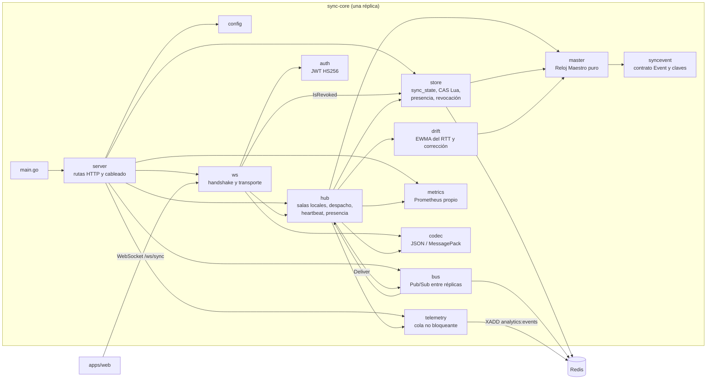
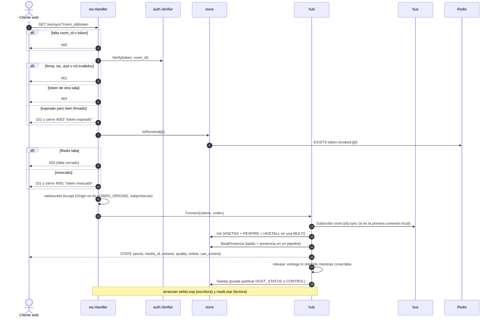
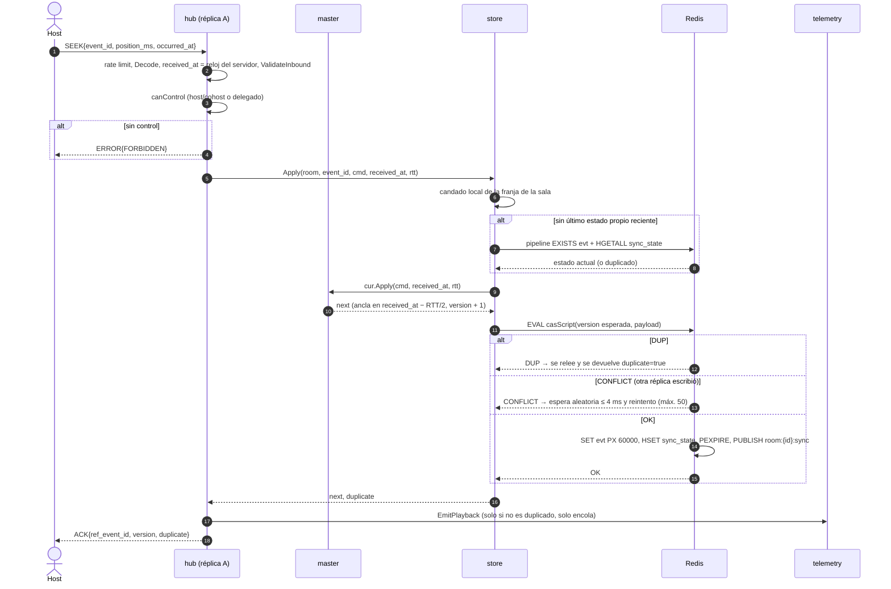
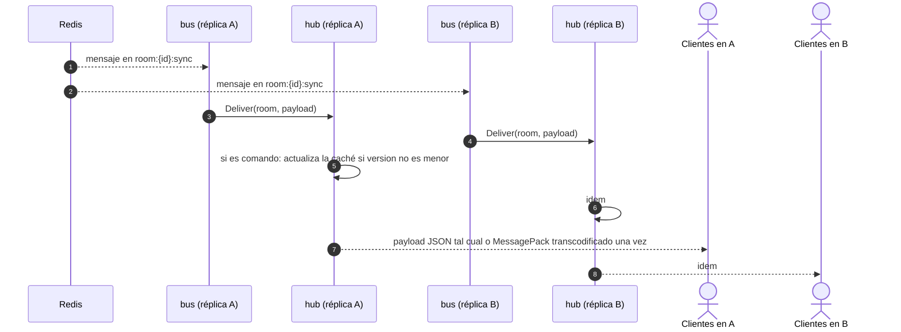
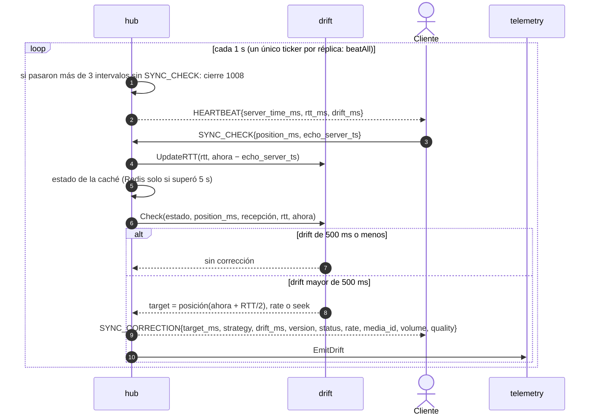
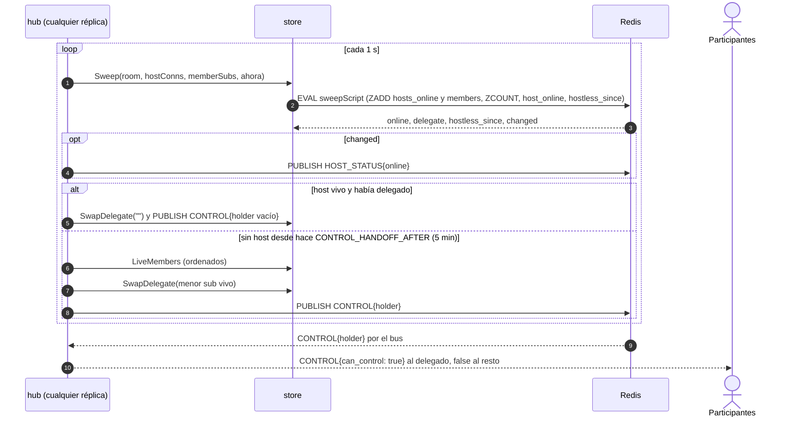
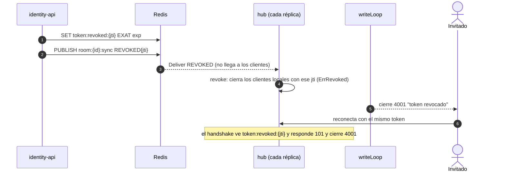
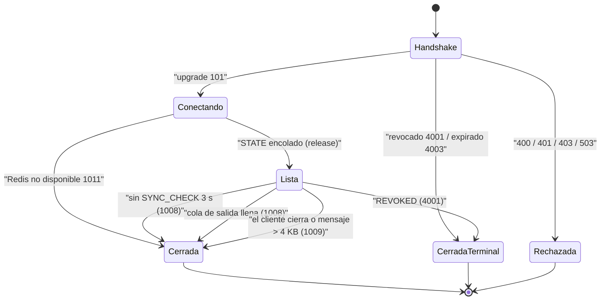
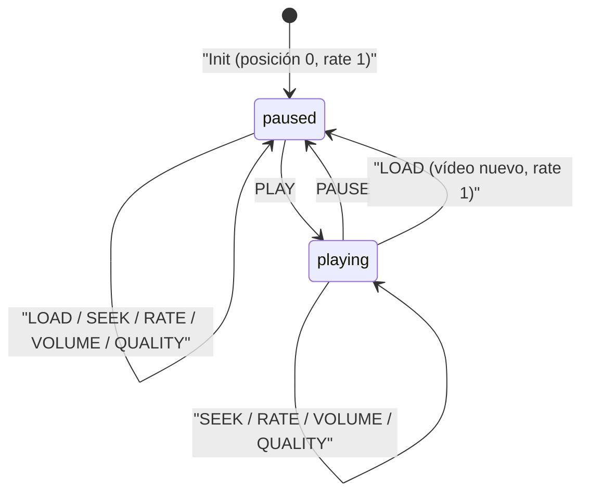

# sync-core: Canal Sync de TINT

Servicio en Go que mantiene el **Reloj Maestro** de cada sala y sincroniza la reproducción de todos los participantes por WebSocket (`/ws/sync`). Este README explica cómo funciona por dentro, pensado para alguien que llega nuevo al código.

> Para el detalle completo del protocolo (tabla de mensajes, códigos de cierre, límites) y las reglas del dominio, consulta [`AGENTS.md`](AGENTS.md). Para los diagramas del dominio completo (web, identity-api, media-worker) está [`docs/dominio-reproduccion.md`](../../docs/dominio-reproduccion.md).

## Índice
1. [Propósito y límites](#1-propósito-y-límites)
2. [Arquitectura interna](#2-arquitectura-interna)
3. [Cómo funciona, paso a paso](#3-cómo-funciona-paso-a-paso)
4. [Estado y datos en Redis](#4-estado-y-datos-en-redis)
5. [Concurrencia y réplicas](#5-concurrencia-y-réplicas)
6. [Configuración](#6-configuración)
7. [Ejecutar, probar y medir](#7-ejecutar-probar-y-medir)
8. [Observabilidad](#8-observabilidad)
9. [Decisiones de arquitectura](#9-decisiones-de-arquitectura)
10. [Enlaces](#10-enlaces)

## 1. Propósito y límites

**Responsabilidades**
- Guardar en Redis el ancla del Reloj Maestro de cada sala (`room:{id}:sync_state`) y aplicar los comandos `PLAY`, `PAUSE`, `SEEK`, `RATE`, `LOAD`, `VOLUME` y `QUALITY` de quien tenga el control.
- Difundir cada comando a todos los clientes de la sala, en cualquier réplica, mediante Redis Pub/Sub.
- Enviar `HEARTBEAT` cada segundo, medir el RTT con el reloj del servidor y corregir el drift de cada cliente (`SYNC_CORRECTION`) cuando supera 500 ms.
- Llevar la presencia del host (`HOST_STATUS`) y delegar el control a un participante si el host se ausenta (`CONTROL`).
- Verificar los tokens HS256 de identity-api en el handshake y cerrar con `4001` las conexiones cuyo token se revoca.
- Publicar telemetría (`playback_command`, `drift_correction`, `buffering`) en `analytics:events` sin bloquear la reproducción.

**Lo que NO hace** (ver [Límites de Dominio](AGENTS.md#límites-de-dominio))
- No procesa chat, reacciones, trivias ni Ambilight: eso es `services/social-core`.
- No persiste telemetría: solo hace `XADD` a `analytics:events`; la consume `services/analytics`.
- No emite tokens: los firma identity-api; sync-core solo los verifica. Tampoco escribe `token:revoked:{jti}`: solo lo lee.
- No usa timers por sala en el servidor: la posición se calcula bajo demanda a partir del ancla.

## 2. Arquitectura interna

`main.go` solo crea el contexto de señales y llama a `server.Run`; toda la lógica vive en `internal/`.



| Paquete | Responsabilidad | Archivo principal |
| :--- | :--- | :--- |
| `internal/config` | Lee el entorno con un `getenv` inyectable; exige `JWT_SECRET` y valida `ROOM_TTL` y `CONTROL_HANDOFF_AFTER`. | [`config.go`](internal/config/config.go) |
| `internal/server` | Arma las dependencias (Redis, bus, telemetría, store, hub) y expone `GET /healthz`, `GET /ws/sync` y `GET /metrics`. Apagado ordenado. | [`server.go`](internal/server/server.go) |
| `internal/ws` | Handshake: valida query, token y revocación; hace el upgrade y cierra con `4001`/`4003` en los casos terminales. Una goroutine lectora y una escritora por conexión. | [`handler.go`](internal/ws/handler.go) |
| `internal/auth` | Verifica tokens HS256 (`iss`, `aud`, `exp`, `room_id`, rol) y distingue "expirado pero bien firmado" (`ErrTokenExpired`). | [`auth.go`](internal/auth/auth.go) |
| `internal/hub` | Salas locales y su caché de estado, `Connect`/`Disconnect`, `Handle` (comandos, `SYNC_CHECK`, `BUFFERING`), `Deliver` desde el bus, bucles de `HEARTBEAT` y de barrido de presencia, delegación y revocación. | [`hub.go`](internal/hub/hub.go), [`client.go`](internal/hub/client.go), [`heartbeat.go`](internal/hub/heartbeat.go) |
| `internal/master` | Reloj Maestro sin I/O: `State`, `PositionAt`, `Apply` (incluido el re-anclaje de `VOLUME`/`QUALITY`). | [`state.go`](internal/master/state.go) |
| `internal/drift` | `UpdateRTT` (EWMA α = 0,2) y `Check` (umbral 500 ms, `rate` hasta 2000 ms, `seek` por encima o en pausa). | [`drift.go`](internal/drift/drift.go) |
| `internal/store` | `sync_state` con compare-and-set por `version` en un script Lua que también publica; deduplicación por `event_id`; presencia en un script por sala (`Sweep`); delegado; `IsRevoked`. | [`store.go`](internal/store/store.go), [`presence.go`](internal/store/presence.go) |
| `internal/bus` | Una conexión Pub/Sub por réplica; se suscribe solo a `room:{id}:sync` de salas con clientes locales. | [`bus.go`](internal/bus/bus.go) |
| `internal/codec` | JSON por defecto; MessagePack con el subprotocolo `tint.sync.msgpack`. | [`codec.go`](internal/codec/codec.go) |
| `internal/syncevent` | Contrato `Event`, tipos, códigos de error, validación y nombres de claves Redis. | [`event.go`](internal/syncevent/event.go) |
| `internal/telemetry` | Encola eventos en un canal con buffer (1024) y una goroutine hace `XADD`; si se llena, descarta y cuenta. | [`telemetry.go`](internal/telemetry/telemetry.go) |
| `internal/metrics` | Registro y exposición Prometheus sin dependencias externas. | [`metrics.go`](internal/metrics/metrics.go) |

## 3. Cómo funciona, paso a paso

### 3.1 Handshake, verificación y `STATE` inicial

El token viaja en la query (`/ws/sync?room_id=…&token=…`) porque el navegador no permite cabeceras en WebSocket; por eso la URL completa nunca se registra.



Puntos clave del código:
- El cliente se **suscribe antes de leer el estado**: si llega un comando concurrente por el bus, tendrá `version` mayor y el cliente descarta lo obsoleto.
- Mientras el cliente no tiene su `STATE` (`ready == false`), `Client.deliver` **retiene** los mensajes de la sala en `held`; `release` los entrega en orden después del `STATE`. Así el `STATE` siempre es el primer mensaje.
- Si Redis falla en `Connect`, la conexión ya está abierta y se cierra con `1011`.

### 3.2 Aplicar un comando (PLAY, SEEK…) con Lua y `version`



- La posición nunca se guarda "en vivo": `posición(t) = position_ms + (t − updated_at_ms) × rate` si `status = playing` (`master.State.PositionAt`).
- `master.Apply` es la única fuente de verdad del siguiente estado; el script Lua solo comprueba `version` y escribe. `host_id` nunca lo cambia un comando (lo fija `Init`).
- `LOAD` deja la sala en pausa, con `rate = 1` y el `media_id` nuevo. `VOLUME` y `QUALITY` **re-anclan** en la posición maestra de `received_at` (ignoran el `position_ms` del emisor) y conservan status y velocidad.
- Tras un comando propio, el siguiente de la misma sala se aplica con una sola ida y vuelta: el store recuerda el último estado escrito por franja (`lastWrite`, máximo 1 min) y el CAS detecta si otra réplica escribió después.
- El orden entre el `ACK` (directo) y el broadcast (Pub/Sub) no está garantizado.

### 3.3 Fan-out por Pub/Sub entre réplicas

La réplica emisora **no difunde localmente**: el `PUBLISH` sale del script Lua y todas las réplicas (incluida la emisora) entregan desde el bus. Un único camino da el mismo orden en todas.



`Deliver` trata aparte dos tipos que nunca se reenvían tal cual: `CONTROL` (cada participante recibe su propio `can_control`) y `REVOKED` (solo cierra conexiones locales).

### 3.4 Heartbeat, RTT y corrección de drift



- El RTT se mide **solo con el reloj del servidor** (eco de `server_time_ms`), así el skew del cliente no influye; las muestras negativas se descartan.
- `drift = posición_cliente − posición_maestra(recepción − RTT/2)`. Estrategia `rate` si la sala reproduce y `|drift| ≤ 2000 ms`; si no, `seek`.
- `SYNC_CHECK` no escribe en Redis. La caché por sala (`roomEntry`) se alimenta del bus y se relee de Redis como mucho cada `CacheTTL` (5 s), red de seguridad ante un mensaje Pub/Sub perdido.
- El `HEARTBEAT` JSON se serializa con una plantilla por sala y tick (`heartbeat.go`): por cliente solo cambian `event_id`, `drift_ms` y `rtt_ms`.

### 3.5 Presencia, `HOST_STATUS` y delegación de control

Cada réplica ejecuta un **barrido por segundo** (`sweepAll`): por sala, un único script Lua (`sweepScript`) registra el latido de las conexiones host/cohost locales (por id de conexión) y de los participantes (por `sub`), lee la presencia y guarda el último `HOST_STATUS` para informar solo de transiciones.



- Un host que no late en 5 s (`PresenceTimeout`) se considera fuera; así también se detecta la caída de la réplica que lo atendía.
- La elección del delegado es determinista (menor `sub` vivo), por eso varias réplicas pueden evaluar la misma sala sin avisos duplicados. Una sala a la que nunca entró el host no delega (`hostless_since` solo existe si alguna vez hubo host).
- `Disconnect` reevalúa de inmediato si se fue un host o el delegado, y refresca el TTL de la sala (`Touch`).

### 3.6 Revocación (`REVOKED` → `4001`)



Los casos terminales hacen upgrade y cierran con `4xxx` porque un rechazo HTTP llega al navegador como `1006` y el cliente reintentaría para siempre. Si Redis no permite comprobar la revocación, el handshake falla cerrado con `503`.

### 3.7 `LOAD`, `VOLUME` y `QUALITY`

Son comandos como los demás (mismo camino de 3.2 y 3.3) con estas diferencias, todas en `master.Apply`:

| Comando | Validación (`syncevent`) | Efecto en el ancla |
| :--- | :--- | :--- |
| `LOAD` | `media_id` de 1 a 128 caracteres | `status = paused`, `rate = 1`, `position_ms` del emisor, `media_id` nuevo |
| `VOLUME` | `volume` obligatorio en [0, 1] | re-ancla en `PositionAt(received_at)`, conserva status y velocidad |
| `QUALITY` | `auto`, `source`, `720p` o `360p` | igual que `VOLUME` |

Un valor fuera de contrato responde `ERROR{INVALID}` y el estado no cambia. Los tres viajan también en `STATE` y `SYNC_CORRECTION`; los hashes antiguos sin `volume`/`quality` se leen con los valores por defecto (`1` y `auto`).

### 3.8 Ciclo de vida de una conexión



## 4. Estado y datos en Redis

Nombres definidos en [`internal/syncevent/event.go`](internal/syncevent/event.go). TTL de sala = `ROOM_TTL` (12 h por defecto).

| Clave | Tipo | TTL | Quién escribe | Contenido |
| :--- | :--- | :--- | :--- | :--- |
| `room:{id}:sync_state` | Hash | `ROOM_TTL`, renovado en comandos, desconexiones y barridos | sync-core (`Init`, `casScript`, `Sweep`) | `status`, `position_ms`, `updated_at_ms`, `rate`, `version`, `host_id`, `media_id`, `volume`, `quality` |
| `room:{id}:evt:{event_id}` | String | 1 min | sync-core (`casScript`) | Marca de idempotencia |
| `room:{id}:sync` | Pub/Sub | — | sync-core (comandos, `HOST_STATUS`, `CONTROL`), identity-api (`REVOKED`) | `Event` en JSON; social-core lo lee para el recap y las trivias |
| `room:{id}:hosts_online` | ZSET | `ROOM_TTL` | sync-core (`Sweep`, `BeatPresence`, `HostGone`) | id de conexión host/cohost → último latido (ms) |
| `room:{id}:members` | ZSET | `ROOM_TTL` | sync-core (`Sweep`, `BeatPresence`, `MemberGone`) | `sub` del participante → último latido (ms) |
| `room:{id}:host_online` | String | `ROOM_TTL` | sync-core (`sweepScript`) | Último `HOST_STATUS` (`1`/`0`) |
| `room:{id}:hostless_since` | String | `ROOM_TTL` | sync-core (`sweepScript`) | Unix ms desde que la sala perdió al host |
| `room:{id}:delegate` | String | `ROOM_TTL` | sync-core (`SwapDelegate`) | `sub` con control delegado |
| `token:revoked:{jti}` | String | `EXAT` = expiración del token | identity-api (sync-core solo lee) | Revocación |
| `analytics:events` | Stream | `MAXLEN ~100000` | sync-core (`telemetry`) y otros productores | Eventos sin PII |

Estado de reproducción de una sala:



Cada transición incrementa `version`, el orden total de la sala. Los clientes descartan `STATE`, broadcasts y `SYNC_CORRECTION` con `version` menor a la última aplicada.

## 5. Concurrencia y réplicas

| Ámbito | Qué hay | Protección |
| :--- | :--- | :--- |
| Por conexión | Goroutine lectora (handler HTTP → `hub.Handle`) y escritora (única dueña de `conn.Write`); cola de salida de 64 | `enqueue` nunca bloquea: si la cola se llena, el cliente se cierra (`ErrSlowConsumer`) |
| Por conexión | RTT, último `SYNC_CHECK` y último drift | `atomic.Int64` |
| Por conexión | Rate limit (20 msg/s) y `BUFFERING` (1/s) | Solo los toca la goroutine lectora |
| Por réplica | `hub.rooms` (clientes locales, caché de estado, delegado) | `sync.Mutex` del hub, mantenido también durante `Subscribe`/`Unsubscribe` |
| Por réplica | Un ticker de `HEARTBEAT` y uno de barrido (`hub.Run`), no uno por conexión | — |
| Por réplica | Comandos de una misma sala | 256 candados por franja (hash FNV de la sala) en `store` |
| Compartido | Estado maestro, deduplicación, presencia, delegado, revocación | Redis; escrituras atómicas con scripts Lua (`casScript`, `sweepScript`) |

- **Deduplicación por `event_id`:** el script CAS rechaza un `event_id` ya aplicado (`DUP`) durante 1 min; el reintento recibe `ACK{duplicate: true}` sin cambiar ni difundir el estado. El broadcast conserva el `event_id` del emisor, así los clientes y social-core pueden deduplicar.
- **Conflictos entre réplicas:** el CAS por `version` detecta escrituras ajenas; se reintenta con espera aleatoria (≤ 4 ms) hasta 50 veces y se cuenta en `sync_store_conflicts_total`.
- **Reloj inyectado:** `Hub.now` (por defecto `time.Now`) y `Verifier.now` se reemplazan en las pruebas; `config.Load` recibe `getenv`. `received_at` lo sella siempre el servidor, nunca el cliente.
- **Apagado:** `http.Server.Shutdown` no espera a los WebSockets; los clientes reconectan y reciben `STATE` desde Redis en otra réplica.

## 6. Configuración

Fuente: [`internal/config/config.go`](internal/config/config.go), [`docker-compose.yml`](../../docker-compose.yml) y [`.env.example`](../../.env.example).

| Variable | Por defecto | Descripción |
| :--- | :--- | :--- |
| `SYNC_CORE_ADDR` | `:8080` | Dirección de escucha HTTP. |
| `REDIS_URL` | `redis://localhost:6379` | Redis de estado, Pub/Sub y streams. Debe responder al `PING` de arranque (3 s). |
| `JWT_SECRET` | — (obligatoria) | Secreto HS256 compartido con identity-api. Sin él no arranca. |
| `JWT_ISSUER` | `tint-identity` | `iss` esperado. |
| `JWT_AUDIENCE` | `tint:room` | `aud` esperado. |
| `ALLOWED_ORIGINS` | `localhost:5173,127.0.0.1:5173` | Patrones de host permitidos en el handshake. En docker compose se toma de `SYNC_ALLOWED_ORIGINS`. |
| `ROOM_TTL` | `12h` | Periodo de gracia de la sala (duración Go positiva). |
| `CONTROL_HANDOFF_AFTER` | `5m` | Tiempo sin host/cohost antes de delegar el control. |

**Puertos:** el contenedor escucha en `8080` y docker compose lo publica en `8083` (`8083:8080`). Rutas: `/ws/sync`, `/healthz`, `/metrics`.

## 7. Ejecutar, probar y medir

```bash
# Con docker compose (desde la raíz del monorepo)
cp .env.example .env
docker compose up -d redis sync-core      # ws://localhost:8083/ws/sync

# En local con go run
docker compose up -d redis
cd services/sync-core
JWT_SECRET=dev-secret-change-in-prod SYNC_CORE_ADDR=:8083 go run .
curl localhost:8083/healthz
```

**Gate del dominio** (el CI bloquea el merge si falla):

```bash
cd services/sync-core
gofmt -l .                                   # debe salir vacío
go vet ./...
go test -race -coverprofile=coverage.out ./...
../../scripts/check-go-coverage.sh coverage.out 85
```

Las pruebas usan `miniredis` para el store, el bus y la telemetría. Los benchmarks de los caminos calientes y sus costos actuales están en [AGENTS.md › Rendimiento](AGENTS.md#rendimiento-caminos-calientes); con miniredis valen `rt/op` y `allocs/op`, pero no `ns/op` (usa `BENCH_REDIS_URL` con Redis real).

**Prueba de carga k6** ([`loadtest/README.md`](loadtest/README.md)): un VU host y N participantes en una sala.

```bash
# CI
k6 run -e VUS=50 -e DURATION=20s services/sync-core/loadtest/sync.js
# Completa (500 VUs, mejor desde otra máquina)
k6 run -e ROOM_ID=sala-carga services/sync-core/loadtest/sync.js
```

Umbrales: `sync_broadcast_latency_ms` p99 < 100 ms, `sync_drift_ms` p99 < 500 ms, `ws_connecting` p95 < 1 s y `sync_forbidden_errors` > 99 %.

## 8. Observabilidad

**Métricas** (`GET /metrics`, formato Prometheus; no exponer públicamente):

| Métrica | Origen |
| :--- | :--- |
| `sync_connections`, `sync_rooms` | Conexiones y salas locales de la réplica |
| `sync_commands_total{result}` | `ok`, `duplicate`, `forbidden`, `invalid`, `error` |
| `sync_messages_invalid_total`, `sync_messages_rate_limited_total` | Mensajes rechazados |
| `sync_disconnects_total{reason}` | `normal`, `stale`, `slow`, `revoked` |
| `sync_corrections_total{strategy}` | `rate` / `seek` |
| `sync_command_apply_seconds` | Duración de `store.Apply` |
| `sync_broadcast_delivery_seconds` | Recepción del comando → entrega en esta réplica |
| `sync_store_conflicts_total` | Reintentos del CAS por escrituras de otras réplicas |
| `sync_telemetry_dropped_total`, `sync_telemetry_failed_total` | Eventos descartados por buffer lleno o `XADD` fallido |

**Logs:** `log.Printf` con prefijo del paquete (`hub:`, `ws:`, `telemetry:`) en errores de barrido, conexión, revocación y `XADD`. Nunca se registra la URL del handshake (lleva el token).

**Eventos de analítica** (`analytics:events`, `source=sync-core`, sin `sub`, `nick` ni `user_id`; solo `role`). Contrato en [`docs/contrato-eventos-analitica.md`](../../docs/contrato-eventos-analitica.md#sync-core).

| `type` | Cuándo | Campos propios |
| :--- | :--- | :--- |
| `playback_command` | Comando aplicado (no duplicado) | `command`, `position_ms`; reutiliza el `event_id` del cliente si es UUID |
| `drift_correction` | Cada `SYNC_CORRECTION` | `drift_ms`, `rtt_ms`, `strategy`, `position_ms` (= `target_ms`) |
| `buffering` | `BUFFERING` aceptado (1/s por conexión) | `duration_ms`, `position_ms` |

## 9. Decisiones de arquitectura

- [ADR 0002 — Reloj maestro autoritativo en sync-core](../../docs/adr/0002-reloj-maestro-autoritativo-en-sync-core.md)
- [ADR 0003 — Redis Pub/Sub para el fan-out entre réplicas](../../docs/adr/0003-redis-pubsub-para-fanout-entre-replicas.md)
- [ADR 0004 — Scripts Lua en lugar de WATCH/MULTI](../../docs/adr/0004-scripts-lua-en-lugar-de-watch-multi.md)
- [ADR 0005 — Canales WebSocket separados Sync y Social](../../docs/adr/0005-canales-websocket-separados-sync-y-social.md)
- [ADR 0006 — Tickets JWT HS256 emitidos por identity-api](../../docs/adr/0006-tickets-jwt-hs256-emitidos-por-identity-api.md)
- [ADR 0007 — Revocación por clave Redis y cierre 4001](../../docs/adr/0007-revocacion-por-clave-redis-y-cierre-4001.md)
- [ADR 0010 — Eventos de analítica sin PII](../../docs/adr/0010-eventos-de-analitica-sin-pii.md)
- [ADR 0014 — Upgrade y cierre 4xxx para estados terminales](../../docs/adr/0014-upgrade-y-cierre-4xxx-para-estados-terminales.md)

## 10. Enlaces

- [`AGENTS.md`](AGENTS.md): protocolo del Canal Sync, límites, reglas y variables (referencia detallada).
- [`docs/dominio-reproduccion.md`](../../docs/dominio-reproduccion.md): flujos de punta a punta del dominio de reproducción.
- [`docs/arquitectura.md`](../../docs/arquitectura.md): [vista de componentes y conectores (C&C)](../../docs/arquitectura.md#vista-de-componentes-y-conectores), contratos compartidos y puertos.
- [`docs/contrato-eventos-analitica.md`](../../docs/contrato-eventos-analitica.md): contrato de `analytics:events`.
- [`docs/usuarios-e-identidad.md`](../../docs/usuarios-e-identidad.md#4-esquemas-de-tokens): esquema de los tokens.
- [`loadtest/README.md`](loadtest/README.md): prueba de carga SYNC-TEST-01.
