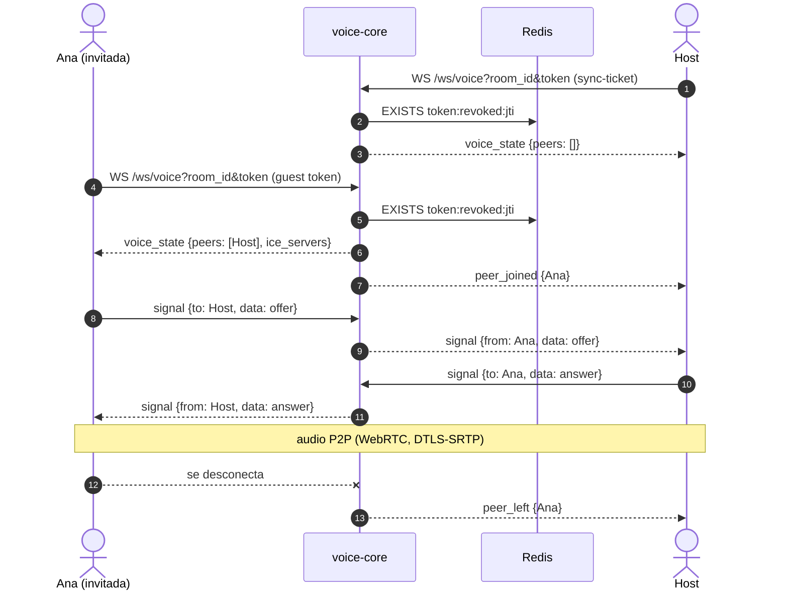

# voice-core — Canal de Voz de TINT

Servicio en **C++23** (Boost.Beast, hiredis) que permite a los participantes de una sala hablar entre sí mientras ven el vídeo. El audio viaja **P2P entre navegadores con WebRTC**; voice-core autoriza, lleva la membresía de la voz y reenvía la señalización.

| | |
| :--- | :--- |
| Puerto | `8085` (`/ws/voice`, `/healthz`) |
| Credencial | Guest token o sync-ticket de identity-api (HS256) |
| Redis | `EXISTS token:revoked:{jti}` y `PSUBSCRIBE room:*:sync` (`REVOKED`) |
| STUN/TURN | `coturn` en `docker compose` (`:3478`) |



## Desarrollo
Ver [AGENTS.md](AGENTS.md) (protocolo, comandos, variables) y [docs/dominio-voz.md](../../docs/dominio-voz.md).

```bash
docker build --target dev -t tint-voice-dev services/voice-core
docker run --rm -v "$PWD/services/voice-core:/src" -w /src tint-voice-dev bash -c \
  'cmake -S . -B build -G Ninja && cmake --build build && ctest --test-dir build --output-on-failure'
docker compose up -d voice-core coturn
curl localhost:8085/healthz
python3 services/voice-core/scripts/smoke.py   # prueba rápida contra el servicio levantado
```

`scripts/smoke.py` solo usa la biblioteca estándar de Python: fabrica tokens con `JWT_SECRET` (del entorno o del `.env`) y comprueba el handshake (401/403/4003), entrar, `peer_joined`, `signal`, `peer_left` y la revocación (4001 al entrar y `REVOKED` en vivo). No prueba audio: eso es de la web.
